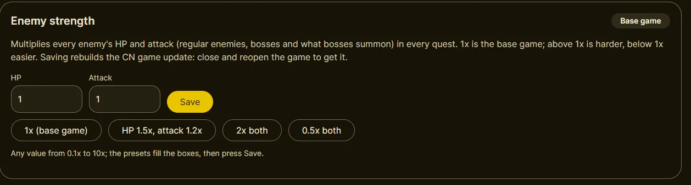
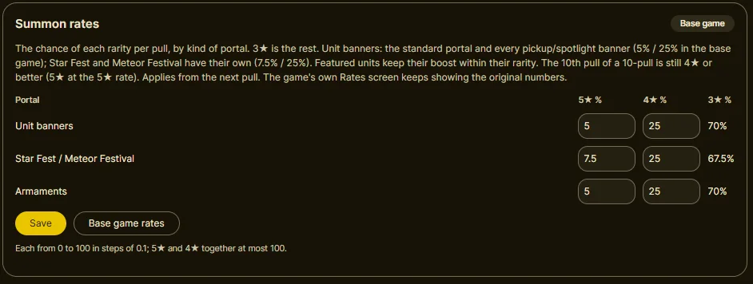
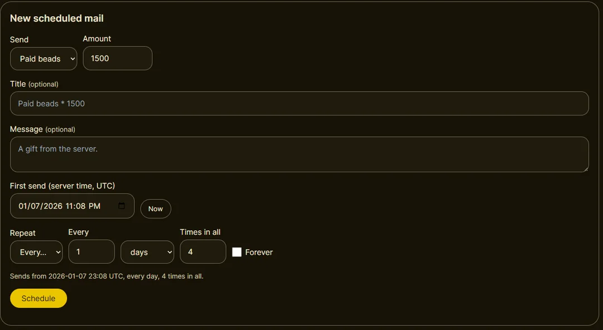
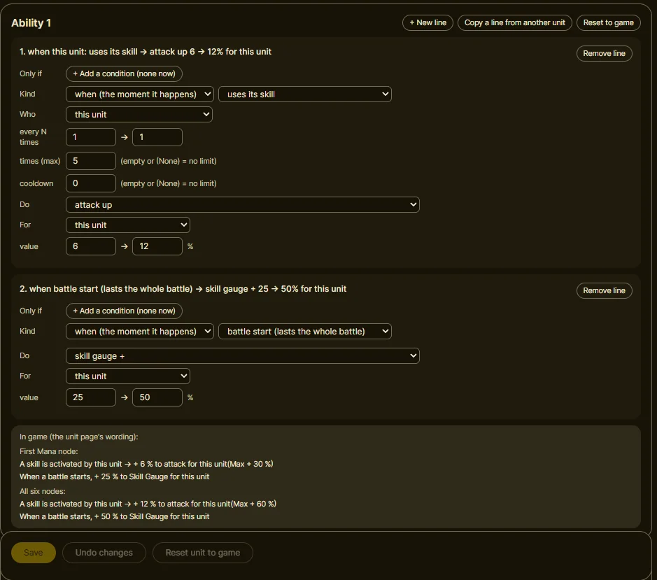

# GlobalPoint

**World Flipper, in English, fully offline.** GlobalPoint runs the Chinese (CN) version of World Flipper
(app 1.8.1) on [StarPoint](https://github.com/duosii/starpoint), a private server, with global's English
text and art put into the game. Everything CN had, including the units, events and summons global never
got, plays on your own PC or phone.

> [!IMPORTANT]
> ## 🤖 This project was vibecoded
> Most of GlobalPoint's code, translations and fixes were written by **Claude** (Anthropic's AI).
> The repository owner tested every change by hand in the game and reviewed the results. Claude also
> checked its own work in the game through direct control of an Android emulator: screenshots,
> logs and play sessions.
> Expect the code to read like it was written quickly by a machine, because it was. Bug reports are
> welcome.

---

## Status

**The CN app is functionally complete.** Story, events, summons, missions, co-op with COM partners,
comics and the rest have been confirmed working in the game, all in English. The phone setups are
tested on an Android 9 emulator, a Samsung Android 16 phone and an Android 16 tablet.

## Quick start (phone only)

Everything runs on the phone: the game, and the **StarPoint Companion** app that runs the server.

1. Download the files from the [Google Drive folder](https://drive.google.com/drive/folders/1EdY0GajMm-v6c219s02ZnuEz0u_0XdOO) (or [MEGA](https://mega.nz/folder/fWRATYbJ#z8wtDI7krmKgBn2HL_s0jg)): the two APKs,
   `starpoint-data.zip`, the comics zip if you want comics, and the game files: either the three
   `.obb` parts, or the single large `.obb` (Google Drive only).
2. Install both APKs: **World Flipper** (the game) and **StarPoint Companion**.
3. Open **StarPoint Companion**.
4. Tap **Setup check** at the top and follow its steps. It finds the downloads, checks them, moves the
   game files where the game reads them, and shows which permissions to turn on.
5. When setup is complete (the light is **green: Ready**), open the game and wait for the files to
   unpack.
6. Enjoy playing the game.

You need about 15 GB free. Stuck? See [If something goes wrong](docs/INSTALL.md#if-something-goes-wrong).

## Other ways to play

| | Server | Game | Guide |
|---|---|---|---|
| **A. PC** | your PC | an Android emulator (e.g. LDPlayer) | [setup A](docs/INSTALL.md#a-on-a-pc-emulator) |
| **B. Phone, copy from a PC** | the phone | the phone | [setup B](docs/INSTALL.md#b-on-a-phone-copying-from-your-pc-over-wi-fi) |
| **C. Phone only** | the phone | the phone | the quick start above, or [setup C in full](docs/INSTALL.md#c-on-a-phone-with-the-obb-file) |
| **D. Phone + PC server** | your PC | a phone | [setup D](docs/INSTALL.md#d-on-a-phone-with-the-server-on-your-pc) |

Setup A needs the official CN game files (~10 GB) from the
[CN CDN 1.4.54 release](https://github.com/dennis96292/.cdn/releases/tag/cdn-1.4.54) and this repository.
The [installation guide](docs/INSTALL.md) has every download with its size and checksum.

## Features

Everything below is on the **dashboard**: open **http://127.0.0.1:8000** in a browser while the
server runs, or tap **Dashboard** in StarPoint Companion. How to use each one is in the
[dashboard guide](docs/DASHBOARD.md).

- **Quest drop multiplier:** 1x (the base game) up to 100x, quests and events.
- **Enemy strength:** enemies' HP and attack, from 0.1x to 10x each. Make the game as easy or as hard
  as you want.

  

- **Summon rates:** set the 5★ and 4★ chance for unit banners, Star Fest / Meteor Festival and
  armaments.

  

- **Daily and never-ending beads:** there's no in-game shop, so paid beads come with each daily login
  bonus, and a 10-pull's worth of beads can always sit in the mailbox.
- **Events and summons on your schedule:** move any event or banner to any date, start several at
  once, and take an event's banners along.
- **Yearly campaigns:** tick seasonal login bonuses, free pulls, stamina and reward campaigns, and
  they repeat every year on their dates.
- **Time travel:** set the server's date to replay any period. Units even play as they did then
  ([balance by date](docs/DETAILS.md#balance-by-date)).
- **News and mail:** post to the in-game News board, and schedule gifts (beads, items, units,
  armaments) once or every day, week, month or year.

  

- **Unit and armament editor:** mix and match conditions, triggers and effects in any ability, change
  a unit's numbers, or rename it and rewrite its title and description. Edited kits can be shared
  as files. See [UNIT_EDITOR.md](docs/UNIT_EDITOR.md).

  

- **Custom units:** add a new unit made from game data and art
  ([CUSTOM_UNITS.md](docs/CUSTOM_UNITS.md); an involved process).
- **And more:** several accounts on one device, a button that syncs the daily reset with real time,
  removing a unit from a save, and collecting the daily login bonus again right away.

## What works

Confirmed in the game: story and quests, events and event shops, summons and exchanges, missions,
the pass and login bonuses, Purge, raids, carnival, Time Attack, score attack, co-op with COM partners
(x2/x3 speed), EX Boost, mana boards, comics, the dashboard, and the English text and art. Units can
also play as they did on any date ([balance by date](docs/DETAILS.md#balance-by-date)).

## What doesn't work

- **Playing with other people.** GlobalPoint is offline only; co-op is with COM partners.
- **Hard multi.** It's built, but it has never been testable.
- **Buying beads with real money.** There's no store; paid beads come with the daily login bonus.
- **The global app** is legacy and not maintained. Use the CN app.

## FAQ

- **Is this the official game?** No. World Flipper's servers are shut down; this is a private server
  for playing it offline.
- **Do I need an account or internet?** No account. Only the downloads need internet.
- **Where is my save?** On the phone, inside the companion: **Export save** keeps a copy. On a PC, on
  the server; the dashboard's **Players** page downloads and uploads saves.
- **I changed something on the dashboard. Why don't I see it?** Close the game fully, wait a minute,
  and open it again: it downloads a small update at the title screen.
- **I installed a newer game APK over the old one.** Clear the game's cache once before opening it:
  Settings > Apps > World Flipper > Storage > **Clear cache** (not Clear data).

## More

- [docs/INSTALL.md](docs/INSTALL.md): every setup in full, downloads, checksums and troubleshooting.
- [docs/DASHBOARD.md](docs/DASHBOARD.md): the dashboard, tab by tab and job by job.
- [docs/DETAILS.md](docs/DETAILS.md): balance by date, the harmless errors in the log, how the game was
  translated, the server's settings (`.env`), and pointers for developers.
- [docs/UNIT_EDITOR.md](docs/UNIT_EDITOR.md) and [docs/CUSTOM_UNITS.md](docs/CUSTOM_UNITS.md): changing
  units and armaments, and adding new units ([docs/MAKING_UNITS.md](docs/MAKING_UNITS.md) to make one).
- [docs/contributing.md](docs/contributing.md): how the project is put together, for developers.

## Special thanks

- **[StarPoint](https://github.com/duosii/starpoint)** by Duosion: the server this is built on.
  Without it there'd be nothing to globalize.
- [wdfp-extractor](https://github.com/ScripterSugar/wdfp-extractor) for the assets and knowledge behind
  the data converter.
- [wfax](https://github.com/blead/wfax) for making modding possible.
- [nodejs-mobile](https://github.com/digidem/nodejs-mobile) (digidem fork), which runs the server
  inside the companion app.
- The World Flipper community, for names and sources used in the translation.

## License

GlobalPoint (StarPoint Fork) is licensed under [GPL-3.0](LICENSE).
