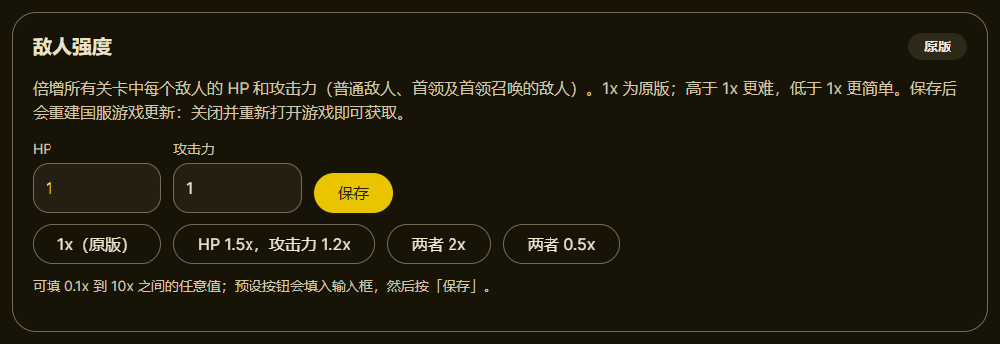
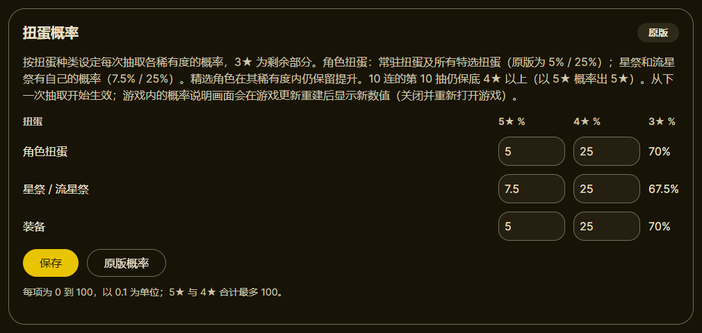
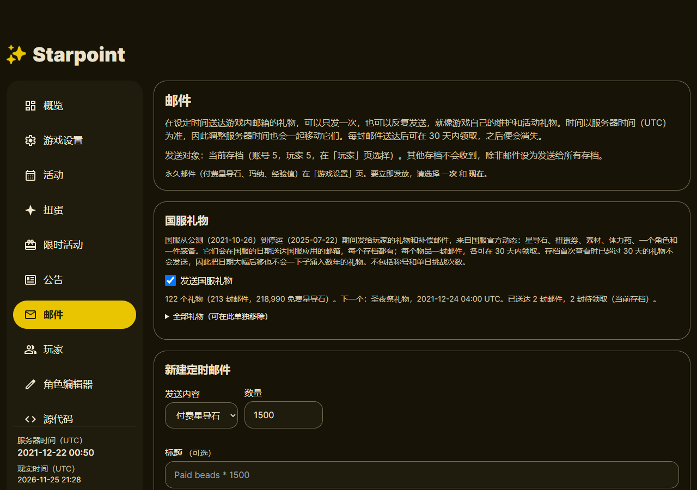
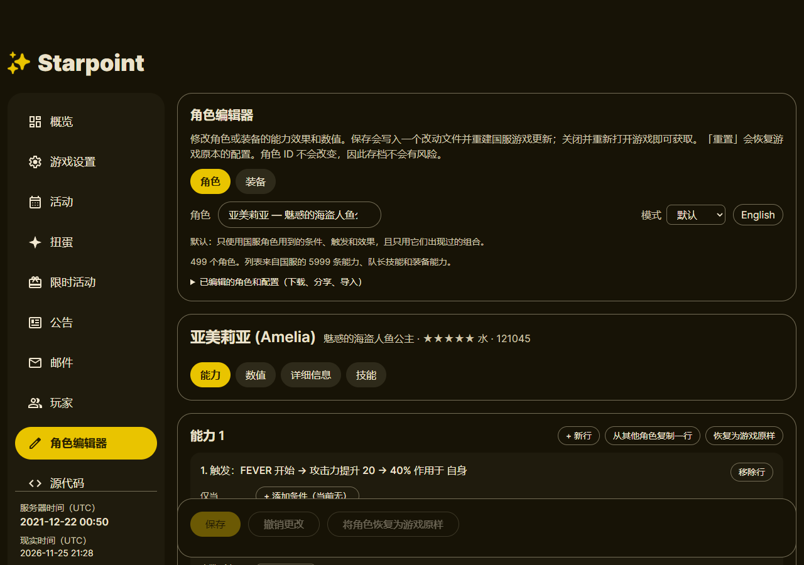

# GlobalPoint

> 本页是 [README.md](README.md) 的中文版，由 Claude（AI）翻译。两者内容相同；如有出入，以英文版为准。

**世界弹射物语，完全离线，英文或简体中文。** GlobalPoint 在私服 [StarPoint](https://github.com/duosii/starpoint) 上运行国服世界弹射物语
（应用 1.8.1），并加入了国际服的英文文本和图片。国服有过的一切，包括国际服从未有过的角色、活动和扭蛋，都能在你自己的电脑或手机上玩。
游戏也可以使用国服自己的简体中文（[见下文](#中文游玩简体中文)）。

> [!IMPORTANT]
> ## 🤖 本项目是 AI 编写的（vibecoded）
> GlobalPoint 的大部分代码、翻译和修复由 **Claude**（Anthropic 的 AI）编写。仓库作者在游戏中亲手测试了每一处改动并检查了结果。
> Claude 也通过直接操作 Android 模拟器在游戏中检查了自己的工作：截图、日志和实际游玩。
> 代码读起来会像是机器快速写出来的，因为它确实是。欢迎反馈问题：在手机上，请附上 StarPoint Companion 的
> **保存日志（用于反馈问题）** 按钮生成的文件。

---

## 状态

**国服应用的功能已经完整。** 主线、活动、扭蛋、任务、与 COM 队友的协力、漫画等都已在游戏中确认可用。手机方式已在 Android 9 模拟器、
三星 Android 16 手机和 Android 16 平板上测试过。

## 快速开始（手机或模拟器）

所有东西都在手机上运行：游戏本身，以及运行服务器的 **StarPoint Companion** 应用。在电脑上，在 Android 模拟器里做同样的事即可，不需要电脑上的服务器。
大多数新的模拟器都能运行游戏（它是 ARM64 的）：雷电模拟器 9 已测试，MuMu 用 Android 12 实例可以（有玩家在 Android 15 实例上遇到卡顿）。

1. 下载文件：国内请用 [百度网盘](https://pan.baidu.com/s/1e_OhBTvGzM9OLFQnAozUkg?pwd=3625)（提取码 `3625`），也可以用
   [Google Drive](https://drive.google.com/drive/folders/1EdY0GajMm-v6c219s02ZnuEz0u_0XdOO) 或 [MEGA](https://mega.nz/folder/fWRATYbJ#z8wtDI7krmKgBn2HL_s0jg)。
   需要：两个 APK、数据包、想看漫画的话再加漫画压缩包，以及游戏文件：三个 `.obb` 分卷。把它们留在手机的 **下载**（Download）文件夹，
   什么都不要解压。各文件的名称见 [下载](docs/zh-CN/INSTALL.md#下载)。
2. 安装两个 APK：**世界弹射物语**（游戏）和 **StarPoint Companion**。
3. 打开 **StarPoint Companion**。
4. 点顶部的 **设置**，再点 **全部设置**，并允许 Android 的请求。它会找到下载的文件、检查它们、把游戏文件移到游戏读取的位置、导入数据（和漫画）并启动服务器。
5. 设置完成后（指示灯为 **绿色：已就绪**），打开游戏，等待文件解压。
6. 开始游戏吧。

手机或模拟器上需要约 15 GB 可用空间。遇到问题？见 [出问题时](docs/zh-CN/INSTALL.md#出问题时)。

## 其他游玩方式

上面的快速开始就是方式 1，玩游戏只需要它。如果想把服务器放在电脑上：

| | 服务器 | 游戏 | 适合 |
|---|---|---|---|
| **2. 手机连接电脑服务器** | 你的电脑 | 手机 | 把服务器和存档留在电脑上（[方式 2](docs/zh-CN/INSTALL.md#2-手机连接电脑服务器)） |
| **3. 只用电脑** | 你的电脑 | 电脑上的模拟器 | 自制角色，或开发 GlobalPoint（[方式 3](docs/zh-CN/INSTALL.md#3-只用电脑模拟器加电脑服务器)） |

两者都需要[在电脑上安装服务器](docs/zh-CN/INSTALL.md#在电脑上安装服务器)（更技术一些：Node.js 22 和几步命令提示符操作），以及
[CN CDN 1.4.54 release](https://github.com/dennis96292/.cdn/releases/tag/cdn-1.4.54) 中的国服官方游戏文件（约 10 GB）。
[安装指南](docs/zh-CN/INSTALL.md) 里有每种方式的完整步骤、每个下载的大小和校验值，以及[如何更新电脑上的服务器](docs/zh-CN/INSTALL.md#更新电脑上的服务器)。

## 中文游玩（简体中文）

控制台 > **游戏设置** > **游戏语言** > **简体中文**，然后重新打开游戏。游戏应用内置的标签和带文字的图片，需要另外安装可选的
**中文版游戏应用** 和 **中文图片包**（1.5 GB）。控制台和 StarPoint Companion 也有中文。步骤见 [docs/zh-CN/CHINESE.md](docs/zh-CN/CHINESE.md)。

## 功能

以下全部在 **控制台** 中：服务器运行时在浏览器打开 **http://127.0.0.1:8000**，或在 StarPoint Companion 里点 **控制台**。
用法见 [控制台指南](docs/zh-CN/DASHBOARD.md)。

- **关卡掉落倍率：** 1 倍（原版）到 100 倍，关卡和活动都适用。
- **敌人强度：** 敌人的生命值和攻击力，各 0.1 倍到 10 倍。想多简单或多难都可以。

  

- **扭蛋概率：** 设置角色扭蛋、星祭 / 流星祭和装备扭蛋的 5★ 与 4★ 概率；游戏内的概率画面也会显示。

  

- **每日和用不完的星导石：** 没有游戏内商店，所以付费星导石随每天的登录奖励发放，邮箱里也可以一直放着够 10 连的星导石。
- **按你的日程安排活动和扭蛋：** 把任意活动或扭蛋移到任意日期，同时开多个，并让活动的扭蛋一起移动。
- **每年的限时活动：** 勾选季节登录奖励、免费抽取、体力和奖励活动，它们每年都会在原来的日期重复。
- **时间旅行：** 设置服务器日期，重玩任意时期。角色甚至会按当时的强度来玩（[按日期的平衡](docs/zh-CN/DETAILS.md#按日期的平衡)）。
- **公告和邮件：** 在游戏内公告栏发帖，并安排礼物（星导石、道具、角色、装备）：一次，或每天、每周、每月、每年，也可以每年重复；日程还能作为文件分享。

  

- **角色和装备编辑器：** 在任意能力中自由组合条件、触发和效果，修改角色的数值，改名并重写称号和介绍，或者重做它的 **技能**
  （攻击范围、特效、时机、强化、召唤），并可实时预览。修改后的配置可以作为文件分享。见 [UNIT_EDITOR.md](docs/zh-CN/UNIT_EDITOR.md) 和
  [技能指南](docs/zh-CN/SKILL_GUIDE.md)。

  

- **自制角色：** 用游戏数据和图片加入新角色（[CUSTOM_UNITS.md](docs/zh-CN/CUSTOM_UNITS.md)；过程比较复杂）。
- **还有更多：** 一台设备上多个账号、让每日重置与现实时间同步的按钮、从存档中移除角色、立即开始新的一天（登录奖励、每日任务），以及解锁全部主线章节或设置等级。

## 能用的部分

已在游戏中确认：主线和关卡、活动和活动商店、扭蛋和兑换、任务、修行之道和登录奖励、歼灭者讨伐战、战阵、嘉年华、竞速、积分挑战、与 COM 队友的协力
（2 倍 / 3 倍速）、EX 突破、玛纳板、漫画、控制台，以及英文文本和图片。角色也可以按任意日期时的强度来玩（[按日期的平衡](docs/zh-CN/DETAILS.md#按日期的平衡)）。

## 不能用的部分

- **和其他人一起玩。** GlobalPoint 只能离线；协力是与 COM 队友一起。
- **高难度多人。** 已经做了，但一直无法测试。
- **用真钱买星导石。** 没有商店；付费星导石随每日登录奖励发放。
- **国际服应用** 是旧版，不再维护。请使用国服应用。

## 常见问题

- **这是官方游戏吗？** 不是。世界弹射物语的服务器已经关闭；这是用来离线游玩的私服。
- **需要账号或网络吗？** 不需要账号。只有下载需要网络。
- **存档在哪里？** 手机上在 StarPoint Companion 里：**导出存档** 可以保存一份。电脑上在服务器里；控制台的 **玩家** 页面可以下载和上传存档。
- **我在控制台改了设置，为什么看不到？** 完全关闭游戏，等一分钟，再打开：它会在标题画面下载一个小更新。
- **我在旧版上安装了新的游戏 APK。** 打开前先清除一次游戏缓存：设置 > 应用 > 世界弹射物语 > 存储 > **清除缓存**（不是清除数据）。

## 更多

- [docs/zh-CN/INSTALL.md](docs/zh-CN/INSTALL.md)：每种方式的完整步骤、下载、校验值和故障排除。
- [docs/zh-CN/DASHBOARD.md](docs/zh-CN/DASHBOARD.md)：控制台，按标签页和按任务说明。
- [docs/zh-CN/CHINESE.md](docs/zh-CN/CHINESE.md)：用简体中文玩。
- [docs/zh-CN/DETAILS.md](docs/zh-CN/DETAILS.md)：按日期的平衡、日志里无害的错误、游戏是怎样翻译的、服务器设置（`.env`），以及给开发者的指引。
- [docs/zh-CN/UNIT_EDITOR.md](docs/zh-CN/UNIT_EDITOR.md) 和 [docs/zh-CN/CUSTOM_UNITS.md](docs/zh-CN/CUSTOM_UNITS.md)：修改角色和装备，以及加入新角色
  （制作方法见 [docs/zh-CN/MAKING_UNITS.md](docs/zh-CN/MAKING_UNITS.md)）。[docs/zh-CN/KIT_FORMAT.md](docs/zh-CN/KIT_FORMAT.md)：配置文件的格式，供在其他国服分支上使用。
- [docs/contributing.md](docs/contributing.md)（英文）：项目的结构，给开发者。

## 特别感谢

- Duosion 的 **[StarPoint](https://github.com/duosii/starpoint)**：本项目所基于的服务器。没有它就没有可以「国际化」的东西。
- [wdfp-extractor](https://github.com/ScripterSugar/wdfp-extractor)：数据转换器背后的资源和知识。
- [wfax](https://github.com/blead/wfax)：让修改游戏成为可能。
- [nodejs-mobile](https://github.com/digidem/nodejs-mobile)（digidem 分支）：在 StarPoint Companion 里运行服务器。
- 世界弹射物语社区：翻译中用到的名称和资料；以及 **晓之车**，中文模式里的中文修正（见 [docs/zh-CN/CHINESE.md](docs/zh-CN/CHINESE.md#中文社区的修正)）。

## 许可证

GlobalPoint（StarPoint 分支）采用 [GPL-3.0](LICENSE) 许可证。
