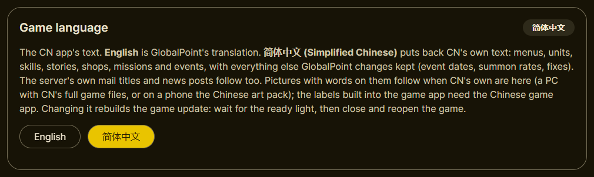

# Playing in Chinese (简体中文)

> 中文版（本页的主要版本）：[CHINESE.md](CHINESE.md)

GlobalPoint runs CN's World Flipper app (世界弹射物语) with English added on top. The game can also run in CN's own
Simplified Chinese, and keep everything else GlobalPoint adds: scheduling, summon rates, the unit editor, fixes.

## Turning it on

1. Dashboard > **Game settings** > **Game language**: pick **简体中文**.
2. Wait for the ready light (about half a minute on a PC, a few minutes on a phone).
3. Close and reopen the game. It downloads the change (about 24 MB).

Optional, for the rest of the game:
- **Chinese game app**, for the labels built into the app (Lv, stamina, battle and result screens, title screen):
  install it over the English one (your files and save stay), then clear the game's cache once (Android Settings >
  Apps > 世界弹射物语 > Storage > **Clear cache**, not Clear data).
- **Chinese art pack**, for the pictures with words on them (home buttons, bottom bar, banners). A PC server with
  CN's full game files needs nothing. On a phone: companion > **Game data** > **Import pack...** (after the data
  pack), then stop and start the server and reopen the game (it downloads about 1.6 GB).

Back to English: pick **English** the same way (and reinstall the English game app if you changed it).

The dashboard and the companion app have their own language:
- **Dashboard:** **Dashboard language** at the bottom of the sidebar. With none picked it follows the browser
  (inside the companion, the phone).
- **Companion app:** follows the phone's language.



## Downloads

| File | Size | On Baidu Netdisk |
|---|---|---|
| Chinese game APK (build 25) | 133 MB | `世界弹射物语-中文版-build25.apk` |
| `starpoint-chinese-art-pack.zip` | 1.5 GB | `StarPoint-中文图片包.zip` |

They're with the other downloads ([INSTALL.md](INSTALL.md#downloads), checksums there). Mainland China:
[Baidu Netdisk](https://pan.baidu.com/s/1e_OhBTvGzM9OLFQnAozUkg?pwd=3625), code `3625`.

## What turns Chinese

| Part | In Chinese |
|---|---|
| Game text: menus, units, skills, abilities, stories, shops, missions, events, items | Yes |
| The server's mail and automatic news posts | Yes |
| Cells CN left in Japanese (the Black Clover collab and others), the three summer stories CN cut short, blank voice actors | Yes: the Chinese community's text, and GlobalPoint's own for the rest |
| Labels built into the game app | With the Chinese game app |
| Pictures with words on them | With CN's full files (PC) or the Chinese art pack (phone) |
| Comics | With a Chinese comics pack (none yet, see [Comics](#comics)) |
| Dashboard | With **Dashboard language** set to 简体中文 |
| Companion app | On a phone set to Chinese |
| Text you type (mail titles, news, Unit editor) | As typed, in either language |

## For developers

Where each part lives:
- game text: the game update, `scripts/cn_language.cjs` (CN's own cells put back);
- mail: `src/nya/mail.ts`, `src/nya/mailSchedule.ts`, `assets/cn_gift_mails.json` (`titleZh`); news: `src/nya/autoNews.ts`,
  `assets/event_names_zh.json`;
- labels in the app: CN's own app bundle, no English text patch; GlobalPoint's own game messages:
  `scripts/client_mod/as3_zh.json`;
- pictures: `assets/cn_lang_art.json` ([Pictures](#pictures)); comics: `.cdn/comics_zh`, `src/routes/api/comic.ts`;
- dashboard: `web/public/js/i18n.js`, `web/public/i18n/zh.json` (built from `scripts/i18n/zh` by
  `scripts/build_dashboard_i18n.cjs`); companion: `companion/i18n/zh.json`, made into `ZhStrings.java` by
  `scripts/gen_companion_zh.cjs`;
- Japanese cells: `assets/cn_zh_fixes.json`, `assets/cn_zh_own.json`; summer stories: `assets/cn_story_fixes_zh`
  (晓之车's complete copies);
- Unit editor edits: the builder puts them back after the Chinese step.

### How the game update does it

When the setting is Chinese, the CN update builder (scripts/gen_cn_event_schedule.cjs) runs one more step on
every table it ships: a cell that CN's own copy has in Chinese and that GlobalPoint changed goes back to CN's
cell. Dates, rows GlobalPoint added, rates and every other change stay. Rows are matched by their keys.

Switching language (or a game coming from another server) ships every table GlobalPoint's translation touched
(about 1,800, from CN_TRANSLATED_DIR files.json), from its newest English copy in StarPoint's updates. Updates
built in Chinese are listed in `<CDN_DIR>/cn_patches/languages.json`, so a switch back to English never takes
a Chinese copy. The setting is `.database/game_language.json` and is part of the rebuild fingerprint.

### The Chinese community's fixes

Thanks to **晓之车**, who keeps an untranslated CN project and shared their CN tables (2026-11-22). Where CN's own
release left text in Japanese, or worded something they improved, their Chinese is used in Chinese mode
(`assets/cn_zh_fixes.json`, built by `node --env-file=.env scripts/gen_cn_zh_fixes.cjs <their intermediate.zip>`):

- 1,479 cells CN left in Japanese, written in Chinese: the Black Clover collab's story, item names and descriptions,
  boss-coin shop items, skill preview quests, login bonus names, unit text and speech placeholders, missions,
  titles, boss skill names, notifications and dialogs.
- 273 of their rewordings of CN's Chinese: the Lv labels (技能Lv, 觉醒Lv, 强化Lv), voice actors' names in Chinese
  characters (德井青空, 岛崎信长), clearer pack and campaign names, a banner name typo (书本装备特选扭蛋).
- One rule from their edits: 生命值 becomes HP in game text (skills, abilities, UI, titles, missions); unit profile
  text keeps 生命值, as theirs does.

Only edits on the same row as CN's are taken: every cell that isn't text (ids, numbers, paths) must match, dates
aside. Their tables also hold their own rows and rows that moved to other ids (689 edits); those are left out. A
fixed cell changes only while CN's own copy still has the text the fix was made from. Edits made in the Unit editor
still win over these.

### GlobalPoint's own Chinese

What the community's fixes don't cover is in `assets/cn_zh_own.json` (`node --env-file=.env scripts/gen_cn_zh_own.cjs`),
in CN's wording and the community's names:

- the boss coin shop's limited-time labels in CN's own form (【2月8日まで】 -> 【至2月8日】, 466 cells);
- the rest of the Black Clover collab (quest names and summaries, Noelle's shop entries, the clovers), 25 collection
  missions, three banner names, the collab pack dialogs;
- the four voice actors CN left blank, in Chinese characters, and the four items only global has.

The payment packs' Japanese names aren't covered: the server lists no payment products, so the game never shows them.
The titles' third column (a kana reading used for sorting) stays as it is; it isn't shown.

### The Chinese game app

Built like the English app (scripts/client_mod/README.txt) but without step 2 (patch_cn_text.cjs) and with CN's
own `bundle.zip`, and `--zh` on patch_cn_storage_dropoff.cjs and patch_cn_server_file.cjs. Steps 1, 4-10 as
usual; the font patch (3) isn't needed. Sign it with the same key as the English app.

### Comics

The comics are global's English ones (`.cdn/comics`, from wfjukebox). With the game in Chinese, the server shows
Chinese comics instead where it has them, in `.cdn/comics_zh`; any episode they don't have stays English. No Chinese
set is shipped yet: CN's own (Simplified) comics were on its servers, now gone. wfjukebox's "TW" set is Traditional
Chinese (episodes 1-360), not CN's.

The folder follows the Chinese StarPoint fork's layout (startpoint-cn, `docs/systems/comic.md`), so a set made for
it goes in as it is:

```
comics_zh/0/第1话 踏上旅程.jpg            Flipper World (弹射小世界): episode and title from the name
comics_zh/0/main/第1话 踏上旅程.png       the page (.png, or .jpg with the same name)
comics_zh/0/thumbnail_l/第1话 踏上旅程.jpg   the wide banner
comics_zh/0/thumbnail_s/第1话 踏上旅程.jpg   the list's thumbnail
comics_zh/1/第1课 今日课程：标题.jpg       Stella's W.F.101 (史黛拉的弹射世界讲座), same subfolders
```

When a set turns up:
1. On a PC server, put it in `.cdn/comics_zh` (the comics show in Chinese mode right away), or make the phone pack:
   `node scripts/build_pack.cjs comics-zh starpoint-comics-zh.zip --comics <the folder>`.
2. Add the pack's SHA-256 and size to `KNOWN` in `companion/app/src/main/java/org/globalpoint/companion/DownloadCheck.java`
   (and the checksums in docs/INSTALL.md), so **Check a file** knows it.
3. Phones import it with **Game data > Import pack...** (it goes beside the English comics; **Set up everything** only
   takes the English comics pack). **Download from PC** with Comics ticked brings both.

### Pictures

GlobalPoint's updates replace 6,318 of CN's pictures and sprite layouts with English ones (global's art in 1.4.56
and 1.4.57, English labels drawn into CN's sheets, and the layouts that had to follow them). The list is
`assets/cn_lang_art.json` (`node --env-file=.env scripts/gen_cn_lang_art.cjs`, on a PC with CN's archives). Left out
are fixes for CN's own broken art, which stay in both languages: the art fixes every update carries
(assets/cn_art_fixes.json), the summon strips without their halftone band, Razelt's Launch Gala animation. A sheet
and its layout always go back together, so CN's own matching pair is used.

On a language switch the builder ships the set as its own update before the tables: CN's originals in Chinese, the
newest English copies back in English. CN's originals come from the PC's CN archives, or on a phone from the Chinese
art pack, which puts them in the slim folder's `tables/` (`node scripts/build_pack.cjs zh-art <out.zip>`; it uses
the skill preview art pack's marker, so any companion can import it). Without them the pictures stay English and
the text still turns Chinese; once the pack is there, the next server start ships them (the rebuild fingerprint
counts it).

Each set (about 1.6 GB) is zipped once into `<CDN_DIR>/cn_patches/lang-art/<language>-<hash>/`, and every later
switch's update entry points at the same archives, so switching back and forth doesn't fill the disk. A new
English art update makes a new English set (the hash is of the contents). Tested on the emulator 2026-11-25 both
ways: the home screen's buttons, bottom bar and banners in Chinese, then English again.
