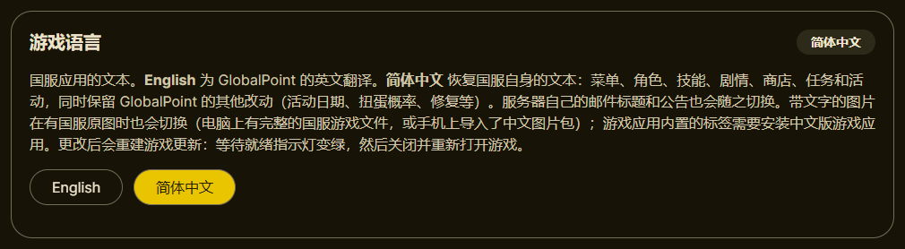

# 中文游玩（简体中文）

> English: [CHINESE.en.md](CHINESE.en.md)。本页由 Claude（AI）撰写，中文为主要版本。

GlobalPoint 运行的是国服的世界弹射物语应用，并在其上加入了英文。游戏也可以使用国服自己的简体中文运行，同时保留
GlobalPoint 的其他全部改动：活动与扭蛋日程、扭蛋概率、角色编辑器、各项修复。

## 开启方法

1. 控制台 > **游戏设置** > **游戏语言**：选择 **简体中文**。
2. 等待就绪指示灯变绿（电脑上约半分钟，手机上几分钟）。
3. 完全关闭并重新打开游戏。它会下载这次更改（约 24 MB）。

可选，让游戏其余部分也变成中文：
- **中文版游戏应用**：游戏应用内置的标签（等级、体力、战斗和结算画面、标题画面）。直接覆盖安装在英文版上（游戏文件和存档都会保留），
  然后清除一次游戏缓存（Android 设置 > 应用 > 世界弹射物语 > 存储 > **清除缓存**，不是清除数据）。
- **中文图片包**：带文字的图片（主界面按钮、底部栏、横幅）。装有国服完整游戏文件的电脑服务器不需要它。手机上：StarPoint Companion >
  **游戏数据** > **导入资源包……**（在数据包之后导入），然后停止并重新启动服务器，再打开游戏（会下载约 1.6 GB）。

改回英文：同样的位置选择 **English**（如果换过中文版游戏应用，再装回英文版）。

控制台和 StarPoint Companion 有各自的语言设置：
- **控制台**：侧边栏底部的 **控制台语言**。没有选择时跟随浏览器（在 StarPoint Companion 里则跟随手机）。
- **StarPoint Companion**：跟随手机的语言。



## 下载

国内玩家请使用 [百度网盘](https://pan.baidu.com/s/1e_OhBTvGzM9OLFQnAozUkg?pwd=3625)（提取码 `3625`）。百度网盘上的文件名是中文的：

| 文件 | 大小 | 百度网盘上的名称 | 其他下载站的名称 |
|---|---|---|---|
| 数据包（必需） | 221 MB | `StarPoint-数据包-1.0.zip` | `starpoint-data.zip` |
| StarPoint Companion（必需，手机） | 76 MB | `StarPoint-伴侣应用-1.0.apk` | StarPoint Companion APK |
| 中文版游戏应用（可选） | 133 MB | `世界弹射物语-中文版-build25.apk` | Chinese game APK |
| 中文图片包（可选） | 1.5 GB | `StarPoint-中文图片包.zip` | `starpoint-chinese-art-pack.zip` |
| OBB（必需，3 个分卷） | 每个 3.6 GB | `.obb` 文件夹里，文件名不变 | `main.1008001.com.leiting.wf.part1of3.obb` 等 |

百度网盘上只有中文版游戏应用：直接安装它就行，它也是完整的游戏应用。改过名字的压缩包也能用：StarPoint Companion 按文件内容识别资源包，不看文件名。校验值见 [INSTALL.zh-CN.md](INSTALL.zh-CN.md#校验值)。

## 哪些内容会变成中文

| 部分 | 中文 |
|---|---|
| 游戏文本：菜单、角色、技能、能力、剧情、商店、任务、活动、道具 | 是 |
| 服务器的邮件和自动公告 | 是 |
| 国服留着日文的文本（黑色五叶草联动等）、国服删短的三个夏日剧情、空白的声优名 | 是：使用中文社区的文本，其余由 GlobalPoint 补上 |
| 游戏应用内置的标签 | 需要中文版游戏应用 |
| 带文字的图片 | 需要国服完整文件（电脑）或中文图片包（手机） |
| 漫画 | 需要中文漫画包（目前还没有，见[漫画](#漫画)） |
| 控制台 | 把 **控制台语言** 设为简体中文 |
| StarPoint Companion | 手机语言为中文时 |
| 你输入的文字（邮件标题、公告、角色编辑器） | 按输入原样，中英文都可以 |

## 开发者说明

各部分所在位置：
- 游戏文本：游戏更新，`scripts/cn_language.cjs`（还原国服自己的单元格）；
- 邮件：`src/nya/mail.ts`、`src/nya/mailSchedule.ts`、`assets/cn_gift_mails.json`（`titleZh`）；公告：`src/nya/autoNews.ts`、
  `assets/event_names_zh.json`；
- 应用内的标签：国服自己的应用 bundle，不打英文文本补丁；GlobalPoint 自己的游戏提示：`scripts/client_mod/as3_zh.json`；
- 图片：`assets/cn_lang_art.json`（见[图片](#图片)）；漫画：`.cdn/comics_zh`、`src/routes/api/comic.ts`；
- 控制台：`web/public/js/i18n.js`、`web/public/i18n/zh.json`（由 `scripts/build_dashboard_i18n.cjs` 从 `scripts/i18n/zh` 生成）；
  StarPoint Companion：`companion/i18n/zh.json`，由 `scripts/gen_companion_zh.cjs` 生成 `ZhStrings.java`；
- 日文单元格：`assets/cn_zh_fixes.json`、`assets/cn_zh_own.json`；夏日剧情：`assets/cn_story_fixes_zh`（晓之车的完整版本）；
- 角色编辑器的修改：生成器在中文步骤之后再把它们放回去。

### 游戏更新怎样做到

设置为中文时，国服更新生成器（`scripts/gen_cn_event_schedule.cjs`）会对它发出的每张数据表多做一步：国服自己的版本里是中文、
而 GlobalPoint 改过的单元格，改回国服的内容。日期、GlobalPoint 新增的行、概率和其他所有改动都保留。行按键值对应。

切换语言（或游戏来自另一个服务器）时，会发出 GlobalPoint 翻译涉及的每张表（约 1,800 张，来自 CN_TRANSLATED_DIR 的
files.json），取自 StarPoint 更新里最新的英文版本。以中文生成的更新会记录在 `<CDN_DIR>/cn_patches/languages.json` 中，所以切回
英文时绝不会取到中文版本。设置保存在 `.database/game_language.json`，并计入重建指纹。

### 中文社区的修正

感谢 **晓之车**：他维护着一个未翻译的国服项目，并分享了他的国服数据表（2026-11-22）。国服正式版留着日文、或他改进过措辞的地方，
中文模式下使用他的中文（`assets/cn_zh_fixes.json`，由 `node --env-file=.env scripts/gen_cn_zh_fixes.cjs <他的 intermediate.zip>` 生成）：

- 国服留着日文的 1,479 个单元格，改为中文：黑色五叶草联动的剧情、道具名称和说明、领主币商店道具、技能预览关卡、登录奖励名称、
  角色文本和台词占位、任务、称号、领主技能名称、通知和对话框。
- 他对国服中文的 273 处改写：等级标签（技能Lv、觉醒Lv、强化Lv）、用汉字写的声优名（德井青空、岛崎信长）、更清楚的礼包和活动名称、
  一处扭蛋名称的错字（书本装备特选扭蛋）。
- 从他的修改中得出的一条规则：游戏文本（技能、能力、界面、称号、任务）中 生命值 改为 HP；角色资料文本和他的一样保留 生命值。

只采用与国服同一行的修改：所有非文本单元格（id、数字、路径）必须一致，日期除外。他的表里还有他自己加的行和移到其他 id 的行
（689 处修改），这些不采用。修正的单元格只在国服自己的版本仍是修正所依据的文本时才会改变。角色编辑器里的修改仍然优先于这些修正。

### GlobalPoint 自己的中文

社区修正没有涵盖的部分在 `assets/cn_zh_own.json`（`node --env-file=.env scripts/gen_cn_zh_own.cjs`），使用国服的措辞和社区的名称：

- 领主币商店的限时标签改为国服自己的格式（【2月8日まで】 -> 【至2月8日】，466 个单元格）；
- 黑色五叶草联动的其余部分（关卡名称和简介、诺艾尔的商店条目、四叶草）、25 个收集任务、三个扭蛋名称、联动礼包对话框；
- 国服留空的四位声优（用汉字），以及只有国际服才有的四件道具。

付费礼包的日文名称没有覆盖：服务器不列出付费商品，所以游戏从不显示它们。称号的第三列（排序用的假名读音）保持原样，不会显示。

### 中文版游戏应用

制作方法与英文版应用相同（`scripts/client_mod/README.txt`），但不做第 2 步（`patch_cn_text.cjs`），使用国服自己的 `bundle.zip`，并在
`patch_cn_storage_dropoff.cjs` 和 `patch_cn_server_file.cjs` 上加 `--zh`。第 1、4-10 步照常；不需要字体补丁（第 3 步）。用与英文版相同的密钥签名。

### 漫画

漫画是国际服的英文漫画（`.cdn/comics`，来自 wfjukebox）。游戏设为中文时，服务器会改为显示 `.cdn/comics_zh` 里有的中文漫画；
没有中文的话数仍显示英文。目前还没有附带中文漫画：国服自己的（简体）漫画在它的服务器上，现已关闭。wfjukebox 的 "TW" 套是繁体中文
（第 1-360 话），不是国服的。

文件夹采用中文 StarPoint 分支（startpoint-cn，`docs/systems/comic.md`）的布局，为它制作的漫画可以直接放进来：

```
comics_zh/0/第1话 踏上旅程.jpg            弹射小世界：话数和标题取自文件名
comics_zh/0/main/第1话 踏上旅程.png       正文页（.png，或同名的 .jpg）
comics_zh/0/thumbnail_l/第1话 踏上旅程.jpg   宽横幅
comics_zh/0/thumbnail_s/第1话 踏上旅程.jpg   列表缩略图
comics_zh/1/第1课 今日课程：标题.jpg       史黛拉的弹射世界讲座，子文件夹相同
```

找到一套时：
1. 电脑服务器：放进 `.cdn/comics_zh`（中文模式下立即显示中文漫画），或制作手机用的资源包：
   `node scripts/build_pack.cjs comics-zh starpoint-comics-zh.zip --comics <文件夹>`。
2. 把资源包的 SHA-256 和大小加入 `companion/app/src/main/java/org/globalpoint/companion/DownloadCheck.java` 的 `KNOWN`
   （以及 docs/INSTALL.md 里的校验值），让 **检查文件……** 认得它。
3. 手机用 **游戏数据** > **导入资源包……** 导入（它会放在英文漫画旁边；**全部设置** 只导入英文漫画包）。勾选漫画后 **从电脑下载** 会两者都带上。

### 图片

GlobalPoint 的更新用英文版替换了国服的 6,318 张图片和精灵布局（国际服 1.4.56 和 1.4.57 的图片、画进国服图集的英文标签，以及必须
随之改变的布局）。列表是 `assets/cn_lang_art.json`（在有国服压缩包的电脑上运行 `node --env-file=.env scripts/gen_cn_lang_art.cjs`）。
不包括修正国服自身损坏图片的部分，它们在两种语言下都保留：每次更新都带的图片修正（`assets/cn_art_fixes.json`）、去掉网点带的扭蛋
横条、拉杰尔特的开服庆典动画。图集和它的布局总是一起还原，所以使用国服自己配对的那一组。

切换语言时，生成器会在数据表之前把这组图片作为单独的更新发出：中文时是国服原图，英文时是最新的英文版本。国服原图来自电脑上的国服
压缩包，手机上则来自中文图片包，它会放进精简文件夹的 `tables/`（`node scripts/build_pack.cjs zh-art <out.zip>`；它使用技能预览图片包的
标记，所以任何版本的 StarPoint Companion 都能导入）。没有原图时图片保持英文，文字仍会变成中文；导入资源包后，下次启动服务器就会发出图片
（重建指纹会计入它）。

每组（约 1.6 GB）只压缩一次，存在 `<CDN_DIR>/cn_patches/lang-art/<语言>-<哈希>/`，之后每次切换的更新条目都指向同一组压缩包，所以来回切换
不会占满磁盘。新的英文图片更新会生成一组新的英文图片（哈希按内容计算）。2026-11-25 在模拟器上测试了两个方向：主界面按钮、底部栏和横幅
变成中文，然后又变回英文。
