# Dashboard guide

> 中文版：[DASHBOARD.zh-CN.md](DASHBOARD.zh-CN.md)

The GlobalPoint dashboard, tab by tab and job by job.

**Opening it:** with the server running, go to **http://127.0.0.1:8000** in a browser on the same PC, or tap
**Dashboard** in StarPoint Companion (the phone's own server). **Times are UTC** everywhere on the dashboard.

**Changes reach the game at its title screen.** After changing events, summons, campaigns, enemy strength, units or
the date, close the game fully and open it again: it downloads a small update. The server builds it in the
background, so wait a minute or two (a few minutes on a phone).

The bottom of the sidebar shows the server time, the real time, the next daily reset, and the game update: **Game
update ready**, or **Rebuilding the game update** (wait before opening the game). **Dashboard language** switches
the dashboard between English and 简体中文 (with none picked, it follows the browser).

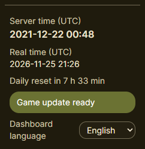

On a phone, the menu button in the top bar opens the tabs; its dot is olive when the update is ready, yellow while it
rebuilds, red when the server can't be reached. On long pages a round **↑** button takes you back to the top.

| Tab | What it's for |
|---|---|
| **Overview** | [the server's date](#go-to-another-date-and-back), [what's on now](#whats-on-now), playing on a phone over Wi-Fi |
| **Game settings** | [game language, drops, enemy strength, summon rates, daily beads, stamina and more](#game-settings) |
| **Events** | [move any event](#move-an-event), CN-only ones included |
| **Summons** | [schedule summon banners](#schedule-a-summon-banner) |
| **Campaigns** | [yearly login bonuses, free pulls and stamina/reward campaigns](#repeat-a-yearly-campaign) |
| **News** | [posts on the in-game News board](#post-news) |
| **Mail** | [gifts, now or at a set time, once or repeating](#schedule-mail) |
| **Players** | [saves](#back-up-or-move-a-save), the active account, [player tools](#player-page-tools) |
| **Unit editor** | [change units' and armaments' abilities, numbers and skills](#edit-a-unit-or-an-armament) |

---

## Go to another date, and back

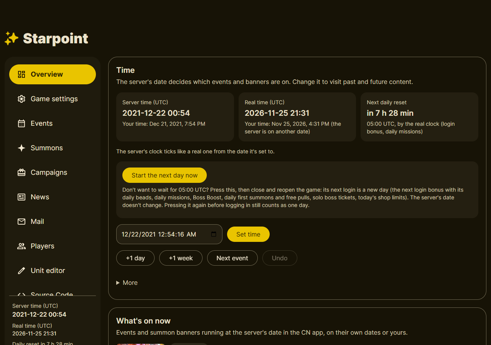

**Overview** shows the **server time** (the date the game plays on), the **real time**, and the **next daily reset**
(05:00 UTC by the real clock).

- Pick a date and time and press **Set time**; the clock keeps ticking from there.
- **+1 day**, **+1 week** and **Next event** (the start of the next event or banner) move the date forward; **Undo**
  goes back to the date before.
- **More**: **Reset to the real time**, or **Match real time (keep date)** (keeps the date, uses the real time of
  day, so the server's day turns over with the daily reset).

Close and reopen the game after changing the date.

**Changing the date doesn't give a login bonus or reset the dailies**: they follow the real day. **Start the next day
now** makes the next login a new day for every save (login bonus and daily beads, daily missions, Boss Boost, daily
first summons and free pulls, solo boss tickets, shop limits). The date doesn't change, and pressing it twice before
logging in still counts as one day.

New installs start on 2021-10-26, the CN game's launch. Events CN never ran (JP-only) are in 2020.

## What's on now

The Overview lists the events and banners running at the server's date (with the time left) and those starting in
the next 7 days, each with **Jump to its start**. Things that run for years (permanent portals, The Haunt) aren't
listed. After CN's last events (2025) it's empty unless you move events there.

## Move an event

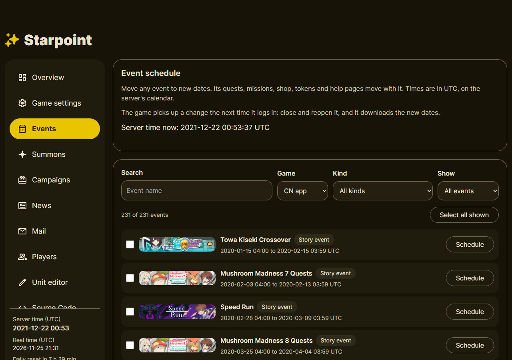

1. Find the event: search, or filter by **Game** (**CN app** for the CN game), **Kind** and **Show**.
2. Press **Schedule**, set **Starts** and **Ends** (or **Start now**; **Original length** keeps its length), and
   **Save**. Its quests, missions, shop and tokens move with it, and so do the banners that opened with it, if ticked.

   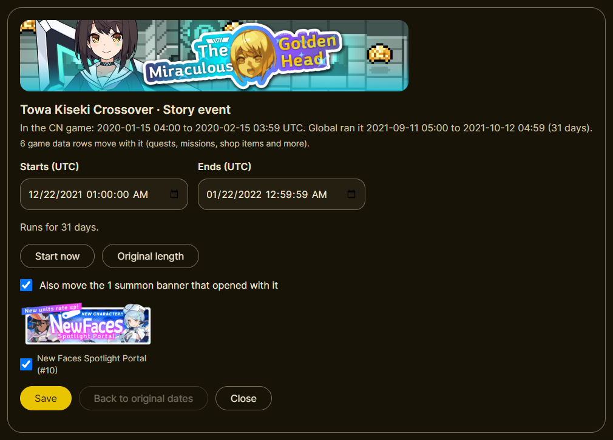

   - An event only shows in the game while the server's date is inside its dates. After saving, the summary says
     where it stands (**on now**, **starts in N days**, **ended**), with a button that moves the server's date to
     its start.
   - An event can run up to 10 years; events longer than about a year aren't listed in What's on or the automatic
     news.
3. To move several, tick them and use **All start at (UTC)**. Give one its own start with **Own start (UTC)** (each
   keeps its own length). **Back to original dates** undoes a move.

## Schedule a summon banner

**Summons** works like Events, for unit and armament banners. A banner given dates here keeps them, even if its
event moves later. Many banners share a name (181 "New Faces Spotlight Portal"s): search a unit's name, e.g.
**Bianca**, to list the banners that feature it.

## Repeat a yearly campaign

**Campaigns**: tick a seasonal login bonus, free pull, stamina or reward campaign to repeat it every year on its
dates, then **Save**. Where two overlap, the longer one runs that year.

## Game settings

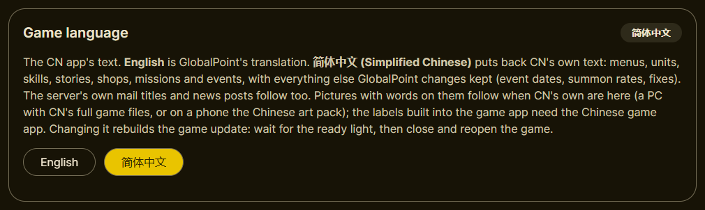

- **Game language:** English (default) or 简体中文, for the CN app. Chinese puts back CN's own text and keeps
  everything else GlobalPoint changes. Wait for the ready light, then reopen the game. See
  [CHINESE.en.md](CHINESE.en.md).
- **Quest drop amount:** 1x (default) is the base game; up to 100x, from the next quest.
- **Enemy strength:** every enemy's HP and attack, 0.1x to 10x each, with presets. Reopen the game after saving.

  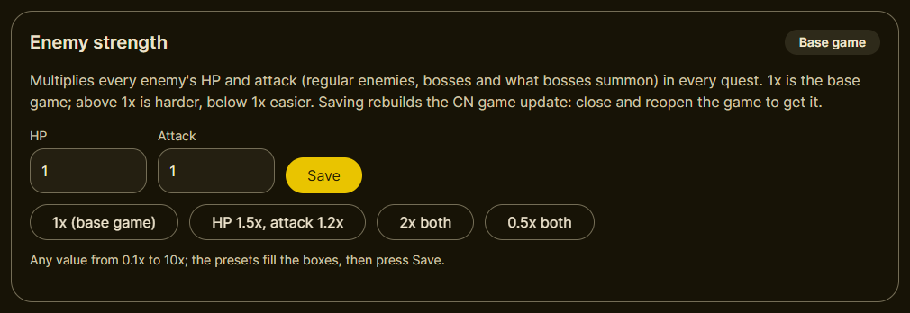
- **Summon rates:** the 5★ and 4★ chance for **Unit banners**, **Star Fest / Meteor Festival** and **Armaments**.
  **Base game rates** restores 5% / 25% (7.5% / 25% for festivals). The game's **Rates** screen shows the new
  numbers after the update rebuilds.

  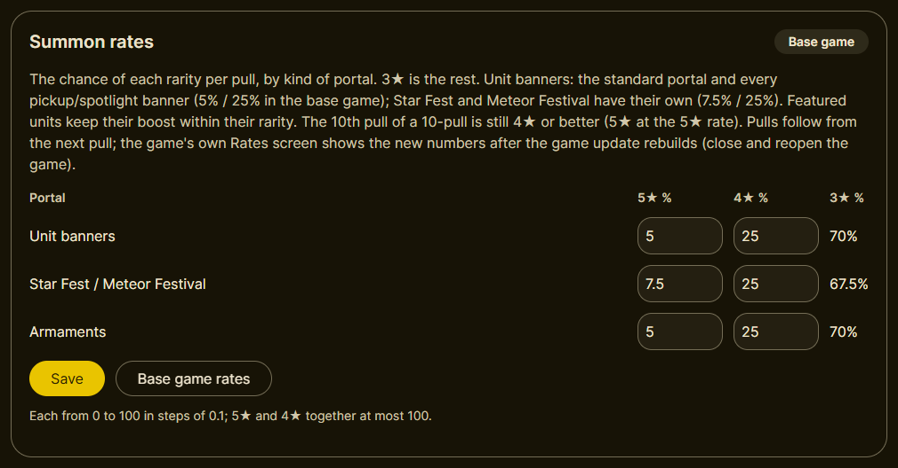
- **Paid beads with each daily login bonus:** 150 by default; 0 turns it off.
- **Never-ending mails:** Bread, Mana and EXP x1500, claimable again and again; untick one to remove it.
- **Stamina** (off by default: battles cost nothing). On, it works like the live game: battles cost stamina,
  retiring gives it back, it refills 1 point every 6 minutes, ranking up refills it, and items or 50 beads refill
  it. Reopen the game after changing it.
- **Co-op rescues** (on): every co-op battle you clear counts as a rescue, paying 10 Silver, Gold or Lilac Nuggets
  and counting for the backup missions.
- **Rank cap** (on): your rank stops at the cap CN had on the server's date (100 from launch, 125 from 2021-12-16,
  150 from 2022-06-16, 175 from 2023-02-02, 250 from 2024-05-09). Off: up to 250 at any date.
- **Returning-player bonuses** (on): a save away 30+ days of server time gets the returning-player login bonuses CN
  had open on that date, once each.

## Post news

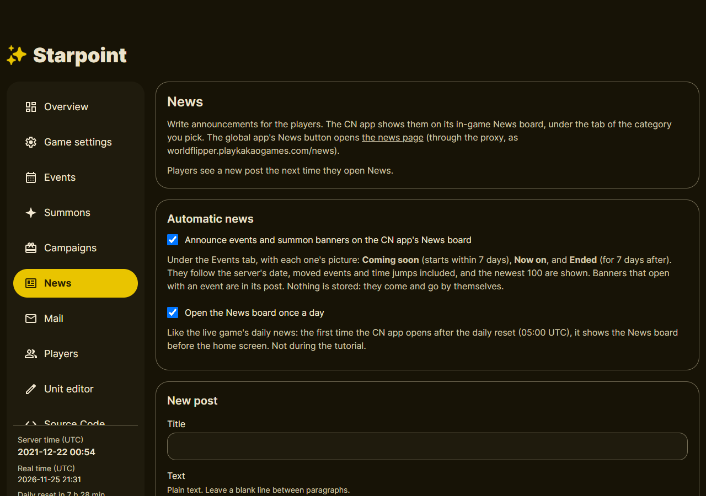

**News** > **New post**: a title, the text (a blank line between paragraphs), the **Category** (the CN app's News tab)
and **Show in**, then **Post**. Players see it the next time they open News.

- **Automatic event posts** (on by default): the News board posts about events and banners by itself, with their
  pictures: **Coming soon** (within 7 days), **Now on**, and **Ended** (for 7 days). They follow the server's date.
- **Open the News board once a day** (on by default): like the live game, the first start after the daily reset
  shows News after the login bonuses.

## Schedule mail

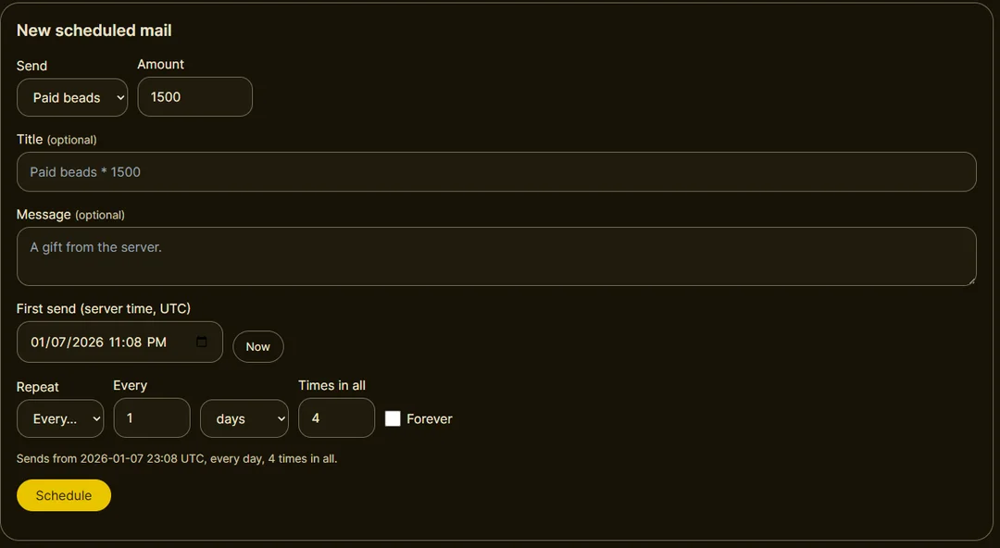

1. Pick what to send (beads, mana, EXP, or an item, unit or armament by name or id) and the amount. Title and message
   are optional.
2. Set the **First send** (**Now** fills in the server's time) and **Repeat**: **Once**, or **Every** N days, weeks,
   months or years, a number of times or forever. **Also repeat the whole run every year** sends the run again each
   year.
3. **Schedule**. The list shows each mail's next send; **Edit** changes it, **Delete** stops it.

To give something right away, pick **Once** and **Now**. It goes to the active save (Players > **Active account**), or
to every save when ticked. Each mail can be claimed for 30 days, and mails follow the server time.

**Share a schedule:** **Export ticked** / **Export all** gives a `.json` file; **Import a file…** adds someone else's
mails (a mail with a unit your setup doesn't have is refused).

**CN's gifts** (on by default): the 122 gifts and compensation mails CN sent its players from 2021-10-26 to
2025-07-22 (213 mails, about 219,000 beads, tickets, materials, a unit and an armament), on CN's dates, for every
save. A gift more than 30 days old when a save first looks isn't sent. **All gifts** lists them; **Remove** stops one.

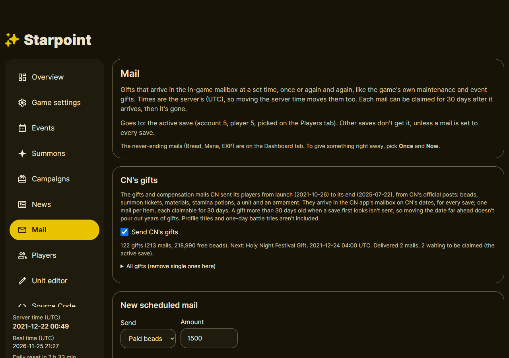

## Back up or move a save

- **Players** > a player > **Download Save** gives a JSON file; **Upload Save** puts one back, on any server.
- **Players** > **Active account** picks which player each app plays on (reopen the game to switch). After
  reinstalling the game, pick your player here.

  
- **On a phone:** the companion's **Export save** / **Import save**. To bring a PC save over, tick **My save** in
  **Download from PC**.

## Player page tools

Close the game before using these, then reopen it. None can be undone.

- **Unlock all chapters:** marks every main story stage cleared (no clear rewards).
- **Set rank:** any rank from 1 to 250 (no rank-up rewards).
- **Co-op partners:** pick up to two of this save's parties as your COM partners (no restart needed); **Clear** goes
  back to the usual order ([DETAILS.md](DETAILS.md#co-op-partners)).
- **Unlock** / **Reset** a mission's reward, and **Remove a unit** ([CUSTOM_UNITS.md](CUSTOM_UNITS.md#removing-a-unit-safely)).
- **Save tools:**

  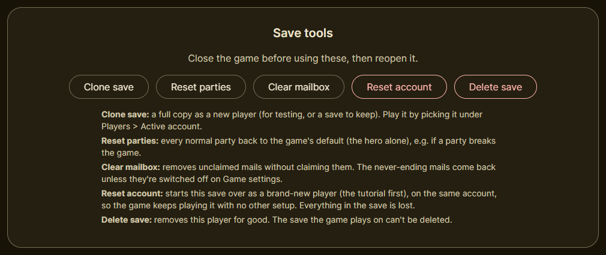

## Edit a unit or an armament

**Unit editor** works for every CN unit and armament, and for custom units. No ids change, so saves are safe. The full
guide is [UNIT_EDITOR.md](UNIT_EDITOR.md).
1. Pick a unit (or switch to **Armaments**).
2. Edit a tab: **Abilities** (one line per effect; **In game** shows the unit page's words), **Numbers** (HP/ATK, skill
   gauge, every min → max), **Details** (name, title, description, class, role), or **Skill** (what the skill does,
   with ▶ Preview skill; see [SKILL_GUIDE.md](SKILL_GUIDE.md)).

   

   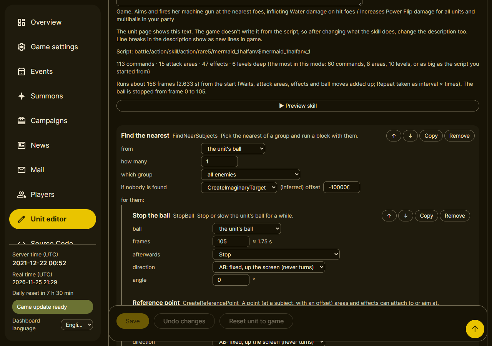
3. **Save** (greyed out while a line breaks a rule), then reopen the game.

**Mode:** **Default** offers what CN's own units use; **Advanced** any combination of those; **Unrestricted** adds parts
CN never uses (may not work, or may crash the game). **Edited units and kits** shares edits as files. **Reset unit to
game** undoes the editor's changes. On a phone the editor works in the companion too; **Download from PC** replaces the
phone's edits, so edit on one side only. New units: [CUSTOM_UNITS.md](CUSTOM_UNITS.md).

---

## Gotchas

- **The date changes how units play:** Mana Board 2, awakening, EX Boost and kits follow it
  ([balance by date](DETAILS.md#balance-by-date)).
- **Opening the game too soon** after a change can give an error (like C8601) or the old dates: close it, wait a
  minute, open it again.
- **Yearly copies follow the clock:** repeating campaigns and The Haunt's monthly floors are built for the game year
  and one year either side; going further means a small download at the next title screen.
- **JP and CN dates in one event:** some pre-2021 events have parts on CN's own dates, 640-690 days later.
  GlobalPoint moves those parts onto their event's dates for you.
- **Boss events 100006 and 100007** are different events in each app; on the CN app they're CN's own.
- **There's no password.** With `LISTEN_HOST` at `127.0.0.1` (the default), only this device can open the dashboard.
  `0.0.0.0` (setup 2, copying to a phone) opens it to your whole network: use it only on one you trust.
