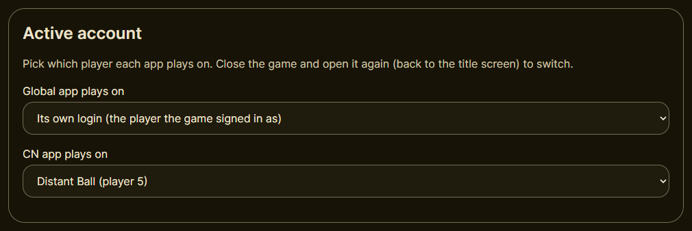
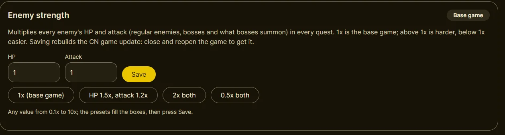
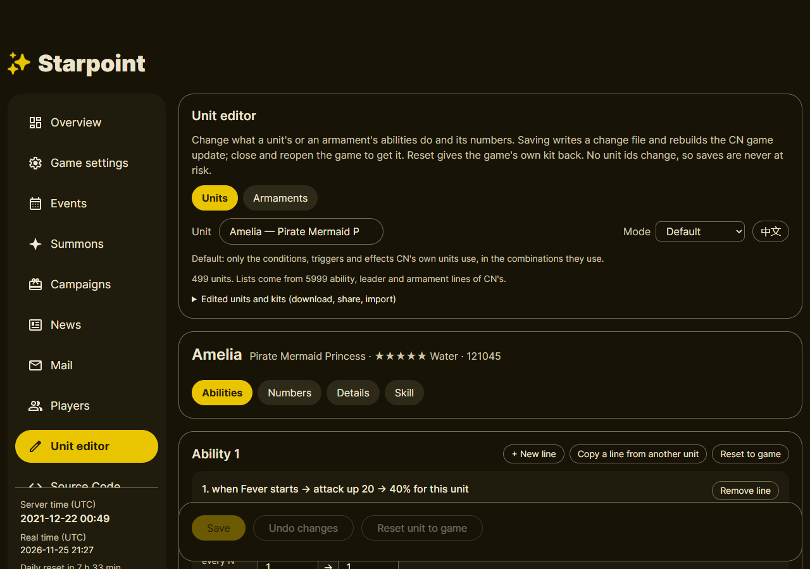
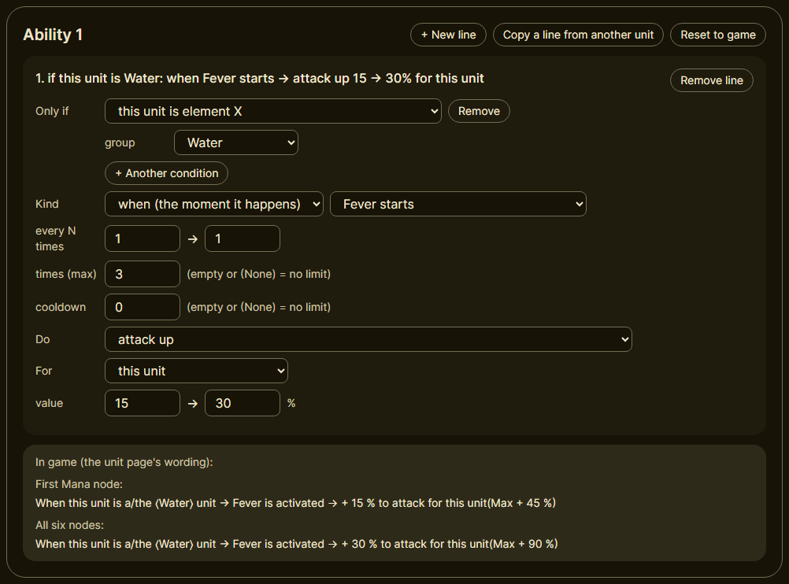
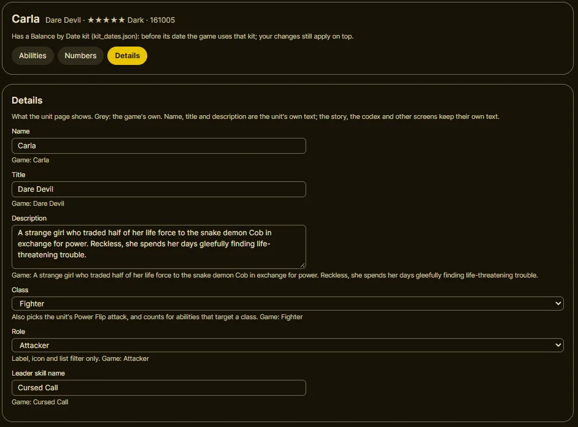

# Dashboard guide

The GlobalPoint dashboard, tab by tab and job by job.

**Opening it:** with the server running, go to **http://127.0.0.1:8000** in a browser on the same PC,
or tap **Dashboard** in StarPoint Companion (that's the phone's own server, not the PC's). **Times are
UTC** everywhere on the dashboard.

**Changes reach the game at its title screen.** After a change to events, summons, campaigns, enemy
strength, units or the date, close the game fully and open it again: it downloads a small update.
The server builds it in the background, so wait a minute or two on a PC (a few minutes on a phone).
The bottom of the sidebar, on every tab, shows:
- the server time, the real time, and when the next daily reset is;
- the game update: **Rebuilding the game update** (wait before opening the game) or **Game update ready**.

On a phone, the menu button in the top bar opens the tabs and this block. The bar's dot shows the game
update: olive is ready, yellow is rebuilding, red means the server can't be reached.
On long pages (Events, Summons), a round **↑** button appears in the bottom-right corner once you scroll
down; it takes you back to the top.

| Tab | What it's for |
|---|---|
| **Overview** (first tab) | [the server's date and time jumps](#go-to-another-date-and-back), [what's on now and next](#whats-on-now), playing on a phone over Wi-Fi |
| **Game settings** | [drops, enemy strength, summon rates, daily beads and mails, stamina, co-op rescues](#game-settings) |
| **Events** | [move any event](#move-an-event), CN-only ones included |
| **Summons** | [schedule summon banners](#schedule-a-summon-banner) |
| **Campaigns** | [yearly login bonuses, free pulls and stamina/reward campaigns](#repeat-a-yearly-campaign) |
| **News** | [posts on the in-game News board](#post-news) |
| **Mail** | [gifts, right away or at a set time, once or repeating](#schedule-mail) |
| **Players** | [saves](#back-up-or-move-a-save), the active account, [removing a unit and other player tools](#player-page-tools) |
| **Unit editor** | [change units' and armaments' abilities and numbers, and units' skills](#edit-a-unit-or-an-armament) |

---

## Go to another date, and back

**Overview**, the first tab, shows three clocks: the **server time** (the date the game plays on), the
**real time**, and when the **next daily reset** is (05:00 UTC by the real clock: the login bonus and daily
missions follow the real day, not the server's). Each also shows in your own time zone.

- Pick a date and time and press **Set time**; the clock keeps ticking from there.
- **+1 day** and **+1 week** move the server's date forward. **Next event** jumps to the start of the next
  event or summon banner (on its own dates or the ones you gave it). **Undo** goes back to the date before
  the last change.
- **More**: **Reset to the real time**, and **Match real time (keep date)**, which keeps the date but
  uses the real time of day, so the server's day turns over with the daily reset.

Close and reopen the game after changing the date.

**Changing the date doesn't give a login bonus or reset the dailies**: those follow the real day. To get
them now, press **Start the next day now**, then close and reopen the game. The next login then counts
as a new day for every save:
- the next login bonus (with the daily beads), daily missions and login-day missions;
- Boss Boost, daily first summons and free pulls;
- solo boss event tickets and today's shop limits.

The server's date doesn't change. Pressing the button twice before logging in still counts as one day.

New installs start on 2021-10-26, the CN game's launch. The events CN never ran (JP-only) are in 2020.

## What's on now

The Overview lists the events and summon banners running at the server's date in the CN app (with how
long is left), and those starting in the next 7 days, with a **Jump to its start** link each. Things that
run for years, like the permanent portals and The Haunt, aren't listed. After CN's last events (2025),
nothing is listed unless you move events there.

## Move an event

1. Find the event (search, or filter by **Game**, **Kind** and **Show**). Set **Game** to **CN app**
   for the CN game's list.
2. Press **Schedule**, set **Starts** and **Ends** (or **Start now**, and **Original length** to keep
   its length), and **Save**. Its quests, missions, shop and tokens move with it.
   - An event can run for up to 10 years. Its phases, shop and mission windows stretch to fit.
   - Events longer than about a year aren't listed in **What's on** or the automatic News posts.

   **An event only shows in the game while the server's date is inside its dates.** After saving, a
   summary says where each event stands on the server's date (**on now**, **starts in N days**, or
   **ended**). It has a **Move the server's date to its start** button, and shows the game update's
   progress (**Rebuilding**... then **ready**: close and reopen the game). Moved events show the same
   status in the list, e.g. **On now · ends in 5 days**.

   
3. To move several, tick them and use **All start at (UTC)**; **Also move the summon banners that opened
   with them** moves their banners too. To start one of them at another time, fill in its **Own start
   (UTC)** in the picked list (each keeps its own length; **Use All start at** puts it back). Handy for
   banners, whose names repeat: pick them by their pictures, then give each its start. **Back to
   original dates** undoes a move.

## Schedule a summon banner

**Summons** works like Events, for unit and armament banners: **Schedule**, set the dates, **Save**. A
banner given dates here keeps them, even if an event it opened with moves later.

Many banners share a name (there are 181 "New Faces Spotlight Portal"s). Search a unit's or armament's
name to list the banners that feature it, e.g. **Bianca**.

## Repeat a yearly campaign

**Campaigns**: tick a seasonal login bonus, free pull, stamina or reward campaign to make it repeat every
year on its dates (untick to stop), then **Save**. Where two picked ones overlap, the longer one runs
that year.

## Player page tools

To give a unit, an item, an armament or beads, use the **Mail** tab: pick **Once** and **Now**
([Schedule mail](#schedule-mail)).

The player page has **Unlock** / **Reset** a mission's reward and **Remove a unit** (close the game
first; it can't be undone, see [CUSTOM_UNITS.md](CUSTOM_UNITS.md#removing-a-unit-safely)).

**Story and rank** on the player page (close the game first, then reopen it; neither can be undone):
- **Unlock all chapters:** marks every main story stage cleared, so all chapters are open. Stages already
  cleared keep their score; no clear rewards are given. Units that join during the story arrive at the next
  login.
- **Set rank:** moves the player rank to any rank from 1 to 250, up or down. Rank-up rewards aren't given.

**Co-op partners** on the player page: pick up to two of this save's parties as your COM partners in co-op
(no game restart needed). **Clear** goes back to the usual order (NPC-named parties, then the strongest; see
DETAILS.md, Co-op partners). The picks are kept in the save, so they move with save export and import.

**Save tools** on the player page (close the game first, then reopen it):
- **Clone save:** a full copy as a new player, everything included. Play it by picking it under **Active
  account**; handy for testing something, or keeping a save as it is.
- **Reset parties:** every normal party back to the game's default (the hero alone), if a party breaks the
  game.
- **Clear mailbox:** removes unclaimed mails without claiming them. The never-ending mails come back unless
  they're switched off on Game settings.
- **Reset account:** starts the save over as a brand-new player (the tutorial first) on the same account, so
  the game keeps playing it with no other setup. Everything in the save is lost (download it first to keep a
  copy). The new player has a new number; the page goes to it.
- **Delete save:** removes the player for good (download the save first to keep a copy). The save the game
  plays on can't be deleted: pick another one under **Active account** first.

## Schedule mail

**Mail**: gifts that arrive right away or at a set server time, like the game's own maintenance gifts.
1. Pick what to send (beads, mana, EXP, or an item, unit or armament by name or ID) and the amount.
   Title and message are optional.
2. Set the **First send** (**Now** fills in the server's time) and **Repeat**: **Once**, or **Every** N
   days, weeks, months or years, a number of times or forever.
   **Also repeat the whole run every year** sends the run again each year from its first send's date
   (e.g. weekly for 6 weeks from 1 March, every March); for a run with an end, under a year long.
3. **Schedule**. The list shows each mail's next send; **Edit** changes it, **Delete** stops it.

**Who gets it:** the active save (Players > **Active account**). Tick **Send to every save** to send it
to all of them; each gets it the next time its mailbox opens.

**Good to know:**
- Each mail can be claimed for 30 days.
- Mails follow the server time, so moving the date forward makes due mails arrive.
- A first send that's already in the past sends once right away, not once for every missed time.
- Scheduled mails survive restarts. The companion's **Download from PC** brings them along with **My save**.

**Share a schedule:** tick mails and press **Export ticked** (or **Export all**). You get one `.json` file
of what is sent and when (not who got what). **Import a file…** adds someone else's mails next to yours,
checked like ones you made. A mail with a unit your setup doesn't have (someone else's custom unit) is
refused, with the reason. If some imported first sends are already in the past, it asks: **Send them
now** (one of each right away) or **Start each at its next time**.

**CN's gifts** (on by default): the gifts and compensation mails CN sent its players from launch
(2021-10-26) to its end (2025-07-22), from CN's official Bilibili posts. That's 122 gifts, 213 mails and
about 219,000 free beads, plus summon tickets, limit-break and EX-break materials, stamina potions, the
unit Eloise (Indomitable Lady) and The Carrot Sword of Imagination.
- They arrive in the CN app's mailbox on CN's dates (CN time 12:00 = 04:00 UTC), for every save. Each item
  is its own mail, claimable for 30 days.
- A gift more than 30 days old when a save first looks isn't sent: jumping the date ahead gives only the
  last month's gifts.
- Gifts for real-world reasons are titled "Milestone Gift" (chart ranks, repost goals, server-wide
  counts) or "Compensation Gift" (CN's apologies for bugs and downtime).
- The global app doesn't get them.
- **Send CN's gifts** turns them all off or on. **All gifts** lists every gift with its items and status;
  **Remove** stops one (**Put back** undoes it). The settings are in `.database/cn_gift_mails.json`, the
  gifts in `assets/cn_gift_mails.json`.
- Not included: profile titles, one-day battle tries and bonus points, gift codes, and mails only some
  players got. Exchange tickets CN gave for free come with their exchange promo instead, not by mail.
- CN sent most of them only to Rank 5+ players; here every save gets them.

## Back up or move a save

- **Players** > a player > **Download Save** gives a JSON file; **Upload Save** puts one back. It works
  between any two servers.
- **Players** > **Active account** picks which player each app plays on (reopen the game to switch).
  After reinstalling the game, pick your player here and the reinstalled game opens it.

  

- **On a phone:** the companion's **Export save** / **Import save**. To bring a PC save over, tick **My
  save** in **Download from PC**.

## Post news

**News** > **New post**: a title, the text (a blank line between paragraphs), the **Category** (the CN
app's News tab) and **Show in**, then **Post**. Players see it the next time they open News.

**Automatic event posts** (on by default; the switch is at the top of the News tab): the CN app's News
board posts about events and summon banners by itself, under its **Events** tab, each with its picture:
- **Coming soon**: starting within 7 days;
- **Now on**;
- **Ended**: for 7 days after it ends.

They follow the server's date (moved events and date changes included) and come and go by themselves.
Banners that open with an event are in that event's post. Your own posts show next to them.

**Open the News board once a day** (on by default, under the automatic posts switch): like the live
game, the first time the CN app opens after the daily reset (05:00 UTC), it shows the News board after
the login bonuses. Later that day the game goes straight to the home screen. Not during the tutorial.

## Game settings

- **Game language:** English (default) or 简体中文 (Simplified Chinese), for the CN app. Chinese puts back
  CN's own text everywhere the game reads its tables (menus, units, skills, stories, shops, missions,
  events) and keeps everything else GlobalPoint changes; the server's mail titles and automatic news
  follow. Pictures with words on them follow too when CN's originals are here (a PC with CN's full game
  files, or a phone with the Chinese art pack, about 1.5 GB); the Chinese game app adds the labels built
  into the app. Saving rebuilds the game update: wait for the ready light, then reopen the game. See
  [CHINESE.md](CHINESE.md).
- **Quest drop amount:** 1x (default) is the base game's amounts; original StarPoint gave 10x. Up to
  100x; applies from the next quest.
- **Enemy strength:** every enemy's HP and attack, 0.1x to 10x each (presets: 1x, HP 1.5x / attack
  1.2x, 2x, 0.5x). Above 1x is harder. Reopen the game after saving.
- **Paid beads with each daily login bonus:** 150 by default; 0 turns it off.
- **Never-ending mails:** Bread, Mana and EXP x1500 that can be claimed again and again; untick one to
  remove it.
- **Stamina (Spend stamina like the real game):** off by default, so battles never cost stamina. Turned
  on, it works like the live game:
  - each battle costs its stamina when it starts (half-cost campaigns count, CN app), and retiring gives
    it back;
  - stamina refills 1 point every 6 minutes (faster at higher ranks), up to your rank's maximum;
  - ranking up adds a full refill on top;
  - stamina items, or 50 beads for 100 stamina, refill it.

  Close and reopen the game after changing it.
- **Co-op rescues (Count co-op clears as rescues):** on by default (CN app). Every co-op battle you clear
  counts as helping in someone else's battle, like the live game. It pays 10 Silver, Gold or Lilac
  Nuggets (harder battles pay better ones) and counts for the "clear battles as a backup" missions.
  Battles that pay: boss battles, advent events, world story bosses, raids and hard multi.
- **Rank cap (Rank cap follows CN's dates):** on by default (CN app). Your rank stops at the cap CN had
  on the server date: 100 from launch (and before it), 125 from 2021-12-16, 150 from 2022-06-16, 175 from
  2023-02-02, 250 from 2024-05-09. At the cap, rank points stop (none are saved up); after the next raise
  ranking up carries on. A save already above the cap keeps its rank. Off: up to 250 at any date.
- **Returning-player bonuses (Give CN's returning-player bonuses):** on by default (CN app). A save away
  30+ days of server time (a real month off, or the date moved a month ahead) gets the returning-player
  login bonuses CN had open on that date, once each, one day per login with the daily bonus: the 15-day
  bonus (1,500 beads in all; 2023-03-02 to 2024-06-12), the one-off returning gift (2023-08-31 to
  2024-05-23), the 7-day bonus with 10-pull tickets (from 2024-05-23) and the 3rd anniversary one
  (2024-07-11 to 08-22). The first load after this update only records the save's date.
- **Summon rates:** the 5★ and 4★ chance per pull for **Unit banners**, **Star Fest / Meteor Festival**
  and **Armaments** (3★ is the rest). **Base game rates** restores 5% / 25%, and 7.5% / 25% for Star
  Fest and Meteor Festival. Pulls follow from the next pull; the game's own **Rates** screen (and its
  guaranteed-slot page) shows the new numbers after the game update rebuilds: close and reopen the game.

## Edit a unit or an armament

**Unit editor** works for every CN unit and armament, and for custom units. No ids change, so saves are
safe. The full guide is [UNIT_EDITOR.md](UNIT_EDITOR.md).
1. Pick a unit (or switch **Units / Armaments** at the top).
2. Edit a tab: **Abilities** (each ability and the leader skill, one line per effect; **In game** shows
   it in the unit page's words), **Numbers** (HP/ATK, skill gauge, every min → max), **Details**
   (name, title, description, class, role), or **Skill** (what the skill and Skill+ do, as commands, with
   ▶ View effect and ▶ Preview skill; [SKILL_GUIDE.md](SKILL_GUIDE.md) is a short guide).

   

   

   
3. **Save** (greyed out while a line breaks a rule), then reopen the game.

**Mode** at the top: **Default** offers what CN's own units use; **Advanced** allows any combination of
those; **Unrestricted** adds parts CN never uses, which may not work or may crash the game. **Edited
units and kits** shares edits as kit files. **Reset unit to game** undoes the editor's changes. On a
phone the editor works in the companion too; with a PC, **Download from PC** replaces the phone's
edits, so edit on one side only.

New units are added with files: see [CUSTOM_UNITS.md](CUSTOM_UNITS.md).

---

## Gotchas

- **The date changes how units play:** Mana Board 2, awakening, EX Boost and kits follow it
  ([balance by date](DETAILS.md#balance-by-date)). A unit already on Mana Board 2 keeps it.
- **Opening the game too soon** after a change can give an error (like C8601) or the old dates: close
  it, wait a minute, open it again.
- **Yearly copies follow the clock:** repeating campaigns and The Haunt's monthly floors are built for
  the game year and one year either side. Moving further means a small download at the next title
  screen.
- **JP and CN dates mixed in one event:** in CN's data, events from before CN's launch (2021) carry JP's
  dates, but a few of their parts carry CN's own dates, about 640-690 days later. Examples: the first
  Serpents' and Not Today, Romero's shops, the anniversary quests' daily attempts, Trial by Water's
  missions, some home banners. GlobalPoint moves those parts onto their event's dates, so you don't need
  to do anything.
- **Boss events 100006 and 100007** are different events in each game: on the CN app they're CN's own (The
  Leap of Haruhi Suzumiya, a Lightcrest Serpent rerun), listed under their own entries.
- **The Haunt** opens on 2020-01-12 and stays open, with a fresh set of floors every month.
- **There's no password.** With `LISTEN_HOST` at `127.0.0.1` (the default), only the same device can
  open the dashboard. `0.0.0.0` (needed to copy to a phone, and for setup 2) opens it to everyone on
  your network, so use it only on a network you trust.
