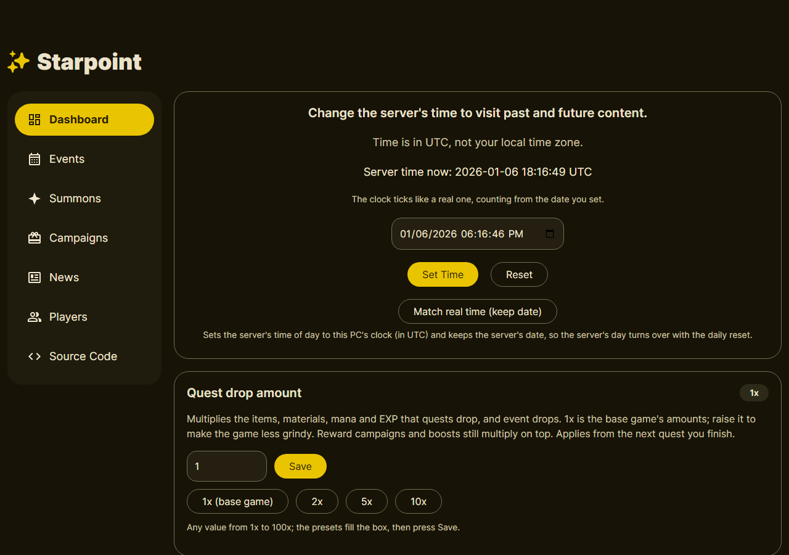
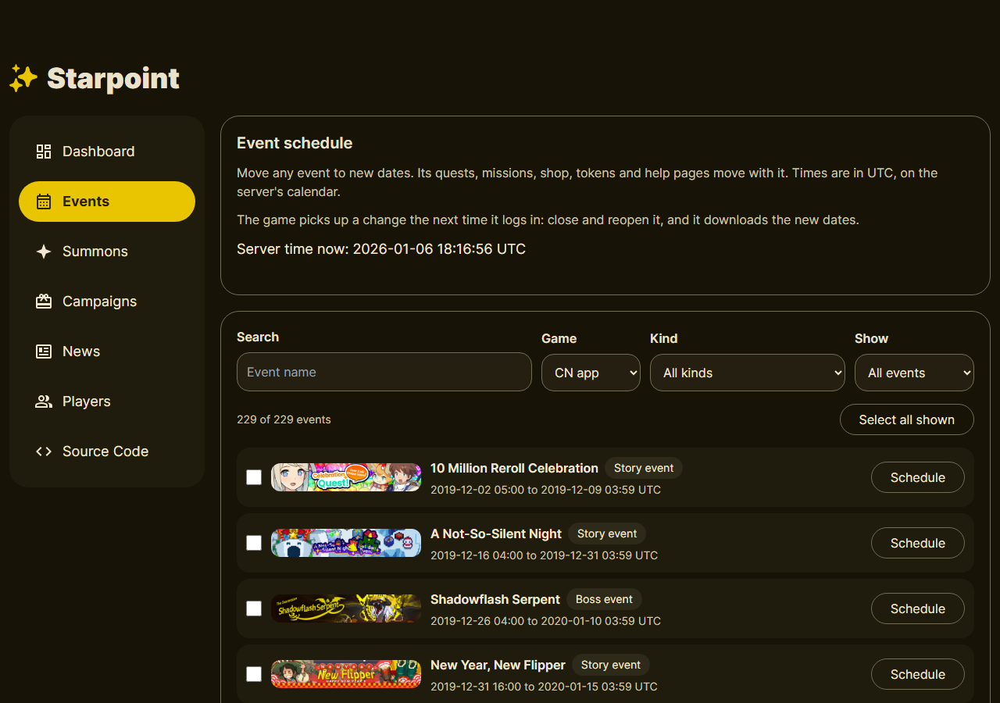
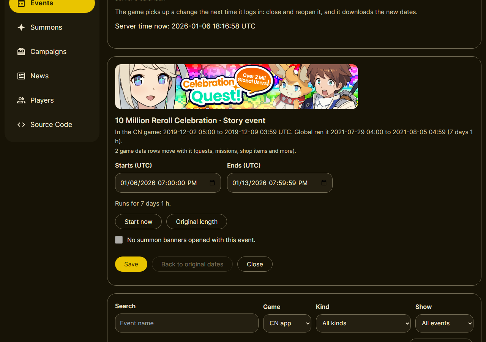
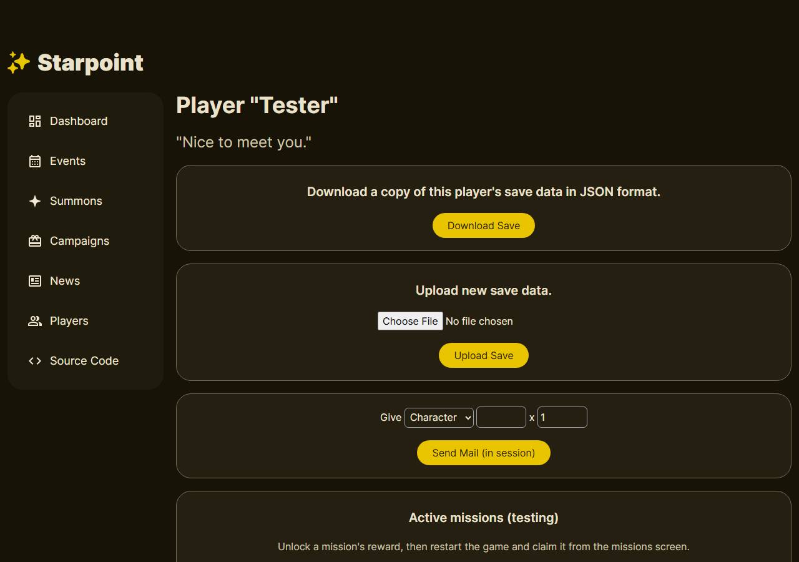
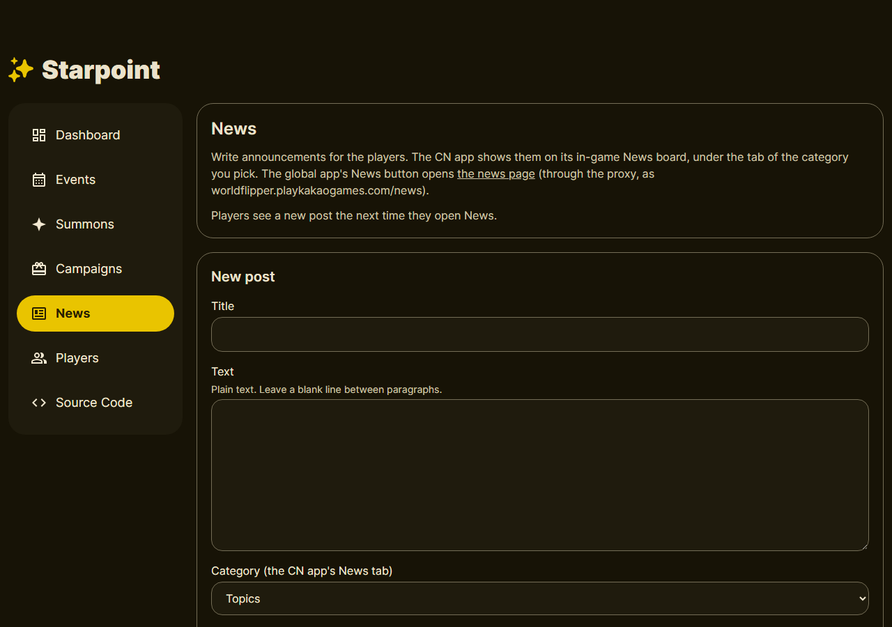
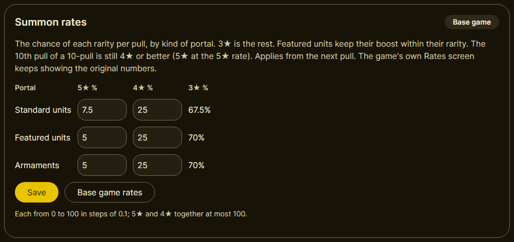
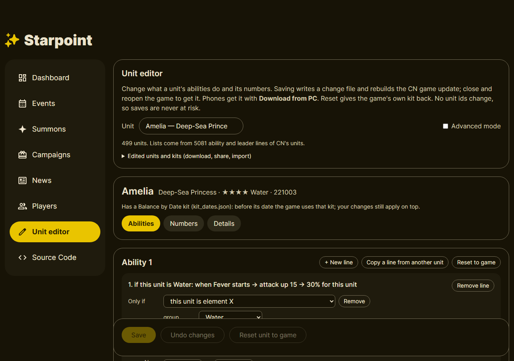
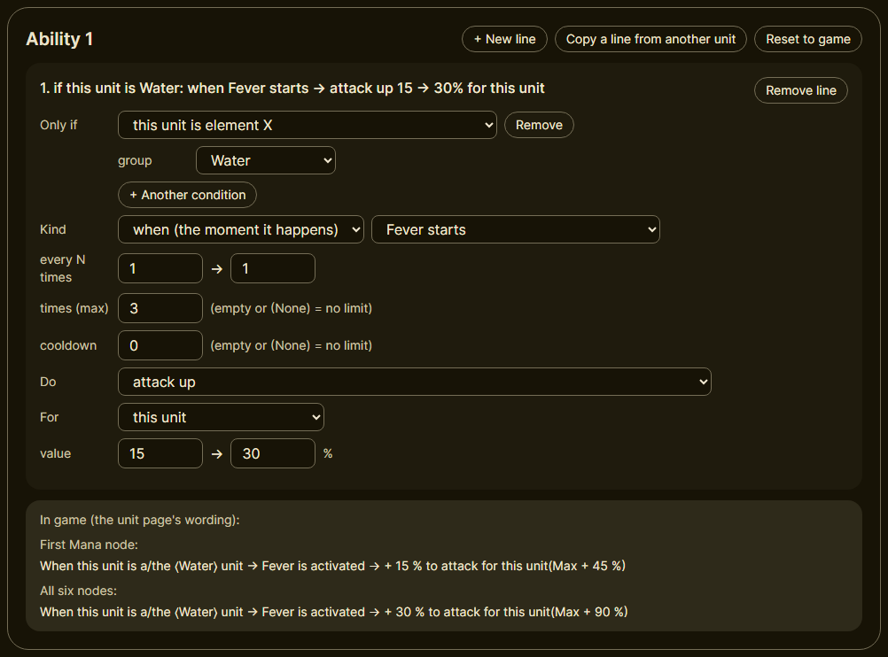

# Dashboard guide

How to do the common jobs on the GlobalPoint dashboard. For a quick list of what each tab holds,
see [The dashboard](../README.md#the-dashboard) in the README.

**Opening it:** with the server running, go to **http://127.0.0.1:8000** in a browser on the same
PC. On a phone with the companion app, tap **Dashboard** in the companion: that's the phone's own
server, not the PC's.

**Times are UTC** everywhere on the dashboard, not your local time.

**Changes reach the game at its title screen.** After a change to events, summons, campaigns or
the date, close the game fully and open it again. It downloads a small update before the title
screen. The server builds that update in the background, so give it a minute or two on a PC (a few
minutes on a phone) before reopening.

---

## Jobs

### Go to another date, and back

First tab (**Dashboard**):
1. In the box at the top ("Change the server's time to visit past and future content"), pick a
   date and time and press **Set Time**. The clock keeps ticking from there.
2. To come back, press **Reset**: the server uses today's real time again. (With banner rotation
   on, Reset hands the date back to the rotation instead.)

**Match real time (keep date)** keeps the server's date but sets its time of day to the PC's
clock, so the server's day turns over with the daily reset.

New installs start on 2019-12-01, just before the CN game's first banners and events.

### Move an event

**Events** tab:
1. Find the event (search, or filter by **Game**, **Kind** and **Show**: On now, Coming up, Moved
   by you). Set **Game** to **CN app** to see the CN game's list.
2. Press **Schedule** next to it, set **Starts** and **Ends** (or press **Start now**, and
   **Original length** to keep its length), and **Save**. Its quests, missions, shop, tokens and
   help pages move with it.

   
3. To move several at once, tick them and use **All start at (UTC)**: each keeps its own length.
   **Also move the summon banners that opened with them** moves their banners too.
4. **Back to original dates** undoes a move.

Then reopen the game.

### Schedule a summon banner

**Summons** tab: the same page and controls as Events, for unit and armament banners. Find the
banner, press **Schedule**, set the dates, **Save**, and reopen the game. A banner given dates here
keeps them, even if an event it opened with is moved later.

### Repeat a yearly campaign

**Campaigns** tab: seasonal login bonuses, seasonal free pulls, stamina campaigns and reward
campaigns.
1. Tick a campaign to make it **repeat every year** on the same dates (the CN game's own dates
   where known). Untick it to stop the repeats.
2. Press **Save** (or **Undo changes**), then reopen the game.

Where two picked campaigns would run at the same time, the longer one runs that year. A free pull
works on any regular unit banner open at the time, and skips a year where one of the game's own
free pull campaigns runs then.

### Give a unit, an item or an armament

**Players** tab > pick a player > **Give**: choose **Character**, **Item** or **Equipment**
(armament), type its ID number and the amount, and press **Send Mail (in session)**. It arrives in the player's in-game
mailbox. The IDs are the game's own (the files in `assets/` list them).

For beads and other basics, see [Paid beads, free mails and drops](#paid-beads-free-mails-and-drops)
below.

The player page also has:
- **Unlock** / **Reset** a mission's reward (restart the game, then claim it on the missions screen);
- **Give login bonus again**;
- **Remove a unit**: takes a unit out of this save (with its Mana Boards, party places and records), e.g.
  before a custom unit is deleted ([CUSTOM_UNITS.md](CUSTOM_UNITS.md#removing-a-unit-safely)). Close the game
  first; it can't be undone, so download the save first if you want a copy;
- **Link my reinstalled game to this player**: press it before you open a reinstalled game, and its
  next new guest login (within 30 minutes) loads this player instead of a new one.

### Back up or move a save

- **Players** > a player > **Download Save** gives that player's save as a JSON file.
  **Upload Save** puts one back, replacing that player's data. This works between any two
  servers: download on one dashboard, upload on the other.
- **Players** > **Active account** picks which player each app plays on. Reopen the game to switch.
- **On a phone** (companion app): **Export save** writes the whole save database to a zip, and
  **Import save** puts one back. To bring a PC save to the phone, use **Game data** > **My save**
  in the companion's **Download from PC**.

### Post news

**News** tab: under **New post**, write a title and the text (plain text; a blank line between
paragraphs), pick the **Category** (the CN app's News tab it shows under) and the app it shows in
(**Show in**), and press **Post**. Players see it the next time they open News in the game.

### Paid beads, free mails and drops

First tab (**Dashboard**):
- **Quest drop amount:** 1x (the default) is the base game's own amounts. Original StarPoint gave
  10x. Pick a preset or type any value from 1x to 100x, then **Save**. It applies from the next
  quest you finish.
- **Paid beads with each daily login bonus:** added once a day on top of the login bonus's own
  rewards (150 by default; 0 turns it off).
- **Never-ending mails:** Bread x1500, Mana x1500 and EXP x1500 sit in the mailbox and can be
  claimed again and again. Untick one to remove it.

### Change summon rates

First tab (**Dashboard**) > **Summon rates**: the chance of a 5★ and a 4★ per pull, for three kinds
of portal: **Standard units**, **Featured units** and **Armaments**. 3★ is the rest.
1. Type the percentages (0 to 100, one decimal) and press **Save**. The badge then says **Custom**.
2. **Base game rates** puts them back: standard 7.5% 5★ / 25% 4★, featured and armament 5% / 25%.

It applies from the next pull, and no game update is needed. Featured units keep their boost within
their rarity. The 10th pull of a 10-pull is still 4★ or better (5★ at the 5★ rate), and special
pulls with their own rules (like a once-per-account guaranteed 5★) keep them. The game's own Rates
screen keeps showing the original numbers. The companion's **Download from PC** brings the PC's
rates along when **My save** is ticked.

### Edit a unit's abilities and numbers

**Unit editor** in the menu (`/unit-editor`): works for every CN unit and for custom units. No unit
ids change, so saves are never at risk. The full guide is [UNIT_EDITOR.md](UNIT_EDITOR.md).

1. Pick a unit.
2. Change it on one of three tabs:
   - **Abilities**: each ability (1-6) and the leader skill, one line per effect (**Only if**
     conditions, the trigger, and what it **Does**). Add, remove or copy lines from another unit;
     **Reset to game** gives an ability its own lines back. **In game** under each ability shows it
     in the unit page's own words.

     
   - **Numbers**: HP/ATK, the skill gauge, and every min → max value.
   - **Details**: name, title, description, leader skill name, class (it also picks the Power Flip)
     and role.
3. Press **Save**. It stays greyed out while a line breaks a rule (a contradiction, a target the
   trigger can't have, or something the game can't read). The server rebuilds the game update.
4. Close and reopen the game.

- **Default mode** only offers the triggers and conditions CN's own units use. **Advanced mode**
  offers everything the game can read, with a warning on the unused ones: they may not work or may
  crash the game.
- **Edited units and kits** at the top lists every edited unit: **Download** them as a kit file, or
  **Import a kit file** from someone else.
- **Reset unit to game** removes the editor's changes for that unit.
- **On a phone**, make the edits on the PC: the companion's **Download from PC** brings them along,
  and replaces the phone's own copy each time.

New units are added with files, not on the dashboard: see [CUSTOM_UNITS.md](CUSTOM_UNITS.md).

---

## Gotchas

- **The date changes how units play.** Moving the server's date also changes which units have Mana
  Board 2, awakening and EX Boost, and which kit (abilities and numbers) they use: units play as
  they did on that date. A unit your save already moved to Mana Board 2 keeps it. See
  [Balance by date](../README.md#balance-by-date).
- **Nothing shows until the title screen.** The game only picks up schedule and date changes when
  it reaches the title screen. If you open it before the server has finished building the update,
  you may get an error (like C8601) or the old dates: close it, wait a minute, open it again.
- **Yearly copies follow the clock.** Repeating campaigns, and The Haunt's monthly floors, are built
  for the game clock's year, one year before it and one after. Move the date further and the server
  rebuilds them by itself, so expect a small download at the next title screen.
- **The Haunt** opens on 2021-05-12 and stays open. It has a new set of floors every month (fresh,
  uncleared), also in the months before and after CN's own 48 months of it (2022-05 to 2026-04).
- **On a phone, it's the phone's dashboard.** The companion's **Dashboard** button opens the
  phone's own server. Changes there don't touch your PC, and the other way round.
- **There's no login.** Anyone who can reach the server can use the dashboard. With
  `LISTEN_HOST` at `127.0.0.1` (the default) that's only the same device. Setting it to `0.0.0.0`
  (setups B and D) opens it to your whole network, so do that only on a network you trust.
