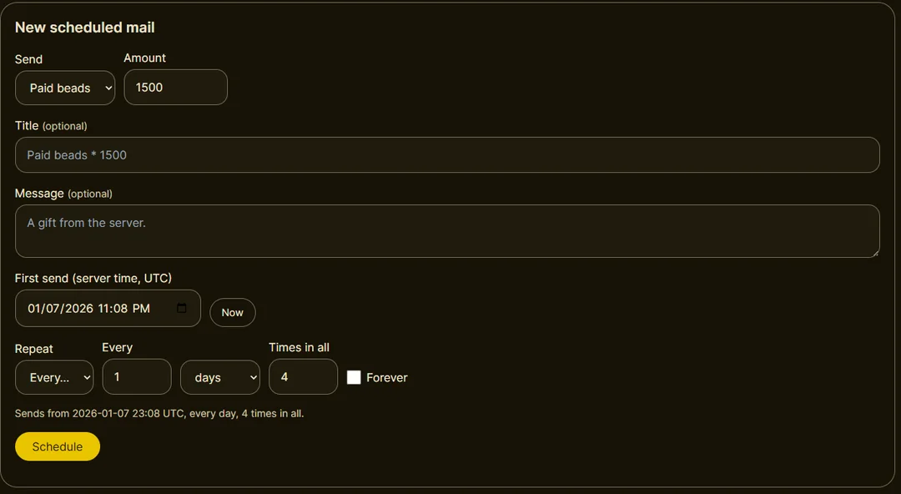
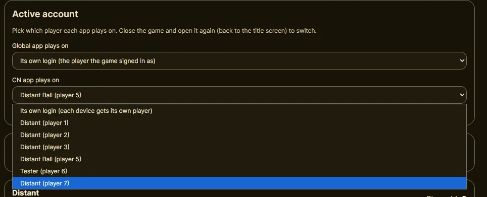
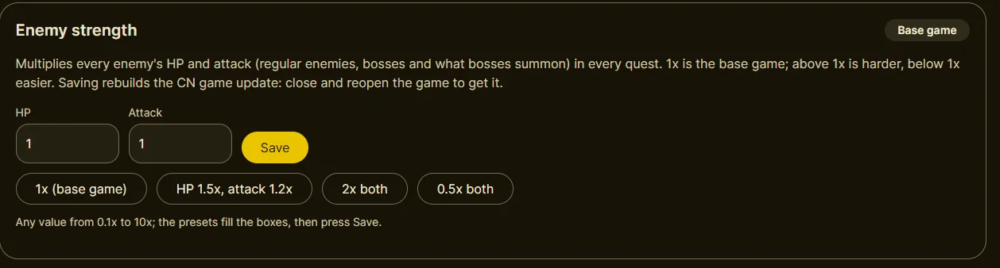
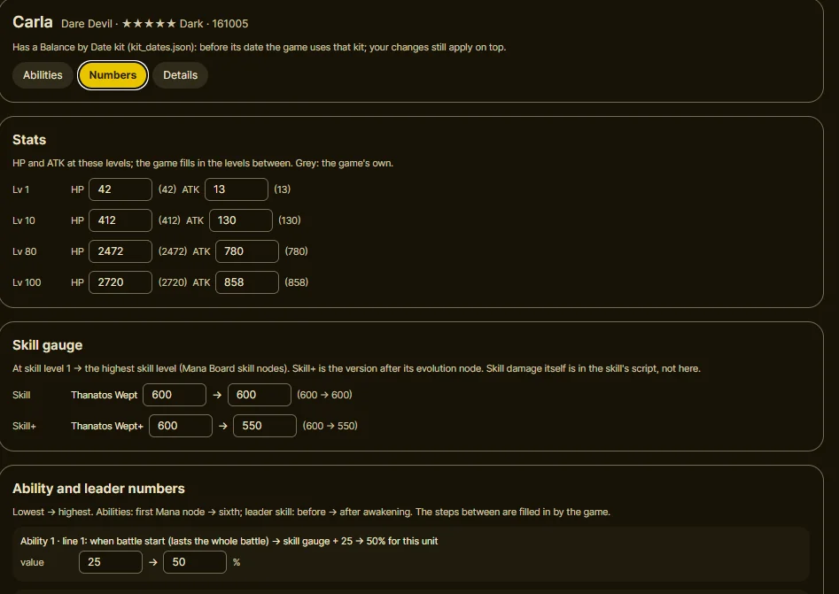
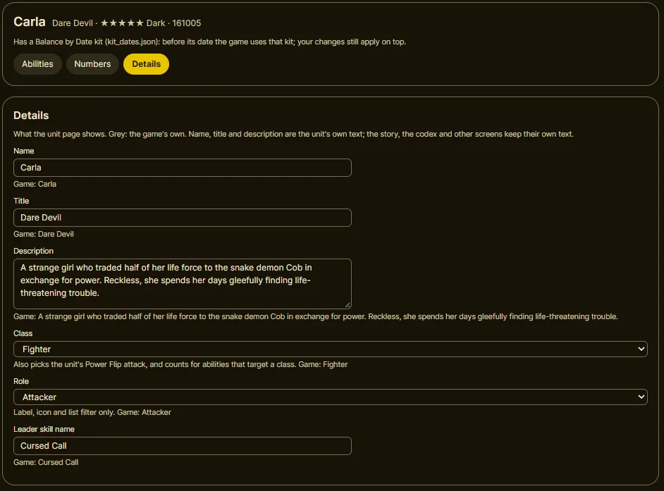

# Dashboard guide

The GlobalPoint dashboard, tab by tab and job by job.

**Opening it:** with the server running, go to **http://127.0.0.1:8000** in a browser on the same PC,
or tap **Dashboard** in StarPoint Companion (that's the phone's own server, not the PC's). **Times are
UTC** everywhere on the dashboard.

**Changes reach the game at its title screen.** After a change to events, summons, campaigns, enemy
strength, units or the date, close the game fully and open it again: it downloads a small update.
The server builds it in the background, so wait a minute or two on a PC (a few minutes on a phone).
The bottom of the sidebar, on every tab, shows the server time, the real time, when the next daily reset
is, and the game update: **Rebuilding the game update** (wait before opening the game) or **Game update
ready**. On a phone, the menu button in the bar at the top opens the tabs and this block; the bar's dot
shows the game update (olive ready, yellow rebuilding, red can't reach the server).
On long pages (Events, Summons), a round **↑** button in the bottom-right corner, shown once you've scrolled
a screen down, goes back to the top.

| Tab | What it's for |
|---|---|
| **Overview** (first tab) | [the server's date and time jumps](#go-to-another-date-and-back), [what's on now and next](#whats-on-now), playing on a phone over Wi-Fi |
| **Game settings** | [drops, enemy strength, summon rates, daily beads and mails, stamina, co-op rescues](#game-settings) |
| **Events** | [move any event](#move-an-event), CN-only ones included |
| **Summons** | [schedule summon banners](#schedule-a-summon-banner) |
| **Campaigns** | [yearly login bonuses, free pulls and stamina/reward campaigns](#repeat-a-yearly-campaign) |
| **News** | [posts on the in-game News board](#post-news) |
| **Mail** | [gifts that arrive at a set time, once or repeating](#schedule-mail) |
| **Players** | [gifts](#give-a-unit-an-item-an-armament-or-beads), [saves](#back-up-or-move-a-save), the active account, removing a unit |
| **Unit editor** | [change units' and armaments' abilities and numbers](#edit-a-unit-or-an-armament) |

---

## Go to another date, and back

**Overview**, the first tab, shows three clocks: the **server time** (the date the game plays on), the
**real time**, and when the **next daily reset** is (05:00 UTC by the real clock: the login bonus and daily
missions follow the real day, not the server's). Each also shows in your own time zone.

- Pick a date and time and press **Set time**; the clock keeps ticking from there.
- **+1 day** and **+1 week** move the server's date forward. **Next event** jumps to the start of the next
  event or summon banner (on its own dates or the ones you gave it). **Undo** goes back to the date before
  the last change.
- **More**: **Reset to the real time**, and **Match real time (keep date)**, which keeps the date but
  uses the real time of day, so the server's day turns over with the daily reset.

Close and reopen the game after changing the date. A jump doesn't give a login bonus or reset the dailies:
those follow the real day. New installs start on 2019-12-01, just before the CN game's first banners and
events.

## What's on now

The Overview lists the events and summon banners running at the server's date in the CN app (with how
long is left), and those starting in the next 7 days, with a **Jump to its start** link each. Things that
run for years, like the permanent portals and The Haunt, aren't listed. After CN's last events (2025),
nothing is listed unless you move events there.

## Move an event

1. Find the event (search, or filter by **Game**, **Kind** and **Show**). Set **Game** to **CN app**
   for the CN game's list.
2. Press **Schedule**, set **Starts** and **Ends** (or **Start now**, and **Original length** to keep
   its length), and **Save**. Its quests, missions, shop and tokens move with it. An event can run for up to
   10 years. A longer run stretches everything inside it to fit (its phases, shop and mission windows),
   and events over about a year are left out of **What's on** and the automatic News posts.

   
3. To move several, tick them and use **All start at (UTC)**; **Also move the summon banners that opened
   with them** moves their banners too. To start one of them at another time, fill in its **Own start
   (UTC)** in the picked list (each keeps its own length; **Use All start at** puts it back). Handy for
   banners, whose names repeat: pick them by their pictures, then give each its start. **Back to
   original dates** undoes a move.

## Schedule a summon banner

**Summons** works like Events, for unit and armament banners: **Schedule**, set the dates, **Save**. A
banner given dates here keeps them, even if an event it opened with moves later.

Many banners share a name (there are 181 "New Faces Spotlight Portal"s). Search a unit's or armament's
name to list the banners that feature it, e.g. **Bianca**.

## Repeat a yearly campaign

**Campaigns**: tick a seasonal login bonus, free pull, stamina or reward campaign to make it repeat every
year on its dates (untick to stop), then **Save**. Where two picked ones overlap, the longer one runs
that year.

## Give a unit, an item, an armament or beads

**Players** > a player > **Give**: choose **Character**, **Item**, **Equipment** (armament), **Paid
beads** or **Free beads**, find it with **Search by name** (or type its ID), type the amount and press
**Send Mail (in session)**. It arrives in the in-game mailbox. These mails last only while the server
runs, so claim them before restarting it; the **Mail** tab's are saved.

The player page also has **Unlock** / **Reset** a mission's reward, **Give login bonus again**, **Remove
a unit** (close the game first; it can't be undone, see
[CUSTOM_UNITS.md](CUSTOM_UNITS.md#removing-a-unit-safely)), and **Link my reinstalled game to this
player** (press it, then open the reinstalled game within 30 minutes).

**Save tools** on the player page (close the game first, then reopen it):
- **Clone save:** a full copy as a new player, everything included. Play it by picking it under **Active
  account**; handy for testing something, or keeping a save as it is.
- **Reset parties:** every normal party back to the game's default (the hero alone), if a party breaks the
  game.
- **Clear mailbox:** removes unclaimed mails without claiming them. The never-ending mails come back unless
  they're switched off on Game settings.
- **Reset account:** starts the save over as a brand-new player (the tutorial first) on the same account, so
  the game keeps playing it with no other setup. Everything in the save is lost (download it first to keep a
  copy). The new player has a new number; the page goes to it.
- **Delete save:** removes the player for good (download the save first to keep a copy). The save the game
  plays on can't be deleted: pick another one under **Active account** first.

## Schedule mail

**Mail**: gifts that arrive at a set server time, like the game's own maintenance gifts.
1. Pick what to send (beads, mana, EXP, or an item, unit or armament by name or ID) and the amount.
   Title and message are optional.
2. Set the **First send** (**Now** fills in the server's time) and **Repeat**: **Once**, or **Every** N
   days, weeks, months or years, a number of times or forever.
   **Also repeat the whole run every year** sends the run again each year from its first send's date
   (e.g. weekly for 6 weeks from 1 March, every March); for a run with an end, under a year long.
3. **Schedule**. The list shows each mail's next send; **Edit** changes it, **Delete** stops it.

**Share a schedule:** tick mails and **Export ticked** (or **Export all**) for one `.json` file of what is
sent and when (not who got what). **Import a file…** adds someone else's next to yours, each checked like
one you made; a unit your setup doesn't have (another setup's custom unit) is refused with the reason.
When some of the imported mails' first send times have already passed, it asks: **Send them now** (one
of each right away) or **Start each at its next time**.

Each mail can be claimed for 30 days. It goes to the active save (Players > **Active account**), or with
**Send to every save** ticked to every save (each gets it the next time its mailbox opens), and
follows the server time, so moving the date makes due mails arrive. A first send already in the past
sends once right away, not every missed one. Mails survive restarts, and the companion's **Download
from PC** brings them with **My save**.

## Back up or move a save

- **Players** > a player > **Download Save** gives a JSON file; **Upload Save** puts one back. It works
  between any two servers.
- **Players** > **Active account** picks which player each app plays on (reopen the game to switch).

  

- **On a phone:** the companion's **Export save** / **Import save**. To bring a PC save over, tick **My
  save** in **Download from PC**.

## Post news

**News** > **New post**: a title, the text (a blank line between paragraphs), the **Category** (the CN
app's News tab) and **Show in**, then **Post**. Players see it the next time they open News.

**Automatic event posts** (on by default; the switch is at the top of the News tab): the CN app's News board
announces events and summon banners under its **Events** tab, each with its picture: **Coming soon**
(starting within 7 days), **Now on**, and **Ended** (for 7 days after), newest first, up to 100. They follow
the server's date, moved events and time jumps included, and nothing is stored: they come and go by
themselves. Banners that open with an event are in its post. Your own posts sit next to them.

**Open the News board once a day** (on by default, under the automatic posts switch): like the live game's
daily news, the first time the CN app opens after the daily reset (05:00 UTC) it shows the News board after
the login bonuses. Opening the game again the same day goes straight home. Not during the tutorial.

## Game settings

- **Quest drop amount:** 1x (default) is the base game's amounts; original StarPoint gave 10x. Up to
  100x; applies from the next quest.
- **Enemy strength:** every enemy's HP and attack, 0.1x to 10x each (presets: 1x, HP 1.5x / attack
  1.2x, 2x, 0.5x). Above 1x is harder. Reopen the game after saving.
- **Paid beads with each daily login bonus:** 150 by default; 0 turns it off.
- **Never-ending mails:** Bread, Mana and EXP x1500 that can be claimed again and again; untick one to
  remove it.
- **Stamina (Spend stamina like the real game):** off by default, so battles never cost stamina. On: each
  battle costs its stamina when it starts (half-cost stamina campaigns included, CN app), retiring gives
  it back, stamina refills 1 point every 6 minutes (faster at higher ranks) up to your rank's maximum,
  ranking up adds the new maximum on top, and stamina items or 50 beads (100 stamina) refill it. Close and
  reopen the game after changing it.
- **Co-op rescues (Count co-op clears as rescues):** on by default (CN app). Every cleared co-op battle
  counts as joining someone else's battle as a backup, like the live game: it pays 10 Silver, Gold or
  Lilac Nuggets (harder battles pay better ones) and counts for the "clear battles as a backup" missions.
  Boss battles, advent events, world story boss battles, raids and hard multi battles pay nuggets.
- **Summon rates:** the 5★ and 4★ chance per pull for **Unit banners**, **Star Fest / Meteor Festival**
  and **Armaments** (3★ is the rest). **Base game rates** restores 5% / 25%, and 7.5% / 25% for Star
  Fest and Meteor Festival. Pulls follow from the next pull; the game's own **Rates** screen (and its
  guaranteed-slot page) shows the new numbers after the game update rebuilds: close and reopen the game.

## Edit a unit or an armament

**Unit editor** works for every CN unit and armament, and for custom units. No ids change, so saves are
safe. The full guide is [UNIT_EDITOR.md](UNIT_EDITOR.md).
1. Pick a unit (or switch **Units / Armaments** at the top).
2. Edit a tab: **Abilities** (each ability and the leader skill, one line per effect; **In game** shows
   it in the unit page's words), **Numbers** (HP/ATK, skill gauge, every min → max), or **Details**
   (name, title, description, class, role).

   

   

   
3. **Save** (greyed out while a line breaks a rule), then reopen the game.

**Mode** at the top: **Default** offers what CN's own units use; **Advanced** allows any combination of
those; **Unrestricted** adds parts CN never uses, which may not work or may crash the game. **Edited
units and kits** shares edits as kit files. **Reset unit to game** undoes the editor's changes. On a
phone the editor works in the companion too; with a PC, **Download from PC** replaces the phone's
edits, so edit on one side only.

New units are added with files: see [CUSTOM_UNITS.md](CUSTOM_UNITS.md).

---

## Gotchas

- **The date changes how units play:** Mana Board 2, awakening, EX Boost and kits follow it
  ([balance by date](DETAILS.md#balance-by-date)). A unit already on Mana Board 2 keeps it.
- **Opening the game too soon** after a change can give an error (like C8601) or the old dates: close
  it, wait a minute, open it again.
- **Yearly copies follow the clock:** repeating campaigns and The Haunt's monthly floors are built for
  the game year and one year either side. Moving further means a small download at the next title
  screen.
- **JP and CN dates mixed in one event:** CN's data dates the events before CN's launch (2021) with JP's
  dates, but some of their parts with CN's own, about 640-690 days later (and the other way round for a few
  later events): the first Serpents' and Not Today, Romero's shops, the anniversary quests' daily attempts,
  Trial by Water's missions, some home banners and announcements. GlobalPoint puts those parts on their
  event's dates (keeping their length), moved or not.
- **Boss events 100006 and 100007** are different events in each game: on the CN app they're CN's own (The
  Leap of Haruhi Suzumiya, a Lightcrest Serpent rerun), listed under their own entries.
- **The Haunt** opens on 2020-01-12 and stays open, with a fresh set of floors every month.
- **There's no login.** With `LISTEN_HOST` at `127.0.0.1` (the default) only the same device can reach
  the dashboard; `0.0.0.0` (needed to copy to a phone, and for setup 2) opens it to your whole network, so use that only on a
  network you trust.
