# 控制台指南

> 本页是 [DASHBOARD.md](DASHBOARD.md) 的中文版，由 Claude（AI）翻译。两者内容相同；如有出入，以英文版为准。

GlobalPoint 的控制台，按标签页和按任务说明。

**打开方法：** 服务器运行时，在同一台电脑的浏览器里打开 **http://127.0.0.1:8000**，或在 StarPoint Companion 里点 **控制台**（手机自己的服务器）。
控制台上的 **时间全部是 UTC**。

**更改在游戏的标题画面生效。** 更改活动、扭蛋、限时活动、敌人强度、角色或日期后，完全关闭游戏再打开：它会下载一个小更新。服务器在后台生成它，
所以请等一两分钟（手机上几分钟）。

侧边栏底部显示服务器时间、现实时间、下次每日重置，以及游戏更新：**游戏更新已就绪**，或 **正在重建游戏更新**（先别打开游戏）。**管理面板语言**
把控制台切换为 English 或简体中文（没有选择时跟随浏览器）。

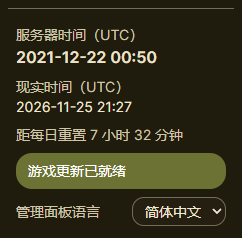

在手机上，顶栏的菜单按钮打开各标签页；它的圆点在更新就绪时是橄榄色，重建时是黄色，连不上服务器时是红色。长页面上，圆形的 **↑** 按钮可以回到顶部。

| 标签页 | 用途 |
|---|---|
| **概览** | [服务器日期](#改到其他日期再改回来)、[当前开放](#当前开放)、通过 Wi-Fi 在手机上游玩 |
| **游戏设置** | [游戏语言、掉落、敌人强度、扭蛋概率、每日星导石、体力等](#游戏设置) |
| **活动** | [移动任意活动](#移动活动)，包括国服独有的 |
| **扭蛋** | [安排扭蛋](#安排扭蛋) |
| **限时活动** | [每年的登录奖励、免费抽取和体力 / 奖励活动](#每年重复限时活动) |
| **公告** | [游戏内公告栏的帖子](#发布公告) |
| **邮件** | [礼物：立即或定时，一次或重复](#定时邮件) |
| **玩家** | [存档](#备份或搬移存档)、当前账号、[玩家工具](#玩家页面工具) |
| **角色编辑器** | [修改角色和装备的能力、数值和技能](#编辑角色或装备) |

---

## 改到其他日期，再改回来

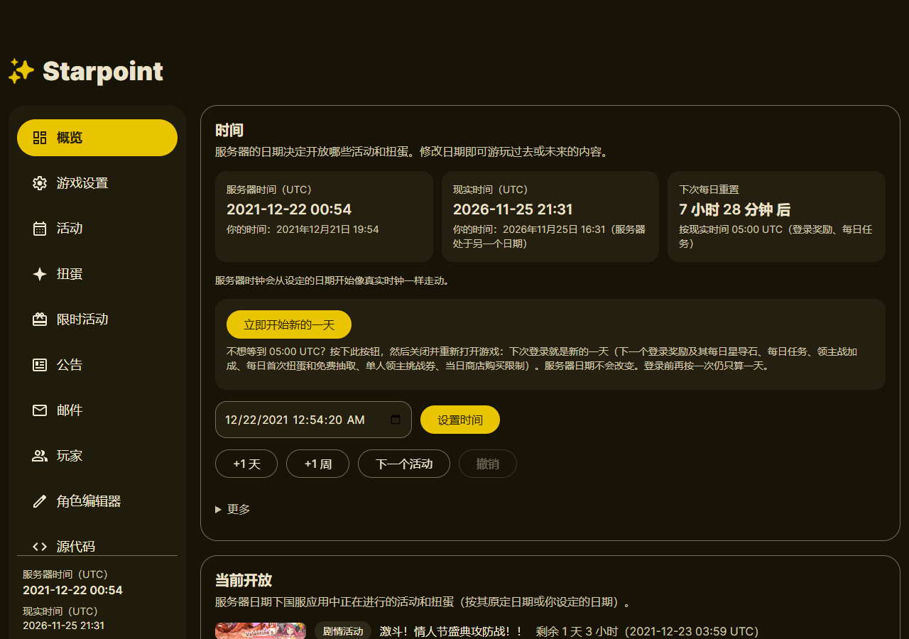

**概览** 显示 **服务器时间**（游戏所在的日期）、**现实时间** 和 **下次每日重置**（按现实时钟 05:00 UTC）。

- 选一个日期和时间，按 **设置时间**；时钟会从那里继续走。
- **+1 天**、**+1 周** 和 **下一个活动**（下一个活动或扭蛋的开始）把日期往后移；**撤销** 回到之前的日期。
- **更多**：**恢复为现实时间**，或 **对齐现实时间（保留日期）**（保留日期，用现实的时刻，这样服务器的一天和每日重置一起切换）。

改日期后请关闭并重新打开游戏。

**改日期不会给登录奖励，也不会重置每日任务**：它们跟随现实的日子。**立即开始新的一天** 让每个存档的下次登录算作新的一天（登录奖励和每日星导石、
每日任务、领主战加成、每日首次扭蛋和免费抽取、单人领主挑战券、商店购买限制）。日期不变；登录前按两次仍只算一天。

新安装从 2021-10-26（国服开服）开始。国服从未举办的活动（日服独有）在 2020 年。

## 当前开放

概览列出服务器日期正在进行的活动和扭蛋（带剩余时间），以及之后 7 天内开始的，每个都有 **跳到开始时**。持续多年的（常驻扭蛋、The Haunt）不列出。
国服最后的活动（2025 年）之后，除非你把活动移过去，否则列表是空的。

## 移动活动

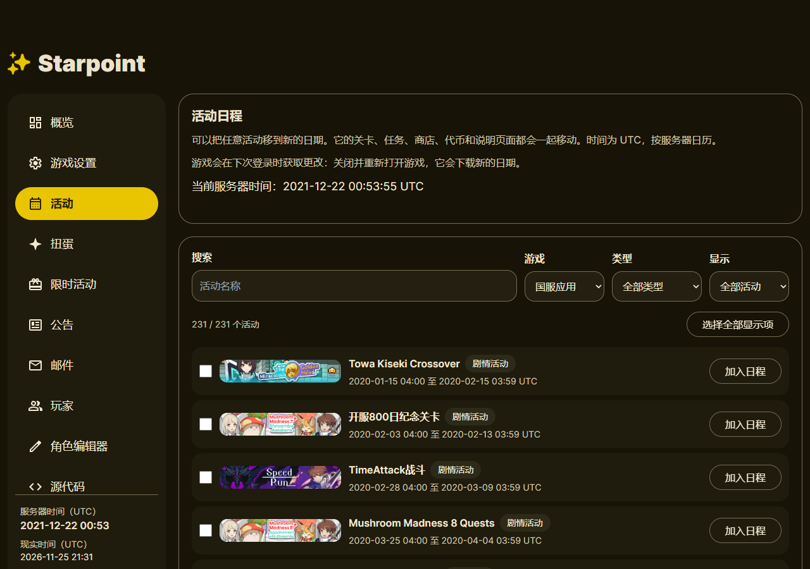

1. 找到活动：搜索，或按 **游戏**（国服游戏选 **国服应用**）、**类型** 和 **显示** 筛选。
2. 按 **加入日程**，设置 **开始** 和 **结束**（或 **立即开始**；**原本时长** 保持原来的长度），然后 **保存**。它的关卡、任务、商店和代币会一起移动，
   勾选的话，与它一起开放的扭蛋也会移动。

   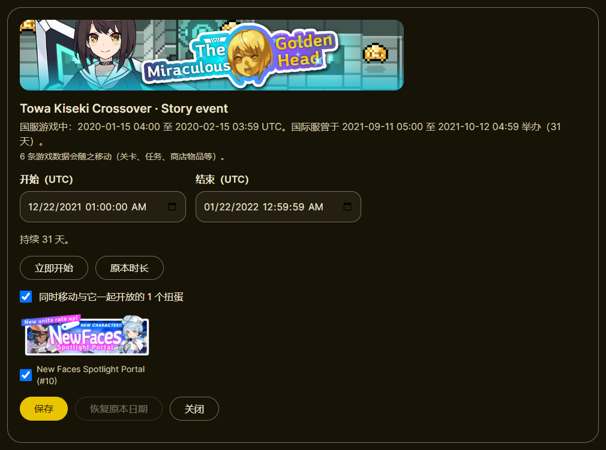

   - 活动只在服务器日期处于它的日期之内时才在游戏里显示。保存后，摘要会说明它的状态（**进行中**、**N 天后开始**、**已结束**），并有一个把服务器日期移到
     它开始时的按钮。
   - 活动最长可以持续 10 年；长于约一年的活动不会列在当前开放和自动公告里。
3. 要移动多个，勾选它们并用 **全部开始于（UTC）**。用 **单独的开始时间（UTC）** 给某一个单独的开始（各自保持自己的长度）。**恢复原本日期** 撤销移动。

## 安排扭蛋

**扭蛋** 的用法和活动一样，适用于角色和装备扭蛋。在这里设了日期的扭蛋会保持这些日期，即使它的活动之后移动了。很多扭蛋同名（有 181 个
「New Faces Spotlight Portal」）：搜索角色名，例如 **碧安卡**，即可列出有它的扭蛋。

## 每年重复限时活动

**限时活动**：勾选季节登录奖励、免费抽取、体力或奖励活动，让它每年在原来的日期重复，然后 **保存**。两个重叠时，那一年运行较长的那个。

## 游戏设置

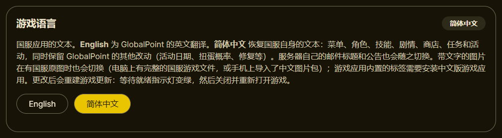

- **游戏语言：** English（默认）或简体中文，用于国服应用。中文会还原国服自己的文本，同时保留 GlobalPoint 的其他全部改动。等待就绪指示灯，然后重新打开游戏。
  见 [CHINESE.md](CHINESE.md)。
- **关卡掉落倍率：** 1 倍（默认）是原版；最高 100 倍，从下一个关卡起生效。
- **敌人强度：** 所有敌人的生命值和攻击力，各 0.1 倍到 10 倍，带预设。保存后重新打开游戏。

  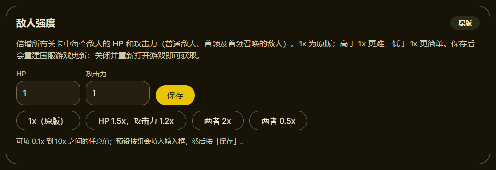
- **扭蛋概率：** **角色扭蛋**、**星祭 / 流星祭** 和 **装备** 的 5★ 与 4★ 概率。**原版概率** 恢复为 5% / 25%（祭典为 7.5% / 25%）。更新重建后，
  游戏的概率画面会显示新的数字。

  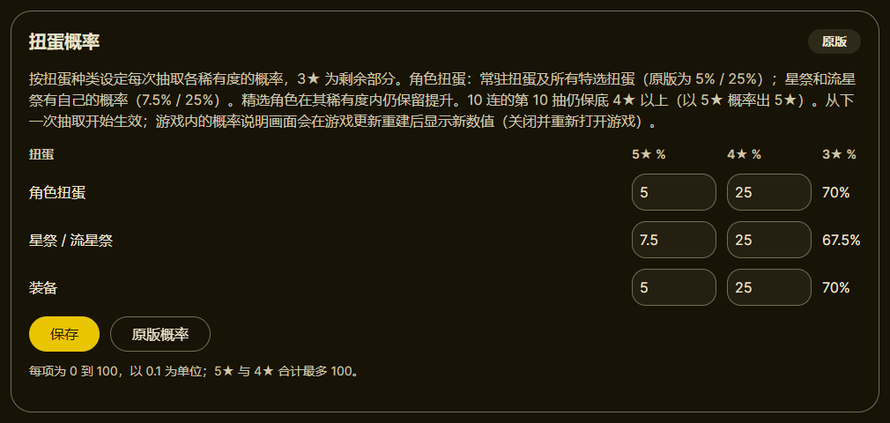
- **每日登录奖励附带的付费星导石：** 默认 150；0 为关闭。
- **用不完的邮件：** 面包、玛纳和经验 x1500，可以一直领取；取消勾选即可移除。
- **体力**（默认关闭：战斗不消耗体力）。开启后和正式游戏一样：战斗消耗体力，撤退会返还，每 6 分钟恢复 1 点，升级时回满，道具或 50 星导石可以恢复。
  更改后请重新打开游戏。
- **协力救援**（开启）：你通关的每场协力战斗都算作救援，获得 10 个银、金或紫金块，并计入救援任务。
- **等级上限**（开启）：等级停在国服在服务器日期时的上限（开服起 100，2021-12-16 起 125，2022-06-16 起 150，2023-02-02 起 175，2024-05-09 起 250）。
  关闭：任何日期都可到 250。
- **回归玩家奖励**（开启）：服务器时间离开 30 天以上的存档，会获得国服在那个日期开放的回归玩家登录奖励，每种一次。

## 发布公告

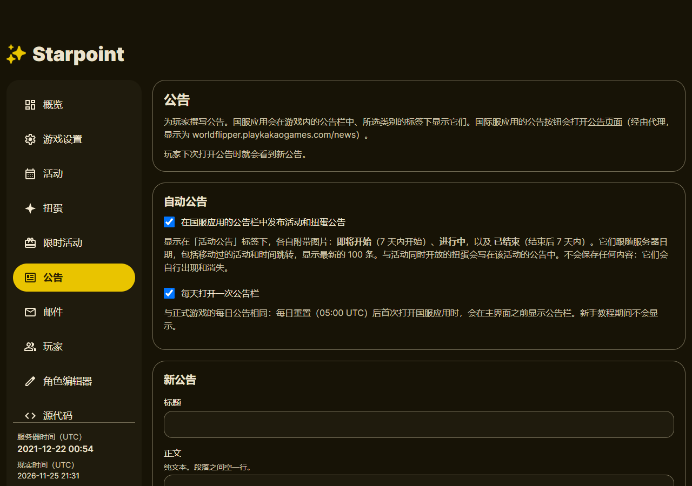

**公告** > **新公告**：标题、正文（段落之间空一行）、**类别**（国服应用的公告标签）和 **显示于**，然后 **发布**。玩家下次打开公告时就会看到。

- **自动公告**（默认开启）：公告栏会自动发布活动和扭蛋的公告，带图片：**即将开始**（7 天内）、**进行中** 和 **已结束**（结束后 7 天内）。它们跟随服务器日期。
- **每天打开一次公告栏**（默认开启）：和正式游戏一样，每日重置后第一次启动时，会在登录奖励之后显示公告栏。

## 定时邮件

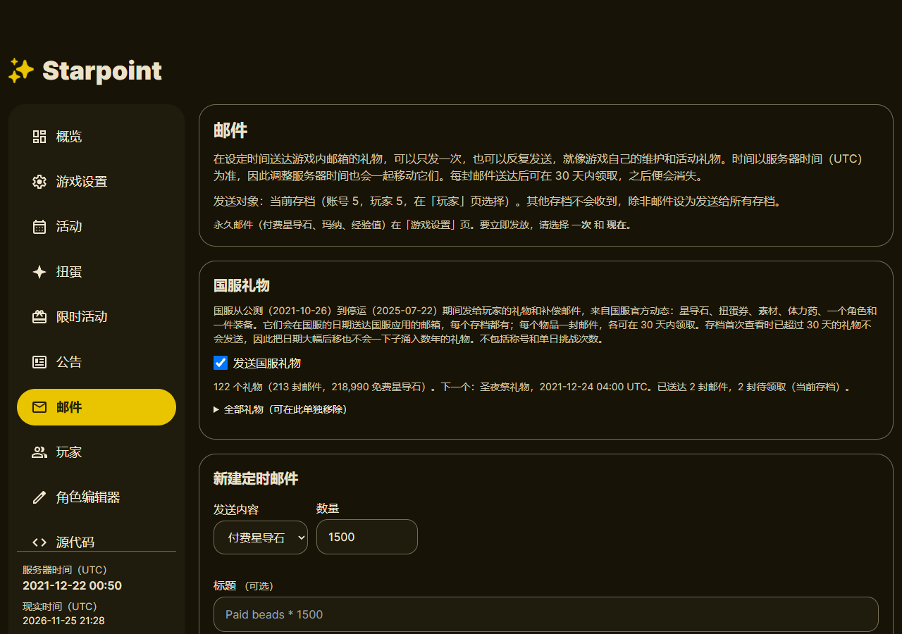

1. 选择要发送的东西（星导石、玛纳、经验，或按名称或 id 选道具、角色、装备）和数量。标题和内容可选。
2. 设置 **首次发送**（**现在** 填入服务器时间）和 **重复**：**一次**，或 **每** N 天、周、月或年，指定次数或永远。**同时每年重复整个流程** 每年再发送一轮。
3. 按 **加入日程**。列表显示每封邮件下次发送的时间；**编辑** 修改它，**删除** 停止它。

要立即给东西，选 **一次** 和 **现在**。它会发给当前存档（玩家 > **当前账号**），勾选的话发给所有存档。每封邮件可以在 30 天内领取，邮件跟随服务器时间。

**分享日程：** **导出勾选项** / **全部导出** 得到一个 `.json` 文件；**导入文件…** 加入别人的邮件（含有你这里没有的角色的邮件会被拒绝）。

**国服礼物**（默认开启）：国服在 2021-10-26 到 2025-07-22 之间发给玩家的 122 份礼物和补偿邮件（213 封邮件，约 219,000 星导石，以及扭蛋券、材料、
一个角色和一件装备），按国服的日期发给每个存档。存档第一次查看时已超过 30 天的礼物不会发送。**全部礼物** 列出它们；**移除** 停止其中一份。

## 备份或搬移存档

- **玩家** > 某个玩家 > **下载存档** 得到一个 JSON 文件；**上传存档** 把它放回去，任何服务器都可以。
- **玩家** > **当前账号** 选择每个应用使用的玩家（重新打开游戏即可切换）。重装游戏后在这里选回你的玩家。

  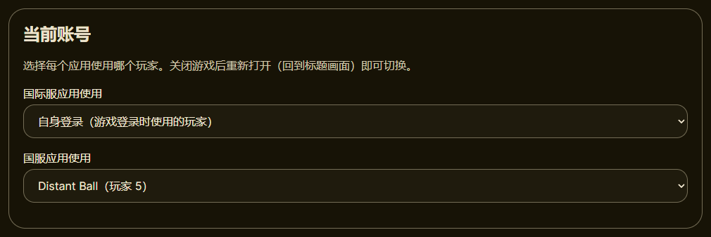
- **手机上：** StarPoint Companion 的 **导出存档** / **导入存档**。要把电脑上的存档搬过来，在 **从电脑下载** 里勾选 **我的存档**。

## 玩家页面工具

使用前先关闭游戏，之后再打开。都无法撤销。

- **解锁全部章节：** 把每个主线关卡标记为已通关（没有通关奖励）。
- **设置等级：** 1 到 250 的任意等级（没有升级奖励）。
- **协力队友：** 从这个存档的队伍里选最多两个作为你的 COM 队友（不用重启）；**清除** 恢复通常的顺序（[DETAILS.zh-CN.md](DETAILS.zh-CN.md#协力队友)）。
- **解锁** / **重置** 任务的奖励，以及 **移除角色**（[CUSTOM_UNITS.zh-CN.md](CUSTOM_UNITS.zh-CN.md#安全地移除角色)）。
- **存档工具：**

  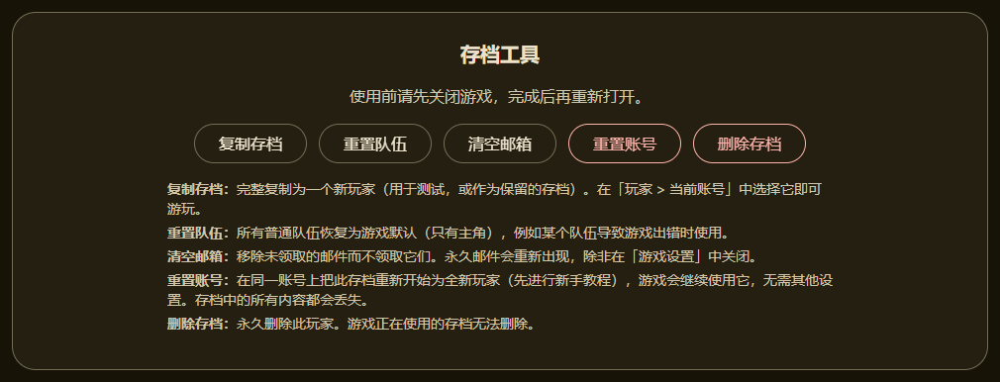

## 编辑角色或装备

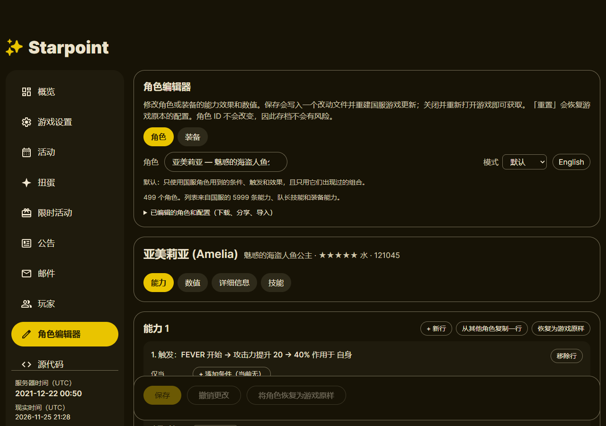

**角色编辑器** 适用于每个国服角色和装备，以及自制角色。id 不会变，所以存档是安全的。完整指南见 [UNIT_EDITOR.zh-CN.md](UNIT_EDITOR.zh-CN.md)。
1. 选一个角色（或切换到 **装备**）。
2. 编辑一个标签页：**能力**（每个效果一行；会按角色页面的措辞显示游戏中的说明）、**数值**（生命值 / 攻击力、技能槽、每个最小 → 最大）、**详细信息**
   （名称、称号、介绍、职业、职责）或 **技能**（技能做什么，带 ▶ 预览技能；见 [SKILL_GUIDE.zh-CN.md](SKILL_GUIDE.zh-CN.md)）。

   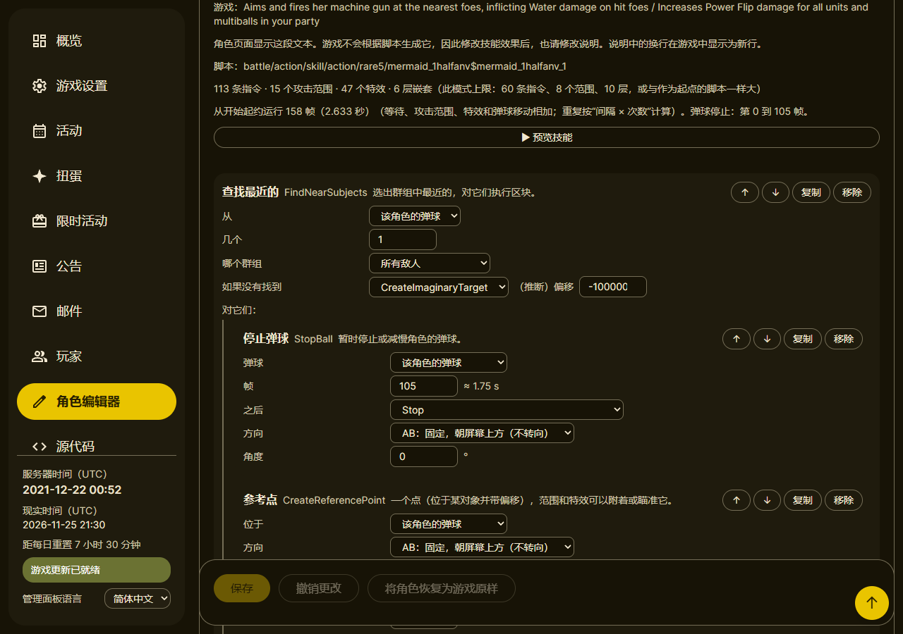
3. **保存**（有一行违反规则时为灰色），然后重新打开游戏。

**模式：** **默认** 只提供国服自己的角色用过的内容；**进阶** 允许这些内容的任意组合；**不受限** 加入国服从未用过的部分（可能无效，或让游戏崩溃）。
**已编辑的角色和配置** 把修改作为文件分享。**将角色恢复为游戏原样** 撤销编辑器的修改。手机上的 StarPoint Companion 里也能用编辑器；**从电脑下载**
会替换手机上的修改，所以只在一边编辑。新角色：[CUSTOM_UNITS.zh-CN.md](CUSTOM_UNITS.zh-CN.md)。

---

## 注意事项

- **日期会改变角色的玩法：** 玛纳板 2、觉醒、EX 突破和配置都跟随日期（[按日期的平衡](DETAILS.zh-CN.md#按日期的平衡)）。
- **更改后太早打开游戏** 可能出现错误（例如 C8601）或旧的日期：关闭它，等一分钟，再打开。
- **每年的副本跟随时钟：** 重复的限时活动和 The Haunt 每月的楼层是为游戏所在年份及前后各一年生成的；更远的话，下次到标题画面时会下载一个小更新。
- **同一活动里的日服和国服日期：** 一些 2021 年之前的活动有部分内容使用国服自己的日期，晚 640-690 天。GlobalPoint 会替你把这些部分移到活动的日期上。
- **领主战活动 100006 和 100007** 在两个应用里是不同的活动；在国服应用里是国服自己的。
- **没有密码。** `LISTEN_HOST` 为 `127.0.0.1`（默认）时，只有本机能打开控制台。`0.0.0.0`（方式 2、复制到手机）会向整个网络开放：只在你信任的网络上使用。
