# Installing GlobalPoint

Every setup in full, with what to do when something goes wrong. The [README](../README.md) has the
short version. **Most people want setup 1**: the game and its server on one Android phone or
emulator, with nothing on a PC.

- [Which setup](#which-setup)
- [Downloads](#downloads)
- [1. Phone or emulator](#1-phone-or-emulator) (the main way)
- [2. Phone with a PC server](#2-phone-with-a-pc-server)
- [3. PC only: an emulator with a PC server](#3-pc-only-an-emulator-with-a-pc-server) (custom units, development)
- [Installing the server on a PC](#installing-the-server-on-a-pc) (for setups 2 and 3)
- [Updating the server on a PC](#updating-the-server-on-a-pc)

## Which setup

| | Server | Game | For |
|---|---|---|---|
| **1. Phone or emulator** | on the device (StarPoint Companion) | the same device | playing: the main way |
| **2. Phone with a PC server** | your PC | a phone | keeping the server and your save on the PC |
| **3. PC only** | your PC | an emulator on the same PC | custom units, or working on GlobalPoint |

An emulator only emulates Android, so on a PC setup 1 is simply setup 1 inside an emulator. Setups 2 and
3 need [the server installed on a PC](#installing-the-server-on-a-pc).

The game app is **build 25** of the patched CN app. By default it talks to `127.0.0.1:8000`: the
companion on the same device (setup 1), or the PC's server through the emulator (setup 3). A small
`server.txt` file on the phone points it at your PC instead (setup 2). That takes the place of original
StarPoint's mitmproxy route, which only worked for the global app.

## Downloads

| File | What it is | Where | Size |
|---|---|---|---|
| **World Flipper (game) APK** | the patched game app (build 25; installs over builds 23 and 24), for every setup | [Google Drive](https://drive.google.com/drive/folders/1EdY0GajMm-v6c219s02ZnuEz0u_0XdOO) | 139 MB |
| **StarPoint Companion APK** | the server-on-your-phone app (0.8.4), for setup 1 (phones and emulators) | [Google Drive](https://drive.google.com/drive/folders/1EdY0GajMm-v6c219s02ZnuEz0u_0XdOO) | 76 MB |
| **OBB in 3 parts** (`main.1008001.com.leiting.wf.part1of3.obb`, `part2of3`, `part3of3`) | every game file (game files 1.4.800, up to date), for setup 1; download all three | [Google Drive](https://drive.google.com/drive/folders/1EdY0GajMm-v6c219s02ZnuEz0u_0XdOO) | 3.6 GB each |
| **OBB** (`main.1008001.com.leiting.wf.obb`), the alternative | the same as one 10 GB file (game files 1.4.203: older, the game updates after unpacking), for phones and file apps that handle one big file | [Google Drive](https://drive.google.com/drive/folders/1EdY0GajMm-v6c219s02ZnuEz0u_0XdOO) | 10.3 GB |
| **`starpoint-data.zip`** | GlobalPoint's English tables, game updates (art and text patches), schedule files, dashboard pictures and news. Setup 1 imports it into the companion; a PC server unzips it into its folder | [Google Drive](https://drive.google.com/drive/folders/1EdY0GajMm-v6c219s02ZnuEz0u_0XdOO) | 2.25 GB |
| **Comics zip** (optional) | the in-game comics, used the same way as `starpoint-data.zip` | [Google Drive](https://drive.google.com/drive/folders/1EdY0GajMm-v6c219s02ZnuEz0u_0XdOO) | 1.4 GB |
| **CN game files** (CN CDN 1.4.54) | the official CN game's files, for a PC server (setups 2 and 3): six parts `cn-cdn.tar.part.00` to `05`, plus `SHA256SUMS.txt` | [dennis96292/.cdn, release cdn-1.4.54](https://github.com/dennis96292/.cdn/releases/tag/cdn-1.4.54) | ~10.1 GB |
| **GlobalPoint** (this repository) | the server, the dashboard and the scripts | `git clone`, or **Code > Download ZIP** on GitHub | small |

Everything except the CN game files and the repository is on [Google Drive](https://drive.google.com/drive/folders/1EdY0GajMm-v6c219s02ZnuEz0u_0XdOO), and all of it except the
single-file OBB is also on [MEGA](https://mega.nz/folder/fWRATYbJ#z8wtDI7krmKgBn2HL_s0jg).

You can also build the OBB yourself on a PC with the server installed.

### Checksums

SHA-256 of the downloads, to check one (`certutil -hashfile <file> SHA256` on Windows,
`sha256sum <file>` elsewhere):

```
a57b1629b3564aa600cfaa9b1bbc88794a36eb1214b58f58238986dc0f0aebb7  main.1008001.com.leiting.wf.part1of3.obb
343438b6ee2debb1843609acbf386b2cf977d23a6ea018485e22e6d48a5fc453  main.1008001.com.leiting.wf.part2of3.obb
b3676a2042c945b26b7c0bfa1bd1127cb15e07984d7b2b47971c8b0d4aa9e412  main.1008001.com.leiting.wf.part3of3.obb
5494b5a79f6508068c133c6ebd971862b1f0aaef1e6d0b2955d85a76eca1f697  main.1008001.com.leiting.wf.obb (the single file)
8637a682ab1439e8c62040ebe9a4ce47b3b3ec28b4f1f65c4ba00f5332a6e393  starpoint-data.zip
7409b79cbe56c8c7ff05e48755904c7c35fb9677914925607a474f5a33424174  starpoint-comics.zip
198f2b4fb31568e2050ca5e1989d711ff63077494b21ff990562263c0ff0774e  World Flipper (game) APK, build 25
```

## 1. Phone or emulator

**The main way to play.** The game's files come from the **OBB**, and **StarPoint Companion** runs the
server on the same device, so nothing runs on a PC. It works the same on a phone and in an Android
emulator; on an emulator, "the phone" below means the emulator.

The emulator must run ARM64 apps, as the game and the companion are ARM64; most modern emulators do,
by translating them. Known so far: **LDPlayer 9** works (tested), and **MuMu** works with an
**Android 12** instance (a player saw hiccups with its Android 15 instance; not yet clear why). If one
emulator gives trouble, try its Android 12 instance or another emulator.

The phone plays on its own: the game's files come from the **OBB** (every game file, ~10.3 GB), and
**StarPoint Companion** runs the server on the phone. StarPoint Companion can do the setup for you
with one button (**Set up everything**); the [steps by hand](#by-hand) still work the same way.

**Downloads** (from the [Google Drive folder](https://drive.google.com/drive/folders/1EdY0GajMm-v6c219s02ZnuEz0u_0XdOO)):
- the **game** APK (build 25) and the **StarPoint Companion** APK (0.8.4 or newer);
- the **OBB**: the 3 parts `part1of3` / `part2of3` / `part3of3` (~3.6 GB each, game files 1.4.800, up to
  date), or the single `.obb` (10.3 GB, game files 1.4.203: older, the game updates itself after
  unpacking). Either works; the 3 parts are newer and easier to download;
- **`starpoint-data.zip`** (the server's data), and the comics zip if you want comics.

Or build the OBB yourself on a PC with [the server installed](#installing-the-server-on-a-pc), in its folder (needs ~10.3 GB free; leave out `--parts 3` for
one file):
```bash
node scripts/build_cn_obb.cjs <output folder> --parts 3
```

### The easy way: one button

1. **Download the files** to the phone: the OBB, `starpoint-data.zip`, and the comics zip if you want
   comics. Leave them in the phone's **Download** folder, where the browser saves them (or copy them
   there from a PC over USB). Don't unzip or rename anything.
2. **Install both APKs**: World Flipper and StarPoint Companion. **Don't open the game yet.**
3. **Open StarPoint Companion** and tap the button at the top, **Setup (set up everything, or check)**.

   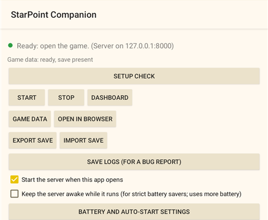
4. **Tap Set up everything.**

   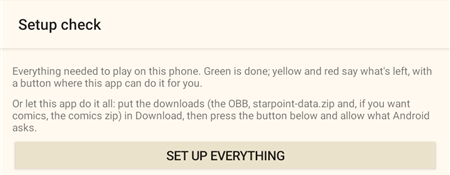

   Then do what it asks:
   - **Android asks** to let StarPoint Companion use the phone's storage: tap **Allow**. (On Android 11
     and newer it opens the **All files access** page instead: switch it on, then press Back.)
   - **It opens World Flipper's settings.** The game is listed under its Chinese name, **世界弹射物语**.
     Turn on **All files access**, and under **Permissions** allow the storage permissions (on Android 13
     and newer: **Music and audio** and **Photos and videos**). Then press Back. The app carries on by
     itself.
   - **It shows a list of what it will do.** Tap **Go**.

     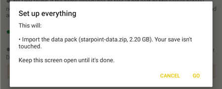
5. **Wait, and keep the screen open.** It checks the OBB isn't damaged and moves it where the game reads
   it, imports the data and comics zips, cleans up leftovers from an earlier setup and starts the server.
   This can take a few minutes.
6. **It asks whether to delete the zips** it imported. **Delete** frees the space; **Keep** is fine too.

   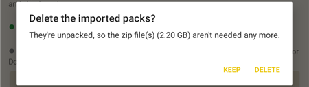
7. **It says All set.** If something is still missing (a download it couldn't find, or a damaged one), it
   says what instead, under **Still to do**.

   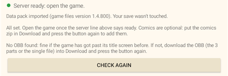
8. **Open the game** once the server line says **ready** (the main screen's light is **green: Ready**).
   The first time, it shows "Unpacking game files", unpacks the OBB by itself and deletes it when done.

### Step by step: Setup check

If **Set up everything** says something is missing, or you'd rather do each step yourself. (Some pictures
below are from an earlier version, where the main button read **Setup check** and the Setup screen had no
**Set up everything** button; the list itself is the same.)

1. Put the downloads in **Download** and install both APKs, as above.
2. Open **StarPoint Companion**. The first time, its light is red and it says **Game data: missing**:
   that's expected.

   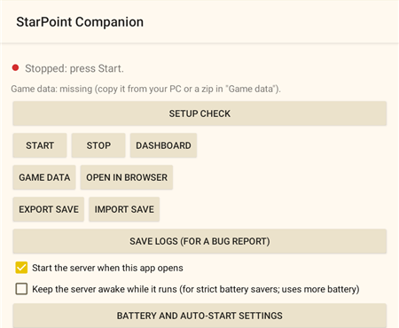

   Tap **Game data** > **Import pack...**, open **Downloads** in the file picker (the ☰ menu at the top
   left) and pick `starpoint-data.zip`. Then the comics zip the same way, if you have it. Or copy them
   from a PC server instead ([below](#copying-the-data-from-a-pc-instead)).

   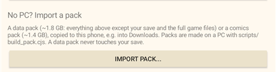
   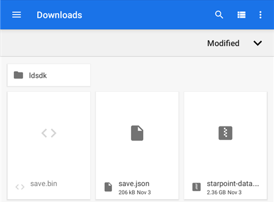

   A bar at the bottom shows the import (a minute or two). When it's done, the app asks whether to
   delete the zip: **Delete** frees 2.2 GB, and **Keep** is fine too.

   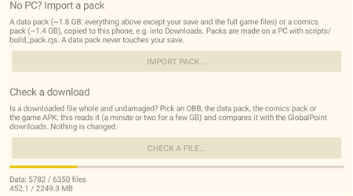
   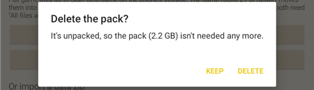
3. Go back and tap **Setup**. Each line is **green** (done), **yellow** (wait) or **red** (something
   left), with a button where the app can do it:

   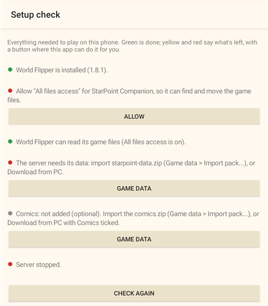

   - **Allow**: lets StarPoint Companion use the phone's storage, so it can find and move the OBB.
     Android asks; tap **Allow** (on Android 11 and newer it opens the **All files access** page: switch
     it on and come back).

     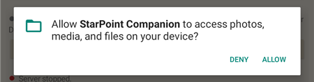
   - **Open World Flipper's settings**: turn on **All files access** and allow the storage permissions.
     Only you can flip these switches; the game never asks for them, and without them it can't see the
     OBB. In Android's settings the game is listed under its Chinese name, **世界弹射物语**, not "World
     Flipper"; the button takes you straight there. Open **Permissions** and switch the storage
     permission on.

     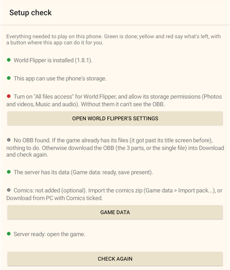
     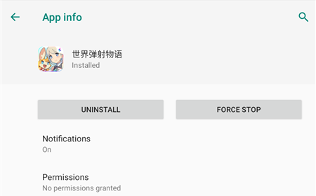
     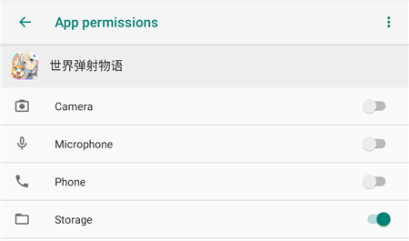

     (These pictures are from an Android 9 emulator. On Android 11 and newer there's also an **All
     files access** switch, and on Android 13 and newer Storage is split into **Music and audio** and
     **Photos and videos**: allow both.)
   - **Check and move it**: checks every OBB file is undamaged (a minute or two per few GB), then moves
     them into `starpoint_game` (made for you; instant, no extra space). If a file is damaged nothing is
     moved and it says which one to download again.
   - **Remove them**: leftover game files from an earlier setup, which would make the game's start very
     slow.
   - **Start**: starts the server, if it isn't running (yellow while it starts).
4. When every line is green, the main screen's light is **green: Ready**. Open the game (if it was
   already open, close it fully first). It shows "Unpacking game files", unpacks the OBB by itself and
   deletes it when done.

   

The light on StarPoint Companion's main screen: **green** = open the game; **yellow** = wait (the server
is starting, or it's rebuilding the game update after a change on the dashboard; a game opened meanwhile
would get the old update); **red** = stopped. **Game data > Check a file** checks any download (an OBB part,
the data pack, the comics zip, the game APK) without changing anything.

### By hand

1. Install the game APK (build 25). **Don't open it yet.**
2. At the top of internal storage, create a folder named exactly **`starpoint_game`**
   (`Internal storage/starpoint_game/`; `Internal storage/StarPoint/game/` works the same way).
3. Put the OBB in it: all three parts together, directly in that folder (not in a subfolder), or the
   single file. From a PC copy them over USB; already on the phone, **Move** them with the file app (Move,
   not Copy: a copy needs twice the space). Don't let anything compress or zip them. To check a download,
   compare its SHA-256 with the [list above](#checksums).
4. Android Settings > Apps > World Flipper (listed as **世界弹射物语**): turn on **All files access**, and under **Permissions** allow
   the storage permissions (as in [step 3 of Step by step](#step-by-step-setup-check)).
5. Install StarPoint Companion, import `starpoint-data.zip` (**Game data** > **Import pack...**), and
   start the server: the main screen should say **Server: running**. Tap **Let the server run in the
   background**, and allow notifications if asked.
6. Open the game, as in [step 8 of the easy way](#the-easy-way-one-button).

### Keeping the server running

If your phone stops the companion's server in the background, tick **Keep the server awake** on its main
screen, and try **Battery and auto-start settings** and **Allow usage access** there too. Your save lives
on the device: **Export save** / **Import save** in the companion move it.

### Copying the data from a PC instead

With [the server installed on a PC](#installing-the-server-on-a-pc) on the same Wi-Fi, the companion can
copy everything from it instead of using the downloads, your PC save included. You need ~25 GB free on
the phone.

1. On the PC, set `LISTEN_HOST="0.0.0.0"` in `.env` so the phone can reach the server, and start it.
   If Windows asks about the firewall, allow it on **Private networks**.
2. Find the PC's address: the dashboard's **Play on a phone over Wi-Fi** shows it, or run `ipconfig`
   and use the **IPv4 Address** line (it starts with `192.168.` or `10.`).
3. Install both APKs on the phone: the **game** and **StarPoint Companion**. If Android blocks it,
   tap **Settings** and turn on **Allow from this source**. **Don't open the game yet.**
4. Open **StarPoint Companion**, tap **Game data**, and type your PC's address with the port, e.g.
   `192.168.1.20:8000` (use your own; that one is only an example).
5. Tick **Full game files**, **My save** (to bring your PC account), **Game updates**, **Event
   schedule editing** and **Dashboard pictures**. Comics are optional.
6. Tap **Download from PC**. When asked, turn on **All files access** for the companion and press
   back. The copy starts by itself and takes a while (~12 GB).
7. On the same screen, tap the button that opens **World Flipper's "All files access"** page and turn
   it on. The game never asks for it itself.
8. On the companion's main screen, check that it says **Server: running**, then tap **Let the server
   run in the background**. Allow notifications if asked. If your phone still stops the server in
   the background, tick **Keep the server awake**, and try **Battery and auto-start settings** and
   **Allow usage access** on the same screen.
9. Open the game. The first start moves the game files into place (a few minutes), then you're in,
   with no download.

If the phone says **"failed to connect"**, the address is wrong or the PC's firewall is blocking
Node.js (allow it on Private networks in Windows Security > Firewall > Allow an app). A phone that
already has the game files (from the OBB) only needs the boxes other than **Full game files**.

From then on your save lives on the phone. Use **Export save** / **Import save** in the companion to
move it.

### If something goes wrong

**The game shows an error code** (like `U_f72d75` or `C8601`): in the companion, press **Save logs (for a
bug report)**, save the file, and send it with what you were doing. It holds the game's full crash report.

The phone needs only a little free space beyond the OBB: the game shrinks the OBB as it unpacks, and if
it's interrupted it carries on where it stopped next time. Setup check shows most of these too.

- **A part missing or cut short:** the game says so, e.g. "Game files part 2 of 3 is missing" or
  "...is incomplete: x of y GB", and unpacks nothing. Copy the missing part next to the others (or
  download it again) and reopen the game.
- **The single-file OBB is older** (game files 1.4.203). After it unpacks, the game downloads the rest
  from the companion once (~2 GB, from the phone itself, so it's quick). The 3 parts and an OBB you build
  yourself are already up to date.
- **Stuck on "Finding game files… (a number)" after unpacking:** a drop-off folder still holds loose
  game files from an earlier setup, usually a `download` folder in `StarPoint/game`, `starpoint_game` or
  `Android/obb/com.leiting.wf` (e.g. from the companion's **Full game files**). The game lists and moves
  every one of them, which takes very long and isn't needed: the OBB already has every file. Close the
  game fully, then Setup check > **Remove them** (or delete that `download` folder by hand, leaving any
  `.obb` there, even a small leftover `part1of3`), and reopen the game.
- **If the game asks to download ~10 GB**, or the title screen shows **ResVer null**, instead of
  "Unpacking game files", it can't see the OBB. Tap Cancel. Check that the OBB is directly in
  `starpoint_game/` and that World Flipper has **All files access** and the storage permissions (Setup
  check shows both). Close the game fully and reopen it. Nothing is lost.
- **The file names don't matter** when placing them by hand, as long as they end in `.obb` and sit
  directly in the folder. One renamed to `.obb.zip` doesn't work. (Setup check looks for the names as
  downloaded: `main.1008001.com.leiting.wf.obb` and `main.1008001.com.leiting.wf.partNof3.obb`, also
  with a browser's ` (1)` or `-1` or an added `.bin`. It looks in Download, Downloads and Documents, one
  folder deeper (some phones' browsers save to `Download/Browser` and the like), the top of storage, and
  the same on an SD card.)
- **`Android/obb/com.leiting.wf/` also works on some phones,** with no permissions needed (they don't
  apply there either way). What matters is which app wrote the file: some phones' file apps (Samsung's My
  Files, for one) leave it unreadable to the game. `starpoint_game` with the permissions above is the
  reliable route, and the one Setup check uses.
- **With a PC and adb**, `Android/obb` always works. If the folder doesn't exist yet:
  ```bash
  adb shell mkdir -p /sdcard/Android/obb/com.leiting.wf
  ```
  ```bash
  adb shell chmod 777 /sdcard/Android/obb/com.leiting.wf
  ```
  ```bash
  adb push main.1008001.com.leiting.wf.obb /sdcard/Android/obb/com.leiting.wf/
  ```
  (For the 3 parts, push each one the same way.)
  adb can't fix a folder a file app already made: rename or delete that folder first.
- **GrapheneOS:** give World Flipper **All files access**, not Storage Scopes. Scopes only shows an app
  the files it made plus ones you pick, and the game also has to shrink and delete the OBB.

## 2. Phone with a PC server

The phone plays against your PC's server, so your save stays on the PC and the PC must be on while
you play. First [install the server on the PC](#installing-the-server-on-a-pc). The game needs its files
too: on a fresh install it downloads ~12 GB from your PC, or put an OBB on the phone as in
[setup 1, by hand](#by-hand), steps 1-4.

**Over Wi-Fi (game build 23 or newer):**
1. On the PC, set `LISTEN_HOST="0.0.0.0"` in `.env` and start the server. Allow it if Windows asks
   about the firewall.
2. Open the dashboard on the PC (**http://127.0.0.1:8000**). Under **Play on a phone over Wi-Fi**,
   pick the PC's address (the one starting with 192.168 or 10) and tap **Download phone connection
   file**. You get `server.txt`.

   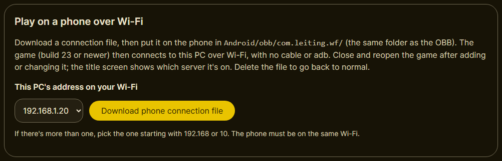
3. Put `server.txt` on the phone in `Internal storage/Android/obb/com.leiting.wf/` (make the
   folder if needed). You can send it to yourself, or download the file straight on the phone by
   opening the dashboard there at `http://<PC address>:8000`.

   Whether the game can read a file there depends on the app that wrote it, as with the OBB in
   setup 1. If the title screen doesn't show "Server: ...", that's the likely cause: put
   `server.txt` in `Internal storage/StarPoint/` instead and give World Flipper the permissions
   from [setup 1, by hand](#by-hand), step 4, or push it with adb (`adb push server.txt
   /sdcard/Android/obb/com.leiting.wf/`, after the folder steps in setup 1's troubleshooting). The game doesn't read
   `server.txt` from `starpoint_game`.
4. Install the game and open it. The title screen shows **"Server: 192.168.x.y:8000"**. If it says
   "server.txt not understood", the file's address line is wrong.

   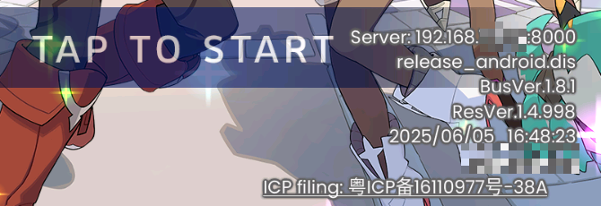

`server.txt` is just one line, the PC's address and port, e.g. `192.168.1.20:8000`, so you can
also write it by hand. Lines starting with `#` are ignored. The game reads it each time it starts.
Delete it to go back to the phone's own server (the companion). If your router gives the PC a new
address, download the file again.

**Over USB (any game build; needs [adb](#getting-adb)):** turn on **USB debugging** in the phone's Developer options, connect
it to the PC, and run `start-cn.bat`. It forwards the phone's `127.0.0.1:8000` to the PC with
`adb reverse`. Android 11+ can do the same without a cable through **Wireless debugging**. The link
drops whenever adb loses the phone; run `start-cn.bat` again to restore it.

## 3. PC only: an emulator with a PC server

For **custom units** ([CUSTOM_UNITS.md](CUSTOM_UNITS.md)), which are added on a PC, or for **working on
GlobalPoint**. Just to play on a PC, use [setup 1](#1-phone-or-emulator) in an emulator instead.

1. Install an Android emulator (tested: LDPlayer 9; it must run ARM64 apps, as in setup 1), and put
   the game APK in an `apk` folder inside your GlobalPoint folder (e.g. `D:\GlobalPoint\apk\`) before the next step.
2. [Install the server on the PC](#installing-the-server-on-a-pc), and [get adb](#getting-adb): the
   emulator reaches the server through it. When `setup.bat` finds `adb`, it offers to install the APK on
   the emulator; or install it yourself.
3. From then on, start the server with **`start-cn.bat`**. It also connects the emulator to it
   (`adb reverse`).
4. Open the game.
   - The first screen is the CN publisher's agreement, in Chinese. The **right** button (同意) agrees
     and continues; the left one (拒绝) closes the game.
   - The first start downloads ~12 GB of game files from your own server (about 6 minutes on an
     emulator). That only happens once.

## Installing the server on a PC

For setups 2 and 3, and for copying the data to a phone in setup 1.

**This part is more technical:** it uses the Command Prompt a few times and moves about 12 GB of files
around. Just to play, you don't need any of it: [setup 1](#1-phone-or-emulator) works on a phone or in an
emulator. The steps below use `D:\GlobalPoint` as the folder; use your own (any drive with at least 16 GB
free), and type your own folder wherever the commands say `D:\GlobalPoint`.

**Opening Command Prompt in a folder:** open the folder in File Explorer, click the address bar at the
top, type `cmd` and press Enter. A black window opens, already in that folder.

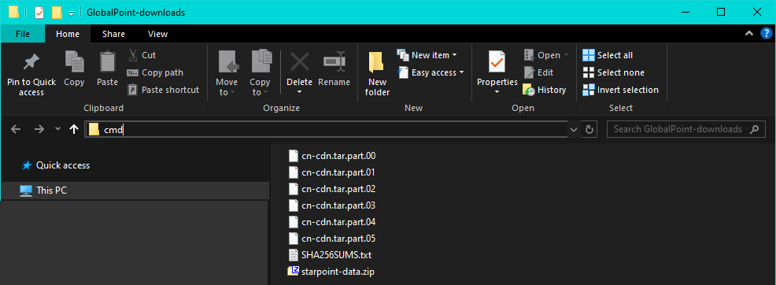

1. **Install Node.js 22.** Download the Windows installer from
   [nodejs.org/dist/latest-v22.x](https://nodejs.org/dist/latest-v22.x/): the file whose name ends in
   **`-x64.msi`** (e.g. `node-v22.23.4-x64.msi`). Run it and keep the default options.
   - Why 22: the server uses a package (`better-sqlite3`) that comes ready-made for Node.js 20 and 22
     only. With a newer Node.js (23, 24 and up, including the one nodejs.org offers first), installing
     it means compiling it, which needs Microsoft's C++ build tools.
   - **Already have a newer Node.js?** If `setup.bat` (step 5) fails with errors that mention
     `better-sqlite3`, `node-gyp` or Visual Studio, either install Node.js 22 instead, or install
     [Visual Studio Build Tools](https://visualstudio.microsoft.com/visual-cpp-build-tools/) with
     **Desktop development with C++** ticked, then run `setup.bat` again.
2. **Get GlobalPoint.** On the GitHub page, press **Code** > **Download ZIP**, and unpack it to
   `D:\GlobalPoint` (right-click the zip > **Extract All**). Check that `setup.bat` is directly in
   `D:\GlobalPoint`, not one folder deeper (move the files up if it is). With git:
   `git clone https://github.com/NekoWeeb19/globalpoint.git D:\GlobalPoint`.

   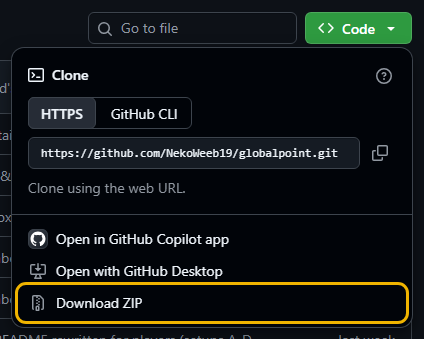
3. **Put the CN game files in.** Download the six `cn-cdn.tar.part.00` to `.05` files and
   `SHA256SUMS.txt` from the [CN CDN 1.4.54 release](https://github.com/dennis96292/.cdn/releases/tag/cdn-1.4.54),
   all into the same folder (e.g. Downloads). Then open Command Prompt **in that folder** and run these,
   one at a time:
   ```bat
   mkdir D:\GlobalPoint\.cdn
   ```
   ```bat
   copy /b cn-cdn.tar.part.00 + cn-cdn.tar.part.01 + cn-cdn.tar.part.02 + cn-cdn.tar.part.03 + cn-cdn.tar.part.04 + cn-cdn.tar.part.05 cn-cdn.tar
   ```
   ```bat
   tar -xf cn-cdn.tar -C D:\GlobalPoint\.cdn
   ```
   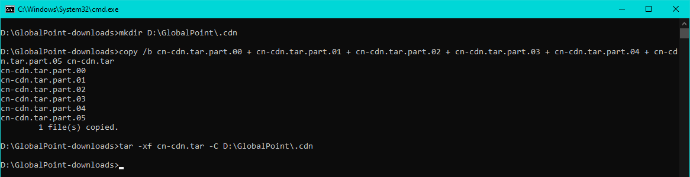

   - The first makes the `.cdn` folder (if it says it already exists, that's fine). The second joins the
     six parts into one file, `cn-cdn.tar`: it needs about 10 GB more free space for a while. The third
     unpacks it; it takes several minutes and shows nothing until it's done.
   - **Check it worked:** `D:\GlobalPoint\.cdn\cn` now holds folders named `archive-...` and one named
     `entities`. Then you can delete `cn-cdn.tar` and the six parts.

     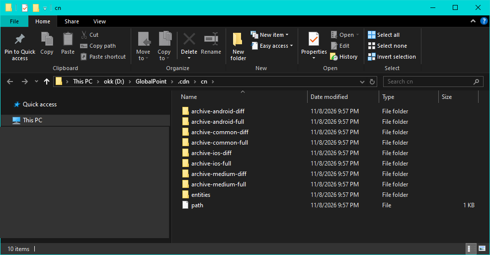
   - Use Command Prompt, not PowerShell: `copy /b` only works in Command Prompt. (`tar` is built into
     Windows 10 and newer.)
   - **Check the downloads** (optional): in the same window, `certutil -hashfile cn-cdn.tar.part.00 SHA256`
     for each part, and compare with `SHA256SUMS.txt`. With Git Bash, Linux or macOS,
     `sha256sum -c SHA256SUMS.txt` checks them all, and `cat cn-cdn.tar.part.* | tar -x -C /path/to/GlobalPoint/.cdn`
     unpacks them without the extra 10 GB.
4. **Unzip `starpoint-data.zip` into `D:\GlobalPoint`** itself: right-click it > **Extract All**, and
   make the destination exactly `D:\GlobalPoint` (Windows suggests `D:\GlobalPoint\starpoint-data`;
   remove the last part). If Windows asks about files that already exist, choose to replace them. Check
   it worked: `D:\GlobalPoint\.cdn` now also has `cn_text` and `cn_patches`. Do the same with the comics
   zip if you want comics.

   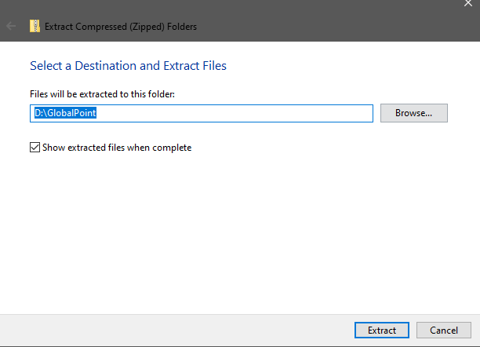
5. **Run `setup.bat`** (double-click it in `D:\GlobalPoint`). It installs the server's packages (this
   needs internet once), builds the server, makes your `.env` settings file from `.env.example`, and
   checks the game files and updates. If something is missing it stops and says what. If it finds
   `adb`, it offers to install the APK from the `apk` folder on your emulator (for setup 3, or setup 2
   over USB, [get adb](#getting-adb) before this step). Then it starts the server.

### Getting adb

`adb` is Android's own tool for talking to a phone or emulator from a PC. `setup.bat` uses it to install
the game, and `start-cn.bat` to connect the emulator (setup 3) or a USB phone (setup 2) to the server.
Without it, setup 3's emulator can't reach the server. Setups 1 and 2 over Wi-Fi don't need it.

1. Download **SDK Platform-Tools for Windows** from
   [Android's site](https://developer.android.com/tools/releases/platform-tools) and unzip it.
2. Copy three files from its `platform-tools` folder into your GlobalPoint folder (next to
   `setup.bat`): **`adb.exe`**, **`AdbWinApi.dll`** and **`AdbWinUsbApi.dll`**. The scripts look
   there first. (Or add the `platform-tools` folder to your PATH, if you know how.)

   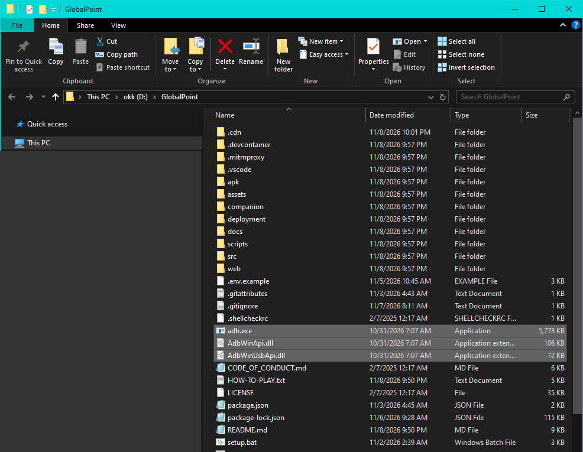
3. Check it: open Command Prompt in the GlobalPoint folder and run `adb devices`. With the emulator
   running (or the phone plugged in, with USB debugging on), it lists one device.

Many emulators also come with their own `adb.exe` in their install folder (LDPlayer 9 does, in
`D:\LDPlayer\LDPlayer9` or wherever you installed it); copying that one in works too. If `adb devices`
lists nothing for your emulator, its settings or help page shows how to turn on ADB, or which
`adb connect 127.0.0.1:<port>` it needs.

After that, run **`start-cn.bat`** to start the server, and open the game. Close the server window to
stop it.

The short version of these steps is in [`HOW-TO-PLAY.txt`](../HOW-TO-PLAY.txt). Linux and macOS have `setup.sh` and
`start-cn.sh`, which are untested.

## Updating the server on a PC

No need to install again: update the code in the same folder. Your save (`.database`), the game files
(`.cdn`), your settings (`.env`) and the `apk` folder aren't part of the code, so an update leaves them
alone.

1. **Close the server window**, and **back up your save**: copy the `.database` folder somewhere safe (or
   download it on the dashboard: **Players** > a player > **Download Save**).
2. **Get the new code:**
   - **Downloaded the ZIP:** download the new ZIP from GitHub (**Code** > **Download ZIP**), unpack it
     anywhere, then copy everything inside it into your GlobalPoint folder, and choose **Replace the files
     in the destination** when Windows asks. Don't delete your old folder first.
   - **Used git:** open Command Prompt in the GlobalPoint folder and run `git pull`.
3. **Delete the `node_modules` folder** in your GlobalPoint folder, then **run `setup.bat`** again. It
   reinstalls the server's packages (needs internet), rebuilds the server and checks the game files.
   (`setup.bat` skips the packages when `node_modules` is already there, so deleting it makes sure an
   update's new packages get installed.)
4. **If the update comes with a new `starpoint-data.zip`** (the Drive has a newer one), unzip it into the
   GlobalPoint folder again, as in [step 4](#installing-the-server-on-a-pc) above.
5. **Start the server** (`start-cn.bat`) and open the game. If the server changed its game update, the
   game downloads a small one at the title screen.

**A new game APK** installs over the old one, on a phone or an emulator, and keeps your progress. Clear the
game's cache once before opening it: Android Settings > Apps > World Flipper (listed as 世界弹射物语) > Storage > **Clear cache**
(not Clear data, which deletes the game files). **A new StarPoint Companion APK** also installs over the
old one and keeps the save on the phone.
