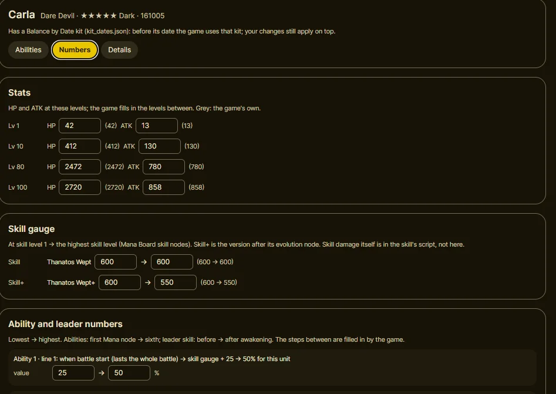
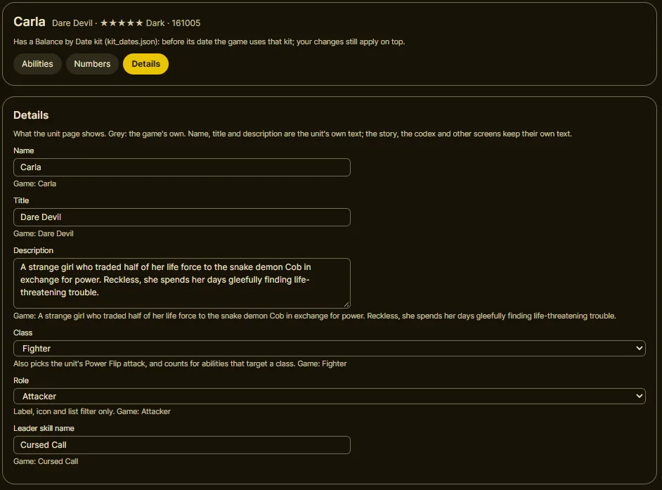

# Unit editor (dashboard)

> 中文版：[UNIT_EDITOR.zh-CN.md](UNIT_EDITOR.zh-CN.md)

> Written by Claude (AI) in a Claude Code session, with the repository owner choosing how it works.

Change what a unit's abilities and skill do, and its numbers, from the dashboard: **Unit editor** in the menu
(`/unit-editor`). Works for every CN unit and for custom units ([CUSTOM_UNITS.md](CUSTOM_UNITS.md)).
No unit ids change, so saves are never at risk.

## What it edits

- **Abilities tab**: every ability (1-6) and the leader skill, as lines. Each line is one effect:
  - **Only if**: up to 3 conditions ("this unit is Water", "6+ Water units in the party", "HP at or above 80%"...);
  - **Kind**: *when* (the moment something happens) or *while* (as long as something is true), and the trigger
    ("Fever starts", "uses its skill", "every X seconds"...), with only the fields that trigger uses (every N times,
    seconds, HP %, who, times (max), cooldown);
  - **Do**: the effect, its target and its numbers (value, duration, max stacks...).

  Leader skill lines also have **Shown**: always, before awakening only, or after awakening only (the game keeps a
  separate line for each where the numbers change at awakening, e.g. Barrek's "+ 55 %" before and "+ 70 %" after).

  Lines can be removed, added (at most **8 lines** per ability or leader skill; CN's own units use up to 6 and 8), or
  copied from any other unit. **Reset to game** on an ability gives its own lines back.

  Under each ability, **In game** shows it in the unit page's own words, at both ends of its range (first Mana node
  and all six; leader skills before and after awakening). Lines with the same conditions and trigger are one sentence
  with their effects joined by "&" ("& " between lasting effects, "&" between timed ones), as the game does; a new
  trigger starts a new paragraph. "When a battle starts," is written for one-off effects (Skill Gauge, Fever gauge),
  not for lasting ones (attack, HP). Example: e.g. "When this unit is a/the ⟨Water⟩ unit → 6 seconds have
  passed → +50 Combo". It's built from the game's own English text pieces (the UI string table) filled in the way the
  client does; 92% of CN's 4,928 ability and leader lines are covered, and all of Amelia's lines matched her unit page on the emulator word for
  word (elements show as ⟨Water⟩ where the game draws an icon). Lines it can't word yet (skill switching,
  multiball groups, unit-specific buffs) say so, and a tick box there, **Use the editor's wording where the game's
  can't be shown**, puts the editor's own sentence for that line in its place (marked "(editor's wording)"); the unit
  page shows the game's text after saving either way.
- **Numbers tab**: HP/ATK at Lv 1/10/80/100, the skill gauge (skill and Skill+), and every min → max pair of every
  line (the same values as the Abilities tab).
- **Details tab**: name, title, description, leader skill name, **class** and **role**. Class (Swordsman, Fighter,
  Deadeye, Support, Special) also picks the unit's Power Flip attack and counts for abilities that target a class;
  role (Attacker, Tank, Healer, Supporter, Jammer, Balance) is a label, icon and list filter only. No stat depends on
  either (client: SpecialityTypeTools, StanceLogic). The story, codex and other screens keep their own text.

**Min → max**: abilities go from their first Mana node to the sixth (the game fills the steps between in a straight
line; with no nodes the ability is off); leader skills from before to after awakening; the skill gauge from skill
level 1 to the highest. Numbers are shown in plain units (%, seconds, points, combo); the tables store them
× 100,000, and the editor converts both ways. An effect whose unit isn't known shows its stored number,
"(game value)".

- **Skill tab**: the skill's and Skill+'s name and description, and what they do, from their scripts (below).

Not editable here: ability text (the game writes it itself from the rows, so
it always matches), element and rarity (the server keeps its own copy), Mana Board costs.

## Skill tab

New to it? Start with [SKILL_GUIDE.md](SKILL_GUIDE.md): what a skill needs, what can go wrong, and recipes to copy.

A skill is a list of **commands**, run from top to bottom. Each card on the tab is one command. Cards indented under
another run inside it: after a **Wait**, when an **Attack area** appears, on each of its hits, for each unit a
**Find** picked, or in one branch of an **If**. The commands you'll use most:

| Command | What it does |
|---|---|
| **Attack area** | The zone that hits: its shape (circle, rectangle or fan), size, where it is (on the unit or its ball, and how far from it, facing which way), how long it lasts and how often it hits. |
| **Effect** | An animation: one of the game's shared effects (drawn in the unit's element) or a unit's own, placed like an area. |
| **Damage** | Inside an area's "on each hit": who's hit, the element, how hard (a multiplier), break-gauge damage and Fever gained. |
| **Buff / debuff** | On the unit, the party or a found group: which buff (attack, skill damage, element resistance...), how long (frames), how much, max stacks. |
| **Stop the ball**, **Move the ball** | What the ball does while the skill plays. |
| **Wait**, **Repeat** | Timing. Wait: what's inside runs after so many frames. Repeat: right away, then every so many frames, a set number of times. |
| **Random pick** | Runs one of its options at random. Each option has a **Weight** (1 and 1 = half the time each). Inside a Repeat it picks again every time. |
| **Find a group**, **Find the nearest** | Picks the party, all enemies, the nearest enemy...; the commands inside act on them. |
| **Camera shake**, **Heal**, **Remove buffs**, **Fever / skill gauge** | What their names say. |

**Editing:**
- **Change** any setting right on its card. Elements, groups, "who it may go to" and what something is attached to are
  dropdowns; angles are in degrees. Numbers that grow with skill level have two boxes: skill level 1, and the top
  level. Settings that most of CN's skills leave alone are tucked under **more**.
- **+ Add…** at the end of every block adds a command, ready to use in its most common form (a new Attack area comes
  with its effect and damage inside). Every card has **↑ ↓ Copy Remove**.
- **Start from another unit's skill** copies another unit's Skill or Skill+ to start from. **Reset to game** puts the
  unit's own skill back.
- The skill pose, cut-in picture and voice aren't part of the list: they stay the unit's own.
- **Name** and **Description** at the top of each skill: the text the unit page shows (grey under each box: the
  game's own). The game doesn't write it from the script, so after changing what a skill does, change its
  description too. A description may run over several lines (press Enter), as some of CN's own do; a name may not
  be empty. Kits carry the text along with the rest of the skill.

**Checking your skill before saving:**
- **▶ Preview skill** plays the whole skill as you've edited it: the unit's skill pose, the effects, outlines of where
  each area hits, the ball's moves, camera shakes, and the hits on a pretend target (a cross). Play, pause, or drag the
  slider to any frame.
- **▶ View effect** on an Effect card plays that one effect, in each element colour it comes in, with a dashed outline
  of the area it's drawn on.
- **The "Drawn:" line** under an Attack area says what its effect looks like there and for how long, and warns when
  the picture doesn't match what hits: a round picture on a rectangle, a picture much bigger or smaller than the area,
  a fan shape (no shared effect is fan-shaped), or a picture that ends long before the area stops hitting.
- **Keep effects in step with their attack areas** (on by default, at the top of the tab) resizes an area's effect
  whenever you change the area or its effect. The effect list suggests the effects that fit the area's shape first.
- **Run time**: how long the skill runs, and when the ball is stopped.
- **Hits per enemy**: under each Damage, how many times its area can hit one enemy, and the total damage multiplier
  over those hits (Clara: 15 hits × 0.533 = 8 per enemy). Worked out from the settings, not measured in a battle.
- **Element note**: when a Damage hits as a different element from the one its effects are drawn in.

**Modes** (the same Mode picker as the other tabs). Every one of CN's own skills passes all of them.
- **Default**: only commands, choices and effects CN's skills use, and at most 60 commands, 8 attack areas and 10
  levels of nesting. (A skill you started from may stay as big as it was: CN's biggest has 149 commands and 16 areas.)
- **Advanced**: bigger limits (200 commands, 20 areas, 16 levels), and ids shown under "more". An id is the name a
  command gives to "the area", "the hit target" or "the group", so commands inside it can point at it; in Default
  mode they're hidden and picked by name for you.
- **Unrestricted**: also commands and choices CN never uses (marked untested, and they may crash the game), any effect,
  any value typed as text ("{ }"), limits 1000 / 100 / 40.
- **Always refused**, in every mode: anything the game can't read (a wrong kind of value, an unknown command), and a
  command pointing at an id nothing above it has named.

**Saving**: the skill goes into the game update, like every other edit: close and reopen the game to get it. **Download
from PC** copies edited skills to phones, and a **kit** carries its unit's skills (importing it puts them back).

### How it works (details)

- **Files**: a skill is a script file that the unit's skill row names. Saving writes a new file,
  `skills/battle/action/skill/action/custom/<unit>_<1|2>_<hash>` in the custom units folder, under a new name every
  time it changes (so the game never keeps an old copy), and points the skill row at it. The game update ships every
  saved script a change file uses. Older script files of the unit that nothing uses any more are deleted when it's
  saved. A kit whose skill script is missing is refused.
- **What happens when a skill fires**: the game plays the sprite's `skill_ready` sequence (the skill pose), shows the
  skill flash and the cut-in, holds the ball for 60 frames, then runs the script. The preview copies this.
- **Effect sizes**: CN draws each shared effect at a fixed size per scale, measured from CN's own skills: e.g.
  *spread* is a circle of radius 42 at scale 1, *air blast* 50, *laser* a 133 × 1333 beam, *claw horizontal* 200 × 80.
  So "Drawn: spread at scale 6 ≈ a circle of radius 252". The warning threshold is 20 % bigger or smaller. Units' own
  effects have no measured size ("size not known"); CN's fan-shaped skills use units' own art.
- **Effect timing** is read from each effect's timeline file (e.g. *spread* plays 40 frames, then its "end" runs to
  frame 68), so the "Drawn" line can say "for 40 frames" or "for as long as the area lasts".
- **Run time** adds up Waits, attack areas, effects and ball moves (a Repeat counts as interval × times). A note shows
  when something attached to the ball lasts past the ball's stop (it then moves with the ball, as Clara's whirlwind is
  meant to).
- **Hits per enemy** comes from the area's time between hits, max hits and "disappears" settings.
- **The preview** is a stage, not a battle: no enemies (enemy groups also stand on the pretend target, which sits
  where the first area reaches), the ball stands still unless Move the ball moves it (upwards), and an If shows its
  first branch. Each area hits the target at its hit interval, up to its max hits, running "on each hit" each time, so
  a Damage's hit effect shows there. Units are drawn × 6, as in battle (effects and areas in battle units). The hit
  effects Fine and Coarse are built into the game app (`assets/bundle.zip` inside the game APK); the server reads them
  from `CN_GAME_APK` or the newest `.apk` in the `apk/` folder, and without one a drawn burst in the element's colour
  stands in. Compared with a battle recording (2026-11-16): the air blast, the 15 Coarse hits of a 5-second area
  hitting every 20 frames, and the skill flash matched.
- **▶ View effect** plays the game's own animation files the way the game does, at 60 frames a second, with the unit's
  own element first and the effect's sequences.

## Sharing kits

**Edited units and kits** (top of the page) lists every unit the editor changed. **Download** one, the ticked ones,
or all: one JSON file with their changes. It is itself a unit change file, so it works two ways: **Import a kit file**
on this page (each unit's changes become its editor file, after the same checks as saving; a kit for a unit that
doesn't exist, rows of another unit, or a line the game can't read is refused), or drop it into the custom units
folder's `changes/`. Custom units' changes are in their own files and aren't listed.

The file's layout (which tables, rows and columns, and how skill scripts travel) is in [KIT_FORMAT.md](KIT_FORMAT.md),
for anyone who wants to use a kit on another CN server or fork.

## The guard rails

- **Default mode** offers only the triggers CN's own units use (every CN unit's 4,928 ability and leader lines):
  their triggers, conditions, condition + trigger pairs and "who" choices. **Any effect goes with any of these
  triggers, with no warning**: the game fires the trigger, then applies the effect the same way whatever fired it
  (tested: "every X seconds" + "combo +", a pair no CN unit has, worked in battle).
- **Advanced mode** (the Mode picker) keeps to the conditions, triggers, "who" and effects CN's units use, in any
  combination: e.g. "not in Fever" with "while this unit has attack up" or "while a multiball is out", which no CN unit
  pairs. Such a line gets a note ("Not used together by CN's units"), not a block.
- **Unrestricted mode** also offers the conditions, triggers, "who" and effects CN never uses (marked "untested").
  Those show "Unused trigger / condition / effect: may not work or crash the game." Triggers are what decides whether a
  line works. (The mode is remembered in the browser.)
- **Unit-specific buffs** ("Energy Drain", "Cursed"...: 19 in CN, each tied to its unit) can only be used by a unit
  whose own kit uses them; a line that names another unit's buff is refused in both modes.
- **Always refused**: contradictions (a condition that rules out the line's own trigger, e.g. "not in Fever" +
  "while in Fever"; the leader being two elements; HP above X and below a lower Y), "for the unit that triggered it" with
  a trigger that has no "who" (e.g. "every X seconds": nobody triggered it; that target isn't offered then), and
  anything the game can't read (an unknown code, a word where a number belongs). Save stays greyed out until they're fixed.

If the unit page shows your text, the game read the row. For a new combination, a quick battle shows whether it
works (the battle code is separate from the description code).

## Saving and getting it into the game

- **Save** writes only the rows that differ from the game's own: for a CN unit
  `assets/custom_units/changes/unit-editor-<id>.json` (a unit change file, [MAKING_UNITS.md](MAKING_UNITS.md#changing-an-existing-unit-by-hand));
  for a custom unit, its own file. The server rebuilds the CN game update right away.
- **Close and reopen the game**: it downloads the update at the title screen.
- **Phone only (no PC)**: the editor is also in StarPoint Companion's **Dashboard**. Saving there writes the change
  file on the phone, and the phone rebuilds its own game update.
- **With a PC**: phones get the PC's edits with **Download from PC** (change files always come along). That copy
  replaces the phone's own edits with the PC's, so either edit on one side only, or **Download** a kit on the phone
  first and import it on the PC.
- **Reset unit to game** deletes the editor's change file and rebuilds. Other change files and Balance by Date kits
  for the unit are listed on the page and stay as they are (changes apply on top of a dated kit).

## Armaments

The **Units / Armaments** switch at the top of the page edits armaments (all 436 of CN's) the same way, with the
same guard rails, saving, kits and reset (`/unit-editor?armament=<id>`).

- **Abilities tab**: each of the armament's abilities is an **Effect** (at most **10**, the game's own limit: slots 0-9;
  CN uses up to 10). An effect has up to **3 versions**, each with **From level**: the game uses, per effect, the
  version from the highest armament level reached (e.g. Ukonvasara: + 50 % skill damage from level 3, + 100 % from
  level 5). Two versions can't be from the same level. CN uses at most 2 versions. **In game** shows the whole
  armament at level 1 and at its max level.
- **Numbers tab**: HP/ATK at the levels the game lists (1, and 3 and 5 for most), and every min → max pair. Values
  scale from armament level 1 to its max level (5, or 1 for 51 armaments).
- **Details tab**: name and description.
- **Armaments with only level 1** can't scale: every min must equal its max (the client stops with an error
  otherwise), so the editor refuses a line where they differ.
- Unit-specific buffs work only if the armament's own rows use them, as for units.

Saved as `changes/armament-editor-<id>.json`, with these tables (from the CN 1.8.1 client's parsers):
`master/item/equipment` (name column 1, description 7, max level 8), `master/item/equipment_status`
(`<id>/<level>`: hp, atk) and `master/ability/ability_soul` (one line per effect version: slot, learn level, kind,
then the unit ability layout). The server keeps no copy of armament stats or abilities (`src/lib/equipment.ts` only
stores owner, level, enhancement and stack), so the update alone changes them.

**Tested (2026-11-04, StarPointTest emulator, companion 0.7.4):** change files from the armament editor in the
phone's `custom_units/changes/`; the phone rebuilt its update (1.4.966, both armament tables in it) and the game took
it (7 MB). At max level, Protostar Bident's page read "Protostar Bident (Edited)" and "+ 90 % to attack for this unit"
(was + 70 %), and Infernal Axe's "Infernal Axe (Edited)" and "+ 40 % to HP for multiballs" (was + 20 %). The game's
armament page lists the version reached and tags a later version "Awakening Lv5". The files were then removed
(update 1.4.967, the game's own rows).

## Chinese (中文) and searching by CN names

- **Search by CN names**: the Unit and Armament boxes (and "From unit" when copying) also find a unit by CN's own
  Chinese name and title (瓦格纳, 狱炎龙王...) and an armament by its CN name (百物语...), in either language. They
  come from CN's own `character_text` and `equipment` tables, so every CN unit and armament has them (custom units
  have only their own name).
- **Language:** the page follows the dashboard's language (the sidebar's **Dashboard language**). The **中文** /
  **English** switch next to Mode overrides it for this page, remembered in this browser. It reloads the page, so it
  asks first if there are unsaved changes. In Chinese:
  - the page's labels, notes, messages and the plain words for the game's codes are in Chinese, using CN's own
    game terms (角色, 装备, 能力, 技能槽, 强化弹射, 协力球, 合击, 玛纳板, 觉醒...);
  - **In game** shows each ability in CN's own Chinese wording (CN's `ui_string` pieces, filled in the same way as
    the English), e.g. "⟨火⟩角色攻击力 + 75 %";
  - the unit's heading shows its CN name and title, with the English name after it.
- What stays as it is: the unit's own text (name, title, description, skill text: the Details and Skill tabs show
  the game's own text in the game's language: English, or CN's Chinese with the game set to Chinese; what you type
  there, in either language, is what the game shows), skill script command names (`CreateHitArea`...), effect file paths, and the
  client's raw names for codes CN's units never use (Unrestricted mode). Race groups (Dragon, Beast...) show their
  codes: CN's tables have no Chinese for them.
- The Chinese text is in `web/public/js/unit-editor-zh.js`: an English string → Chinese table plus patterns for
  text with numbers or names in it. Text it has no entry for stays in English, so a missing line never breaks the
  page; add the English as a key to translate it.

## More

The editor's code files, its offline tests and the in-game test logs are in
[research/custom-unit-tooling.md](research/custom-unit-tooling.md#unit-editor-code).
