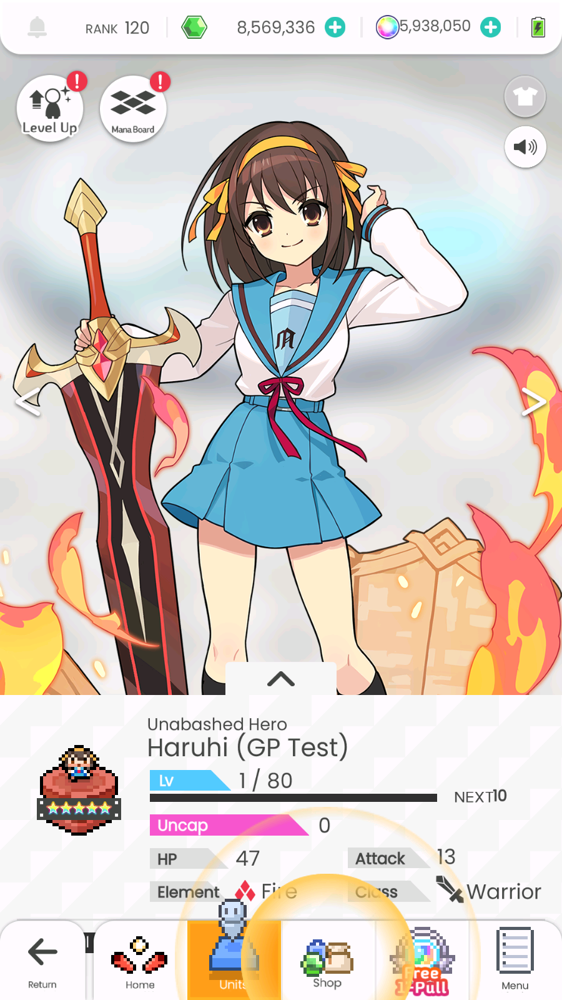
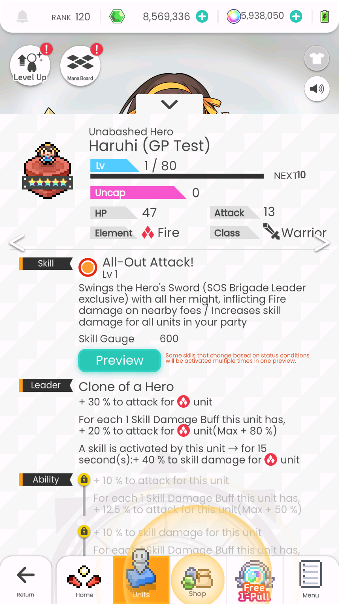
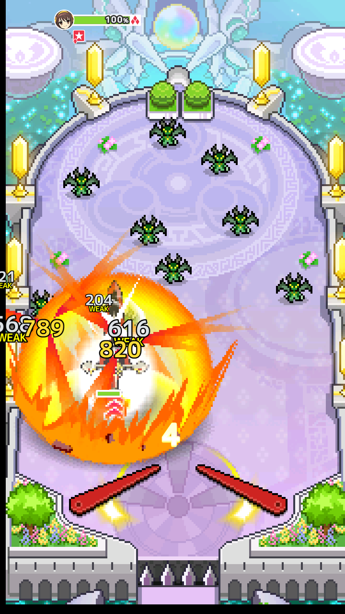
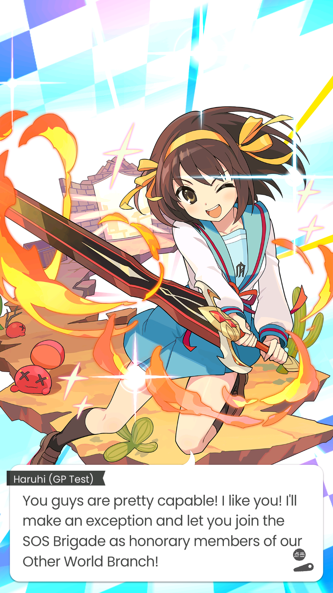

# New units in the CN app from data only (research, 2026-11-03)

> [!IMPORTANT]
> ## 🤖 Written by AI
> This research and write-up were done by **Claude** (Anthropic's AI) in a Claude Code session, with the
> repository owner testing in the game alongside. The facts come from the game's own data (every CN table scanned,
> the file list checked, files measured), the decompiled CN client, and tests on an Android emulator; the owner
> confirmed the battle, co-op, equipment, uncap, Mana Board 2 and summon results by hand. Parts that were not
> tested are marked as such in the checklist. Treat those as educated guesses until someone tries them.

**Result: it works.** A brand-new unit (id 111907, string id `gp_test_haruhi`, "Haruhi (GP Test)") was added to the
patched CN 1.8.1 app with **no game-code change**: table rows plus files, shipped as an ordinary StarPoint update
patch, plus two server data entries. On the StarPointTest emulator it was mailed to a save and claimed, and it showed in
the unit list. Its detail page worked, and so did its skill **Preview** (a real battle run, with the new skill script,
skill effects and voices). It was leveled to 80, uncapped and EX Boosted. Mana Board 1 was unlocked in full,
**awakening included** (awakened art, voice line and upgraded leader talent), it **finished a single-player quest battle and a co-op battle**, and it took an armament and
an ability soul. A second copy stacked as a normal duplicate (with its Fire EX Boost material), and it
**dropped from a real summon banner** once its id was added to that banner's pool. Level 100, both amity scrolls and
a fully unlocked **Mana Board 2** work too.

The test unit is a clone of Haruhi Suzumiya (111069) under a new id and string id, so every one of its files is a
*new* file. That makes it the same path a hand-made unit would take. What a hand-made unit would still need is new
content: art, a kit, a skill script. The full list of what a unit needs is the
[Checklist](#checklist-everything-a-custom-unit-needs); tooling ideas are in [What a "new unit" tool needs](#what-a-new-unit-tool-needs).

| | |
|---|---|
|  |  |
|  |  |

## Where this came from

- **Community mod (global app, 2024).** duosii's `haruhi_mod` added Haruhi to global, building her on Alk's files
  (`alk_3halfanv`). Every table change in it is additive, and it adds about 380 new files. Two failures were
  reported: "game crashes when entering battle & opening character details", and an "asset check" that sends you
  to the download screen. Both are explained below; they were the two bugs this research hit first, too.
- **Tools.** [wfax](https://github.com/blead/wfax) (Go: `fetch`, `extract`, `pack`) and
  [wdfp-extractor](https://github.com/ScripterSugar/wdfp-extractor) (Electron, newer) extract and repack files.
  Their path lists (67,645 and 61,894 logical paths) mostly hold paths that appear inside tables. Neither lists a
  unit's portraits, sprites or battle voices: those names are built in game code. GlobalPoint already has its own
  equivalents (`scripts/cdn_hash.cjs`, `cdn_rows.cjs`, `amf3.cjs`, `build_cn_patch.cjs`).
- **Decompiled CN client** (`F:\WF client\cn\decompiled\scripts`): the source of everything marked *(code)* below.
  `pinball/master/generated/*Values.as` holds a parser for each of the 785 tables, which names every column.

## How the game finds a unit

- **The id** (`111907`) keys most tables. By convention digit 1 = rarity (1 = 5★) and digit 2 = element (1 fire …
  6 dark), but the game reads rarity and element from the character row, not the id: CN's own 700000-700019 and
  999999 break the pattern. Only StarPoint reads a digit (`src/lib/gacha.ts`: the first digit picks the summon
  animation's rarity). Unused ids work; nothing checks a range.
- **The string id** (character column 0, `gp_test_haruhi`) is the folder of every file:
  `character/<string id>/ui/...`, `/pixelart/...`, `/voice/...`, `/battle/...`. *(code)*
- **Character column 8** names the skill (`master/skill/action_skill` key `<name>/1`, `/2`). The skill row's
  column 7 names the skill script `battle/action/skill/action/rare5/<name>$<name>_N`. *(code: CharacterValues)*
- **Mana Board node ids are not free numbers.** The game finds a node's row from its id:
  `board = id / 200 % 10`, `index = id % 200`, so `id = unit × 2000 + board × 200 + index`
  (Haruhi 222138201 = 111069 × 2000 + 200 + 1; Meteor Light's MB2 ids 302306201… = 151153 × 2000 + …).
  *(code: GeneralManaNodeLogic.get_values)* Other ids crash the detail page with C8601 "key 5".

## The tables (19)

Found by decoding every CN table (3,895) and searching for the id and the string id. The keys are the new unit's.

| Table | Key | Notes |
|---|---|---|
| master/character/character | id | col 0 string id, 8 skill name, 17 leader id, 18 leader name, 19-24 ability ids, 27 identity id |
| master/character/character_text | id | col 0 name, 3 title, then skill/ability texts (already English in GlobalPoint's tables) |
| character_status `5c/6a4f…` | id/level | "HP,ATK" at 1/10/80/100 |
| master/character/character_speech | id | home lines; col 4 = voice file under `voice/` |
| ability `1e/664c…` | id×10+1..6 | two lines per row (layout in the memory note kit-rows-decode) |
| leader_ability `ff/8435…` | id | |
| master/skill/action_skill | skill name / 1, 2 | col 7 skill script path, 4/5 gauge |
| skill_preview_character `aa/abdd…` | id | which preview stage |
| character stance_detail `d7/50c2…` | id | |
| full_shot_image_attribute `b9/132d…`, character_image `3e/b411…`, trimmed_image `fb/ab43…` | id/0,1; picture path | picture crops |
| upskill `57/8872…` | id | |
| character_gacha_sound `ac/b038…` | id/frame | sounds of the "unit joins" animation |
| master/mana_board/mana_node | id/board/index | node ids as above |
| master/generated/mana_board | id/board/index | layout; col 5 = parent node ids |
| master/mana_board/mana_board2_open_condition | id | |
| master/encyclopedia/encyclopedia | 1<id> | |
| master/story/story_character | string id | name, voice folder, expressions |

Not needed for a playable unit (tested: nothing breaks without them): degree (title), degree_mission, gacha/banner rows, shops, event stories.
Rows can be appended anywhere: lookups are by key (`OrderedMap`, `indexOf`), not binary search.

## The files (76 for Haruhi)

- `pixelart/` 8: `pixelart`, `special` `.frame` + `.timeline`, `sprite_sheet` and `special_sprite_sheet` `.png` + `.atlas`
- `ui/` 41 (most in `medium_upload`): `square_*`, `thumb_*`, `full_shot_1440_1920_0/1`, `skill_cutin_0/1`,
  `cutin_skill_chain_*`, `battle_*`, `episode_banner_0`, `illustration_setting_sprite_sheet`, `story/<expression>`
- `voice/` 22: `battle/` (battle_start, skill, skill_ready, outhole, power_flip, normal_attack, win; `_0`/`_1`),
  `login/login_0..2`, `home/…` (from character_speech)
- `ui/skill_cutin_0/1.atf.deflate` 2 (Android-only folder `android_upload`): the battle skill cut-in textures
- `battle/character_detail_skill_preview` and `character_info_skill_preview` `.battle`: recorded preview inputs
- skill scripts `battle/action/skill/action/rare5/<skill>$<skill>_1/_2.action.dsl`; skill effects under
  `battle/effect/skill_unique/...` (the skill script names them, so a new unit can reuse another unit's effects)

Stored names: `<logical path>.<type>` hashed with `scripts/cdn_hash.cjs`; JSON-like files are AMF3 + deflate
(`.atlas.amf3.deflate`, `.frame.amf3.deflate`, `.action.dsl.amf3.deflate`); pictures `.png`; voices `.mp3`.
`scripts/research/unit_files.cjs <id>` lists a unit's files (it tries every name the game builds).

**Files that name themselves.** `.frame` and `.atlas` files hold their own path (`"name":
"character/suzumiya_haruhi/pixelart/special"`). A renamed copy must be rewritten inside, or the game asks for the
old animation: C8003 "…pixelart/special 的影像短片尚未加载". This is very likely duosii's crash on battle and
character details. `scripts/amf3.cjs` reads and writes these (decode, edit, encode: same values on re-read). Some
files are raw deflate, some zlib.

## The "asset check"

There is no manifest check. Whenever the game reads a file that isn't on disk, it goes to the "Insufficient data.
Returning to the title screen" screen, or throws error 8100 *(code: FileReader → AssetSufficiencyCheckLoadingTask)*.
The game reports the exact path to the server's crash log (`/cn/crash` in `cn_requests.log`):
`notify_asset_recovery 未找到素材 character/gp_test_haruhi/battle/character_detail_skill_preview.battle.amf3.deflate`.
So a missing file is easy to diagnose: open the screen, read the log, add the file.
The Haruhi mod shipped no voice files and no `battle/` preview files, which explains its download screen.

A related trap: when a table lookup fails (C8601), the game **deletes its copy of that table**. The next update that
ships the table restores it.

## Shipping

- An update patch can add any new file, in `upload/` or `medium_upload/` (`scripts/build_cn_patch.cjs`; the
  1.4.600 home banners already did this).
- **Server**: `assets/character.json` (`{ name, rarity, element, skill_count: 6, cn: true }`) so the server can give
  the unit (dashboard Give → mail), and `assets/mana_node_cn.json` (same node ids) so Mana Board unlocks are accepted.
- **The schedule rebuild is the catch.** Seven of the tables (character, character_status, ability,
  leader_ability, action_skill, encyclopedia, mana_board2_open_condition) are re-shipped by every schedule build
  (`scripts/gen_cn_event_schedule.cjs`), from CN's own rows, so the new rows would vanish at the next rebuild,
  and a save holding the unit would then hit C8601. The kit-by-date mechanism (`assets/kit_dates.json`) only
  *replaces* existing rows. A permanent version needs a small server-side step that *adds* custom-unit rows
  inside the schedule build (data only; no game-code change).

## The proof of concept

`scripts/research/clone_cn_unit.cjs` (unit and names set at the top) writes the 19 tables with the new rows, the
76 files under the new string id (renamed inside where needed), `files.json` for `build_cn_patch.cjs`, and
`server.json` for the two server files. It takes tables from the newest copy the device has
(CN → this PC's patches → `--newer` folders, e.g. a phone's own schedule builds), so translations stay English.

Test run (emulator 5556, companion server, game at schedule build 1.4.805):

1. 1.4.950: everything except the files' inner names → mail icon fine, **C8003** on claiming (frame names).
2. 1.4.951: frame/atlas names rewritten → unit list fine, detail page **C8601** (Mana Board node ids).
3. 1.4.952: node ids = unit × 2000 + … → detail page, skill, leader, abilities fine; Preview → **asset recovery**
   for `battle/character_detail_skill_preview.battle`.
4. 1.4.953: the two preview files added → Preview battle with the skill firing; Mana Board unlocks accepted by the
   server; levels 1-80, uncap, EX Boost, Mana Board 1 with awakening all work. A quest battle → **asset recovery**
   for `ui/skill_cutin_1.atf.deflate`.
5. 1.4.954: the two `.atf.deflate` cut-ins added (Android folder) → single-player quest battle and co-op battle
   finished; equipping an armament and an ability soul works. A second copy by mail: the unit-obtained scene, stack +1
   and a Fire EX Boost item. Added to banner 1613's 5★ pool (`assets/gacha.json`): pulled with the normal result screen.

6. Same 1.4.954: Lv 100, both amity scrolls (`receive_bond_token`), Mana Board 2 opened and all its nodes learned
   (board 2 ids 111907 × 2000 + 400 + index). No title is awarded, since the degree rows weren't copied, and
   there's no error.

Not tested yet: multiplayer with another device, a real phone, a schedule rebuild (known to drop the rows).
The codex (encyclopedia) entry wasn't opened; the tested patches still had Haruhi's id as its unlock condition
(column 21), which `clone_cn_unit.cjs` now replaces.

## Checklist: everything a custom unit needs

How sure each part is:
- **Proven in game:** a unit with exactly these ids, rows, files and server entries works in everything tested
  (see the proof of concept). Every failure listed under error codes was seen, explained and fixed.
- **Measured:** sizes, formats, the lowercase `png` signature, the MP3 frame headers (`7FFB`, checked), the ATF header,
  the animation sequence names: what Haruhi's files are, not tested limits.
- **Not tested:** whether the "required by screens" tables are all really required (everything Haruhi has was
  copied; none was left out to see); whether screens not opened in the test (Town, home-screen character, codex) ask
  for more files (the log would name them); whether plain PNG / plain MP3 / a `png2atf` cut-in are accepted for new
  art; the `character.json` element numbering beyond Fire. "Optional" items were
  tested only where said (titles, the Rates list).

### 1. Ids (pick first; everything else derives from them)

| Id | Rule | Test unit |
|---|---|---|
| Unit id | 6 digits, not one of CN's 505 ids. Keep digit 1 = rarity (1 = 5★ … 5 = 1★) if the unit can be summoned (the server picks the summon animation from it); digit 2 = element (1 fire, 2 water, 3 thunder, 4 wind, 5 light, 6 dark) is convention only; digits 3-6 are free | 111907 |
| String id | lowercase folder name for every file; unique | `gp_test_haruhi` |
| Skill name | character column 8, key of the skill rows (usually = string id) | `gp_test_haruhi` |
| Ability ids | unit id × 10 + 1..6 | 1119071-1119076 |
| Leader id | = unit id | 111907 |
| Encyclopedia key / entry id | `1` + unit id / `1` + unit id + `01` | 1111907 / 111190701 |
| Mana Board node ids | unit id × 2000 + board × 200 + index (board 1-2, index 1-199); the game derives board and row from the id | 223814201… |

### 2. Table rows (19 tables, shipped in a game update)

All copied from a template unit and edited. Text fields are what players read (English in GlobalPoint's tables).

- **Required for the unit to exist:** character, character_text (name, title, skill and ability text),
  character_status (HP/ATK at Lv 1/10/80/100), ability ×6, leader_ability, action_skill (2 rows: skill and skill+),
  mana_node + generated/mana_board (both boards), mana_board2_open_condition (board 2 open date).
- **Required by screens:** character_speech (home lines, voice names), story_character (name, expressions),
  stance_detail, skill_preview_character, upskill, full_shot_image_attribute, character_image and
  trimmed_image (picture crops), encyclopedia (its unlock condition, column 21, names the unit itself), character_gacha_sound (`ac/b038…`, the
  "unit joins" animation sounds).
- **Optional:** degree + degree_mission + degree_mission_reward (Lv 100 / board titles), gacha_odds (Rates list),
  gacha / feature banner rows, character episodes, event stories.

### 3. Files (76; most players never see the folder names)

Names are hashed (`scripts/cdn_hash.cjs`); each file keeps its folder kind (`upload`, `medium_upload`,
`android_upload`). Pictures are PNG with the signature written in lower case (`\x89png`, as all of the game's own);
AMF3 files are raw-deflated except where noted.

| Files | Folder | Format / size | Notes |
|---|---|---|---|
| `pixelart/sprite_sheet.png` + `.atlas.amf3.deflate` | upload | PNG ~250×255; atlas of frames | frames are 256×256 cells at scale 6, named `character/<id>/pixelart/pixelart0001`… |
| `pixelart/pixelart.frame` + `.timeline` `.amf3.deflate` | upload | AMF3 | frame names its own path; timeline sequences: `neutral`, `walk_back`, `walk_front`, `skill_ready`, `kachidoki`, `into_coffin`, `ghost_raise`, `ghost_neutral`, `revive` |
| `pixelart/special_sprite_sheet.png` + `.atlas`, `special.frame` + `.timeline` | upload | PNG 128×512 | skill pose: sequences `special_land`, `special_pose` |
| `ui/full_shot_1440_1920_0/1.png` | medium | ~1400×1700 / ~1560×1500 | portrait, `_1` = awakened |
| `ui/skill_cutin_0/1.png` | medium | 1024×512 | |
| `ui/skill_cutin_0/1.atf.deflate` | **android** | ATF texture (`ATF` header), zlib | battle cut-in; needs an ATF encoder (Adobe AIR SDK `png2atf`) for new art |
| `ui/square_0/1`, `square_132_132_*`, `square_round_136_136_*`, `square_round_95_95_*` | medium | 212², 132², 136², 95² | icons |
| `ui/thumb_party_main_*`, `thumb_party_unison_*`, `thumb_level_up_*` | medium | 186×392, 144×188, 252×329 | |
| `ui/battle_control_board_*`, `battle_member_status_*`, `cutin_skill_chain_*` | medium | 104×268, 58×58, 276×319 | battle HUD |
| `ui/episode_banner_0` | medium | 430×215 | |
| `ui/illustration_setting_sprite_sheet.png` + `.atlas` | medium + upload | 362×792 | two crops `full_shot_illustration_setting_0/1` |
| `ui/story/base_0/1` + one per expression in story_character | medium | 570×~600; expressions ~200×290 | |
| `battle/character_detail_skill_preview` / `character_info_skill_preview` `.battle.amf3.deflate` | upload | AMF3, zlib | recorded skill-preview input; can be copied from any unit |
| `battle/action/skill/action/rare5/<skill>$<skill>_1/_2.action.dsl.amf3.deflate` | upload | AMF3 skill script | names effect files under `battle/effect/skill_unique/…` (reuse any unit's, or add new) |
| `voice/battle/` battle_start_0/1, skill_0/1, skill_ready, outhole_0/1, power_flip_0/1, win_0/1 (normal_attack_* for some units) | upload | MP3 (ID3-tagged; frame sync 0xFF stored as 0x7F) | |
| `voice/login/login_0..2`, `voice/home/*`, `voice/ally/join`, `voice/ally/evolution` | upload | MP3 | names come from character_speech |

A missing file shows as "Insufficient data. Returning to the title screen" (or error 8100); the exact path is in the
companion's `files/server/logs/cn_requests.log` (`/cn/crash`, `未找到素材 <path>`).

### 4. Server data

- `assets/character.json`: `"<id>": { "name": "", "rarity": 5, "element": 0, "skill_count": 6, "cn": true }`
  (element here is 0 fire … 5 dark). Needed to give, level, uncap and stack the unit.
- `assets/mana_node_cn.json`: both boards, node id → items, mana cost (needed to unlock nodes).
- Optional: `assets/gacha.json` pools (first in the tier's list, or rescale weights; see Summoning).

### 5. Shipping

- One game update (`scripts/build_cn_patch.cjs`) with the tables and files, numbered far above schedule builds
  (art patches 1.4.9xx; never on a number a phone's own schedule build could take).
- The tables the schedule rebuilds (character, character_status, ability, leader_ability, action_skill,
  encyclopedia, mana_board2_open_condition) must get the unit's rows from the schedule build itself, or they're
  lost at the next rebuild and a save holding the unit stops loading (C8601). Being built in the follow-up
  session "Custom units in the CN schedule build".
- Phones get it like any update (Wi-Fi copy with game updates ticked).

### 6. Error codes met on the way

| Code | Meaning | Cause here |
|---|---|---|
| 8100 / asset recovery screen | a file the game read isn't there | a file left out (path in the log) |
| C8003 `…的影像短片尚未加载` | animation not loaded | a `.frame`/`.atlas` still naming the template unit's path |
| C8601 `指定的Key不存在` | table row missing (and the game deletes that table) | wrong Mana Board node ids; or rows dropped by a rebuild |

## What a "new unit" tool needs

1. **Rows.** A unit as a small JSON file (id, string id, rarity, element, stats, ability rows, leader, skill rows,
   Mana Board), compiled into the 19 tables. Ability/leader columns are decoded already (memory note
   kit-rows-decode, `scripts/build_kit_*.cjs`), and `*Values.as` names every column of every table.
2. **Schedule integration.** Add those rows in `gen_cn_event_schedule.cjs` (like kit_dates, but appending), and
   write `character.json` / `mana_node_cn.json` entries, so rebuilds keep the unit.
3. **Art pipeline.** Pixel sprites as sheets + `.atlas` (frame rects, AMF3) + `.frame`/`.timeline` (animation
   sequences such as `special_land`/`special_pose`); portraits and icons at fixed sizes (the `ui/` list above);
   `trimmed_image`/`character_image` crop rows. `scripts/cn_sprite_merge.cjs`/`amf3.cjs` already write sheets and
   atlases. Drawing the art is the real cost.
   **Art is data-driven:** no picture or animation is in the game code. The code fixes only names: the file paths
   built from the string id, and the animation sequences it plays (battle: `neutral`, `walk_front`/`walk_back`,
   `skill_ready`, `kachidoki`, `into_coffin`, `ghost_raise`, `ghost_neutral`, `revive`; join movie and skill:
   `special_land`, `special_pose`). Everything else is in the unit's files and rows: how many frames each
   sequence has and how long they show (`.timeline`), where each frame sits on the sheet and how it is offset
   (`.atlas`: `n` frame name, `x`/`y`/`w`/`h`, `r` rotated, `fx`/`fy`/`fw`/`fh` placement in a 256×256 cell),
   the drawing scale (`.frame`), and the portrait crops (`trimmed_image`, `character_image`,
   `full_shot_image_attribute`). **Not studied yet:** the rules behind those values (frame counts per sequence,
   timing, how crops are measured, which atlas fields are required); copy a template unit's and compare.
4. **Skills.** A skill script is a JSON-shaped AMF3 tree (`["ActionDsl", 2, …, ["Block", [["Command",
   ["StopBall", …]], ["Command", ["ShowEffect", …, "battle/effect/skill_unique/<x>/<y>"]] …]]]`). New skills can
   combine existing commands and reuse any unit's effects. Writing one by hand needs the command list documented
   (wfax/wdfp-extractor decode the format but don't explain it). New *effect* animations are art, like sprites.
5. **Voices.** Optional. Game MP3s have each frame's sync byte 0xFF stored as 0x7F (wdfp-extractor's restoreMp3);
   a new clip should be stored the same way (untested whether plain MP3 also plays).
6. **Ids.** Pick an id with the right rarity/element digits that CN never used; Mana Board ids follow from it.

## Summoning

The draw is server data: each banner in `assets/gacha.json` lists its pool by tier, and adding the unit's id there is
enough to pull it (tested on banner 1613). The result screen uses files the unit already has. Two details:
- `src/lib/gacha.ts` rolls 0-1000 and walks the tier's list in order, so the weights (`rarity`, per mille) must still
  sum to about 1000: rescale the others, or the added unit at the end is almost never picked.
- The banner's Rates screen comes from CN's odds table (`master/gacha_odds/<id>`), so without a row there the unit
  drops but isn't listed. A featured banner (pictures, feature content, pickup movie) is a much larger job.

An id the server doesn't know is skipped (the roll is lost, no error); an id the server knows but the game's tables
don't would be saved and then break the save (C8601), so pools must only name units that exist on both sides.

**Bosses and events** follow the same rules (data tables + files + the server's own quest data); the Haunt and
the event schedule already add rows that way. They weren't tested here.

## Replacing an existing unit's files (reskins, voice swaps)

Much smaller than a new unit: no ids, no table rows, no server data. Ship the replacement files in a game update
under the **same logical paths** (so the same hashed names and the same folder kind: `upload`, `medium_upload`,
`android_upload`); the newer update wins. This is what the community reskins (`V1.0.0.zip`: flame_witch and
wild_wolfgirl, 223 files) and voice swaps (`Shakari_unpacked.rar`) did on global. On CN the same files go into a
StarPoint update patch (`scripts/build_cn_patch.cjs`) instead of global's `.cdn/mods`.

Rules, from this research:
- **Replace pairs together.** A sprite sheet `.png` and its `.atlas` must match (a mismatch draws scrambled
  frames: the handbook's "scrambled portals"). `.frame` files name their own path, which stays right when the path
  is the same, so they only change if the drawing scale or offset changes.
- **Pixel sprites have been reskinned before.** V1.0.0 (Shakari's flame_witch / wild_wolfgirl reskin) ships all
  8 sprite files for flame_witch and 4 for wild_wolfgirl: new sheets (repacked, e.g. a 1953×81 strip) with new
  atlases, and frame/timeline files with exactly the game's frame counts per sequence (redrawn frames on the
  original animation). Shakari's working folder holds the single-frame PNGs and GIF previews behind it.
- **The battle cut-in is two files.** `ui/skill_cutin_N.png` (menus) and `ui/skill_cutin_N.atf.deflate`
  (Android folder) both exist; the battle asked for the `.atf.deflate`. V1.0.0 replaced only the PNGs, so its
  battle cut-in very likely still showed the original. A full reskin needs an ATF encoder (not tested).
- **Portraits with a different framing** also need their crop rows changed (`trimmed_image`, `character_image`,
  `full_shot_image_attribute`), which are table rows, not files.
- **Voices:** the game's own MP3s have the frame sync byte stored as `7F`, but the Shakari swap used plain MP3s
  (`FF`) and was released as working on global, so plain MP3 very likely plays. Not tested on CN.
- **Missing or wrong files** show the same way as for new units: the asset recovery screen, or C8003 for an
  animation that names the wrong path; the path is in `cn_requests.log`.
- **Undo** by shipping the original files in a later update (the game keeps whatever it got last).
- **Text** (names, skill descriptions) is table rows, not files; several of those tables are rebuilt by the
  schedule, so text changes belong in the schedule build (like `assets/kit_dates.json`), not in a one-off update.

## Appendix: the 19 tables, column by column

Field names are the CN client's own (`pinball/master/generated/<Parser>.as` in the decompiled client, extracted by
`scripts/research/table_columns.cjs`, not guessed); values are the test unit's rows as shipped (English text). Columns that are
always empty for this unit are left out except where the client names them. "Example key" is one row; tables keyed
by unit/level, unit/board/node etc. have one row per sub-key.

**ability and leader_ability** carry a whole effect tree per row (one CSV line per effect). Their layout is
the one exception to "the client's own names" here: the decompile used for this appendix is from an **older
client**, whose ability rows are 2 columns shorter (124/122, like the 2024 Haruhi mod's rows), and it couldn't read
the big effect parsers anyway (stack overflow). The columns below are CN 1.8.1's, checked against the shipped rows
and against [ability-triggers.md](ability-triggers.md), which reads them from the installed client's p-code:

| Ability col | Leader col | Part |
|---|---|---|
| 0-2 | 0 | string_id, unisonable (false = main unit only), statue_group_id (icon group); leader: string_id |
| 5 | 3 | line kind: 0 when (instant), 1 while (during), battle start |
| 6, 13, 20 | 4, 11, 18 | condition, condition 2, condition 3 ("only if"), each with its element/count columns next to it |
| 27, 28 | 25, 26 | "when" event and who; 30/31 its threshold (min/max) |
| 47, 48 | 45, 46 | "when" effect and its target |
| 97, 98 | 95, 96 | "while" state and who; 100/101 its threshold |
| 109, 110 | 107, 108 | "while" effect and its target |

The other 17 tables' names come from the same older decompile; they line up with CN 1.8.1's rows value by value
(every named column holds the kind of value its name says), so they're kept as they are.

Columns inside those blocks that were changed and checked in game during the kit-by-date work (Amelia's old kit):
ability 6 unit condition (9/10 count, 11 element), 27 trigger (8 Fever starts, 23 skill, 77 elapsed seconds, …),
28 who triggers, 30/31 threshold, 34 max stacks, 47 effect (32 attack up, 205 HP, 206 heal %, 213 Fever gauge, …),
48 target (0 this unit, 2 leader, 5 party filtered by 49), 51/52 value at Lv 1/max (100000 = 100%), 57/58 duration
in frames × 100000; during: 97 condition (0 HP above, 1 HP below, 4 in Fever), 98 subject, 100/101 threshold,
109 effect, 110 target, 113/114 values. Leader: the same columns −2; 56 = Fever time.

### master/character/character (`2d/5cb9…`, parser `CharacterValues`)

Example key: `111907`.

| Col | Client field | Test unit value |
|---|---|---|
| 0 | string_id | gp_test_haruhi |
| 1 | gacha_odds_weight | 1 |
| 2 | rarity | 5 |
| 3 | element | 0 |
| 4 | race | Human |
| 5 | character_tag |  |
| 6 | speciality_type | 0 |
| 7 | gender | Female |
| 8 | action_skill | gp_test_haruhi |
| 9 | action_skill_switching | (None) |
| 10 | action_skill_switching.condition |  |
| 11 | action_skill_switching.condition.unique_condition_id |  |
| 12 | action_skill_switching.multiballs |  |
| 13 | action_skill_switching.threshold |  |
| 14 | action_skill_switching.action_skill |  |
| 15 | action_skill_switching.no_voice |  |
| 16 | action_skill_switching.no_ready_voice |  |
| 17 | leader_ability (id = unit id) | 111907 |
| 18 | leader_ability (name) | Clone of a Hero |
| 19 | ability_1 | 1119071 |
| 20 | ability_2 | 1119072 |
| 21 | ability_3 | 1119073 |
| 22 | ability_4 | 1119074 |
| 23 | ability_5 | 1119075 |
| 24 | ability_6 | 1119076 |
| 25 | mana_board_kind | 2 |
| 26 | stance | Attacker |
| 27 | identity_character_id | 111907 |
| 28 | pedestal_image | (None) |
| 29 | max_evolution_level | 1 |
| 30 | omit_character_quest | true |
| 31 | web_site_publish | false |
| 32 | obtain_source | 0 |
| 33 | mana_node_auto_mode | 1 |
| 34 | mana_node_auto_mode.kind |  |
| 35 | mana_node_auto_mode.has_board2 |  |
| 36 | max_ability_powers | 6,6,6,6,6,6 |

### master/character/character_text (`8b/0357…`, parser `CharacterTextValues`)

Example key: `111907`.

| Col | Client field | Test unit value |
|---|---|---|
| 0 | name | Haruhi (GP Test) |
| 1 | furigana | LIANGGONGCHUNRI |
| 2 | description | A hero who crossed over from another world and the leader… |
| 3 | nickname | Unabashed Hero |
| 4 | skill_name_1 | All-Out Attack! |
| 5 | skill_description_1 | Swings the Hero's Sword (SOS Brigade Leader exclusive) wi… |
| 6 | skill_name_2 | All-Out Attack!+ |
| 7 | skill_description_2 | Swings the Hero's Sword (SOS Brigade Leader exclusive) wi… |
| 8 | leader_ability_name | (None) |
| 9 | voice_actor | (None) |
| 10 | (not read by this client) leader skill name | Power to Liven Up the World |
| 11 | (not read by this client) voice actor | Aya Hirano |

### character_status (`5c/6a4f…`, parser `CharacterStatusValues`)

Example key: `111907/1`.

| Col | Client field | Test unit value |
|---|---|---|
| 0 | hp | 47 |
| 1 | atk | 13 |

### master/character/character_speech (`b4/a286…`, parser `CharacterSpeechValues`)

Example key: `111907`; 8 lines in this row.

| Col | Client field | Test unit value |
|---|---|---|
| 0 | kind | 0 |
| 1 | kind.constraint | 0 |
| 2 | kind.evolution_level | 1 |
| 3 | speech | This place is SO much fun! There's something new to disco… |
| 4 | voice_path | home/kokotte_hontoni |

### ability (`1e/664c…`) and leader_ability (`ff/8435…`)

Example keys: `1119071`…`1119076` (two lines each for Haruhi's), leader `111907` (3 lines). Columns: the table at
the start of this appendix, and every code in [ability-triggers.md](ability-triggers.md).

### master/skill/action_skill (`91/7989…`, parser `ActionSkillValues`)

Example key: `gp_test_haruhi/1`.

| Col | Client field | Test unit value |
|---|---|---|
| 0 | name | All-Out Attack! |
| 1 | description | Swings the Hero's Sword (SOS Brigade Leader exclusive) wi… |
| 2 | icon_id | dynamic/skill/atk_surround |
| 3 | unisonable | true |
| 4 | min_skill_weight | 600 |
| 5 | max_skill_weight | 600 |
| 6 | skill_chain_strength | 1 |
| 7 | program_path | battle/action/skill/action/rare5/gp_test_haruhi$gp_test_h… |
| 8 | autoplay_auto_invocation_condition | 1 |
| 9 | autoplay_auto_invocation_condition.area_shape | 0 |
| 10 | autoplay_auto_invocation_condition.area_shape.p1 | 225 |
| 11 | autoplay_auto_invocation_condition.area_shape.p2 |  |
| 12 | autoplay_auto_invocation_condition.area_shape.offset_x | 0 |
| 13 | autoplay_auto_invocation_condition.area_shape.offset_y | -100 |
| 14 | autoplay_auto_invocation_condition.area_shape.direction_kind |  |
| 15 | autoplay_auto_invocation_condition.area_shape.direction_degrees |  |
| 16 | autoplay_auto_invocation_condition_changed_by_skill_flag | (None) |
| 17 | autoplay_auto_invocation_condition_changed_by_skill_flag.area_shape |  |
| 18 | autoplay_auto_invocation_condition_changed_by_skill_flag.area_shape.p1 |  |
| 19 | autoplay_auto_invocation_condition_changed_by_skill_flag.area_shape.p2 |  |
| 20 | autoplay_auto_invocation_condition_changed_by_skill_flag.area_shape.offset_x |  |
| 21 | autoplay_auto_invocation_condition_changed_by_skill_flag.area_shape.offset_y |  |
| 22 | autoplay_auto_invocation_condition_changed_by_skill_flag.area_shape.direction_kind |  |
| 23 | autoplay_auto_invocation_condition_changed_by_skill_flag.area_shape.direction_degrees |  |

### skill_preview_character (`aa/abdd…`, parser `SkillPreviewCharacterValues`)

Example key: `111907`.

| Col | Client field | Test unit value |
|---|---|---|
| 0 | character_detail_quest_id | 901 |
| 1 | character_detail_enables_ability | false |
| 2 | character_detail_enables_powerflip | false |
| 3 | character_info_quest_id | 901 |
| 4 | character_info_enables_ability | false |
| 5 | character_info_enables_powerflip | false |
| 6 | log | (None) |
| 7 | clip | (None) |

### character_stance_detail (`d7/50c2…`, parser `CharacterStanceDetailValues`)

Example key: `111907`.

| Col | Client field | Test unit value |
|---|---|---|
| 0 | main_stance |  |
| 1 | main_stance | 1 |
| 2 | main_stance | 1 |
| 3 | unison_stance | 2 |
| 4 | unison_stance |  |
| 5 | unison_stance | 1 |
| 6 | unison_stance | 1 |
| 7 | unison_stance | 2 |

### full_shot_image_attribute (`b9/132d…`, parser `FullShotImageAttributeValues`)

Example key: `111907/0`.

| Col | Client field | Test unit value |
|---|---|---|
| 0 | pivot_x | 1000 |
| 1 | pivot_y | 1000 |
| 2 | scale | 1 |
| 3 | face_x | 1016 |
| 4 | face_y | 429 |

### generated/character_image (`3e/b411…`, parser `CharacterImageValues`)

Example key: `111907/0`.

| Col | Client field | Test unit value |
|---|---|---|
| 0 | full_shot_x | 261 |
| 1 | full_shot_y | 272 |
| 2 | full_shot_width | 1399 |
| 3 | full_shot_height | 1702 |

### generated/trimmed_image (`fb/ab43…`, parser `TrimmedImageValues`)

Example key: `character/gp_test_haruhi/ui/full_shot_1440_1920_0`.

| Col | Client field | Test unit value |
|---|---|---|
| 0 | x | 261 |
| 1 | y | 272 |
| 2 | width | 2000 |
| 3 | height | 2000 |

### upskill (`57/8872…`, parser `UpskillValues`)

Example key: `111907`.

| Col | Client field | Test unit value |
|---|---|---|
| 0 | skillevolution | common_attack_up |
| 1 | skillevolution | skill_damage_up |
| 2 | skillevolution | (None) |
| 3 | skillevolution | (None) |
| 4 | skillevolution | (None) |
| 5 | skillevolution | (None) |
| 6 | skilllevel | common_attack_up |
| 7 | skilllevel | skill_damage_up |
| 8 | skilllevel | (None) |
| 9 | skilllevel | (None) |
| 10 | skilllevel | (None) |
| 11 | skilllevel | (None) |

### character_gacha_sound (`ac/b038…`, parser `CharacterGachaSoundValues`)

Example key: `111907/11`.

| Col | Client field | Test unit value |
|---|---|---|
| 0 | sound | sound_effect/weapon/se_throw_slow |

### master/mana_board/mana_node (`1d/222e…`, parser `ManaNodeValues`)

Example key: `111907/1/1`.

| Col | Client field | Test unit value |
|---|---|---|
| 0 | multiplied_id | 223814201 |
| 1 | kind | 0 |
| 2 | kind.required_item_ids | 1 |
| 3 | kind.required_item_counts | 3 |
| 4 | kind.required_mana | 60 |
| 5 | kind.effect | 0 |
| 6 | kind.effect.skill_slot_index | 1 |

### master/generated/mana_board (`27/7b65…`, parser `ManaBoardValues`)

Example key: `111907/1/6`.

| Col | Client field | Test unit value |
|---|---|---|
| 0 | multiplied_id | 223814206 |
| 1 | x | 5 |
| 2 | y | -10 |
| 3 | road | sssss |
| 4 | pedestal_size | 0 |
| 5 | parent | 223814201 |

### master/mana_board/mana_board2_open_condition (`bc/0bc8…`, parser `ManaBoard2OpenConditionValues`)

Example key: `111907`.

| Col | Client field | Test unit value |
|---|---|---|
| 0 | start_time | 2024-03-21 12:00:00 |
| 1 | end_time | 2199-12-31 23:59:59 |

### master/encyclopedia/encyclopedia (`61/408e…`, parser `EncyclopediaValues`)

Example key: `1111907/1`.

| Col | Client field | Test unit value |
|---|---|---|
| 0 | multiplied_id | 111190701 |
| 1 | string_id | character_gp_test_haruhi |
| 2 | is_secret | false |
| 3 | open_time | 2022-11-10 12:20:20 |
| 4 | kind | 1 |
| 5 | kind.character_id | 111907 |
| 6 | kind.story_character_id | gp_test_haruhi |
| 7 | kind.npc_character_id |  |
| 8 | kind.has_pixel_art |  |
| 9 | kind.voice_actor |  |
| 10 | kind.race |  |
| 11 | kind.gender |  |
| 12 | kind.chapter_id |  |
| 13 | kind.event |  |
| 14 | kind.event |  |
| 15 | kind.world_banner |  |
| 16 | kind.world_header_background |  |
| 17 | kind.name |  |
| 18 | kind.furigana |  |
| 19 | related_keywords |  |
| 20 | information | The commander of the SOS Brigade, summoned from another w… |
| 21 | condition_owned_character_1 | 111907 |
| 22 | condition_owned_character_2 | (None) |
| 23 | condition_quest_clear_1 | (None) |
| 24 | condition_quest_clear_1 |  |
| 25 | condition_quest_clear_1 |  |
| 26 | condition_quest_clear_1 |  |
| 27 | condition_quest_clear_1_multiplied_ids | (None) |
| 28 | condition_quest_clear_2 | (None) |
| 29 | condition_quest_clear_2 |  |
| 30 | condition_quest_clear_2 |  |
| 31 | condition_quest_clear_2 |  |
| 32 | condition_quest_clear_2_multiplied_ids | (None) |
| 33 | condition_tag_1 | (None) |
| 34 | condition_tag_2 | (None) |
| 35 | condition_other_keyword_1 | (None) |
| 36 | condition_other_keyword_2 |  |
| 37 | condition_other_keyword_2 | (None) |
| 39 | (not read by this client) hash | 33e7c0ab364c53dccf376b706d1e761b934c8290 |

### master/story/story_character (`92/dcd1…`, parser `StoryCharacterValues`)

Example key: `gp_test_haruhi`.

| Col | Client field | Test unit value |
|---|---|---|
| 0 | name | Haruhi (GP Test) |
| 1 | name_label_background_color | 0xa32535 |
| 2 | voice_directory | character/gp_test_haruhi/voice/ |
| 3 | face | normal,anger,guess,normal_b,shame,smile,smile_b,surprise,… |
| 4 | base_image_path | character/gp_test_haruhi/ui/story/base_0,character/gp_tes… |
| 5 | face_image_path | character/gp_test_haruhi/ui/story/normal,character/gp_tes… |
