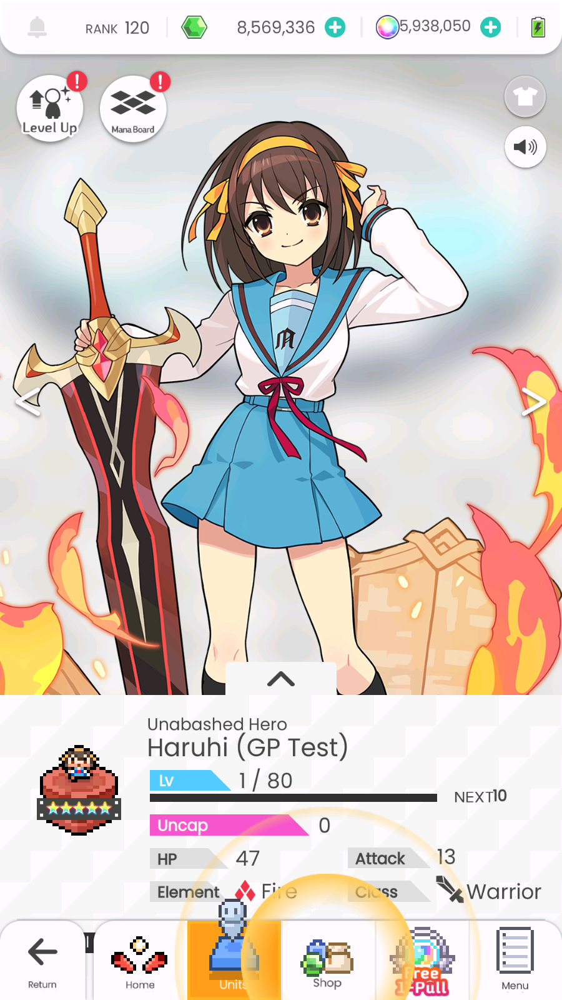
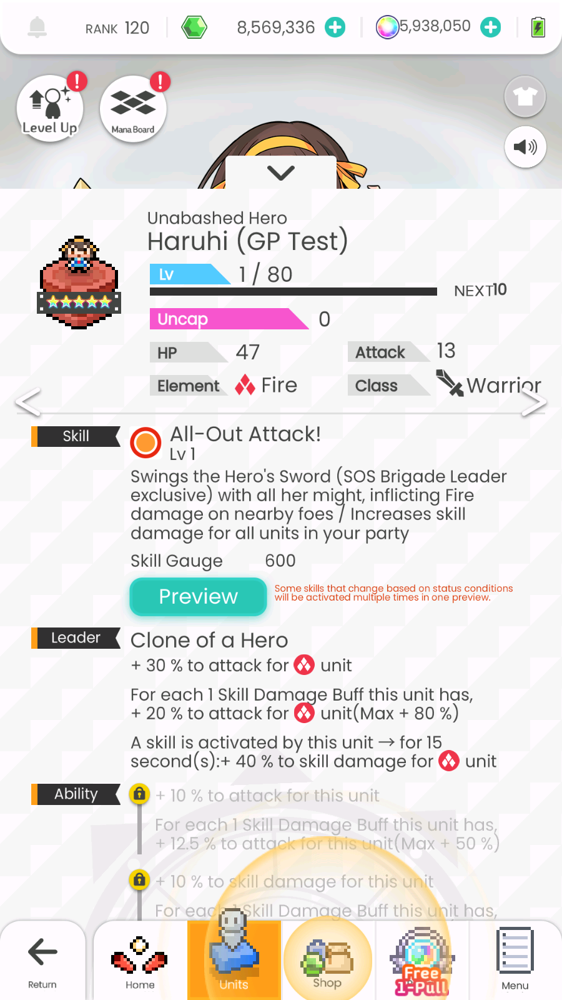
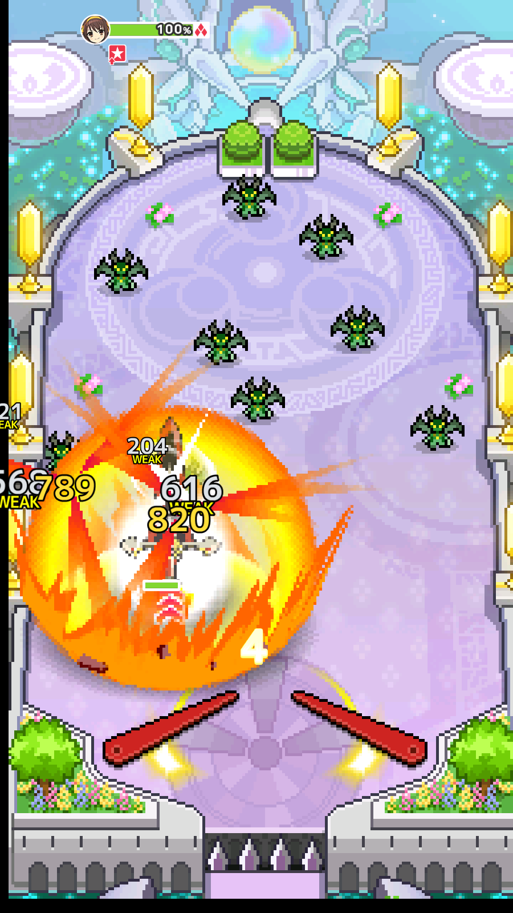
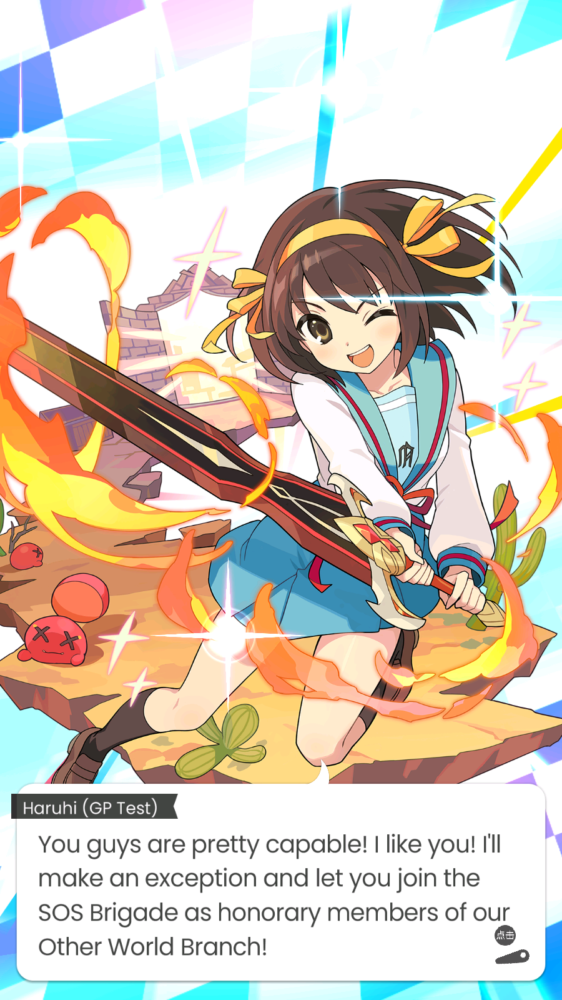

# 只用数据在国服客户端中加入新角色（研究，2026-11-03）

> 本页是 [new-units.md](new-units.md) 的中文版，由 Claude（AI）翻译。两者内容相同；如有出入，以英文版为准。

> [!IMPORTANT]
> ## 🤖 由 AI 撰写
> 这项研究和本文由 **Claude**（Anthropic 的 AI）在 Claude Code 会话中完成，仓库所有者同时在游戏中测试。事实来自游戏
> 自己的数据（扫描了国服的每个数据表、核对了文件列表、测量了文件）、反编译的国服客户端，以及在 Android 模拟器上的
> 测试；战斗、多人游戏、装备、上限突破、能力学习 2 和扭蛋的结果由所有者亲手确认。清单中注明了未测试的部分。在有人
> 实际试过之前，请把这些部分当作有根据的推测。

**结论：可行。** 一个全新的角色（ID 111907，字符串 ID `gp_test_haruhi`，“Haruhi (GP Test)”）被加入了打过补丁的国服 1.8.1
客户端，**没有修改任何游戏代码**：只用数据表的行加上文件，作为普通的 StarPoint 更新包发送，再加上两条服务器数据条目。
在 StarPointTest 模拟器上，它通过邮件发到存档并被领取，出现在角色列表中。它的详情页正常，技能**预览**也正常（真正运行
一场战斗，使用新的技能脚本、技能特效和语音）。它升到了 80 级，完成了上限突破和 EX突破。能力学习 1 全部解锁，
**包括觉醒**（觉醒立绘、语音和强化后的队长特性），它**完成了一场单人关卡战斗和一场多人游戏战斗**，还装上了装备和能力
魂珠。第二个副本作为普通的重复角色叠加（附带火属性 EX突破材料），把它的 ID 加入某个卡池后，它**从真实的扭蛋中被抽出**。
100 级、两种信赖之证以及完全解锁的**能力学习 2** 也都正常。

测试角色是凉宫春日（111069）的复制品，换了新的 ID 和字符串 ID，所以它的每个文件都是*新*文件。这和手工制作的角色走的是
同一条路。手工制作的角色还需要新的内容：美术、配置（kit）、技能脚本。角色所需的完整列表见
[清单](#清单自制角色需要的一切)；工具方面的想法见[“新角色”工具需要什么](#新角色工具需要什么)。

| | |
|---|---|
|  |  |
|  |  |

## 来源

- **社区模组（国际服，2024）。** duosii 的 `haruhi_mod` 把凉宫春日加入了国际服，以阿尔克（Alk）的文件
  （`alk_3halfanv`）为基础。它对数据表的修改全是新增，并加入了约 380 个新文件。有两个已报告的问题：“进入战斗和打开
  角色详情时游戏崩溃”，以及一个会把你送到下载画面的“素材检查”。两者在下文都有解释；它们也正是这项研究最先遇到的两个
  问题。
- **工具。** [wfax](https://github.com/blead/wfax)（Go：`fetch`、`extract`、`pack`）和
  [wdfp-extractor](https://github.com/ScripterSugar/wdfp-extractor)（Electron，较新）可以提取和重新打包文件。它们的路径
  列表（67,645 和 61,894 个逻辑路径）大多是数据表中出现的路径。两者都没有列出角色的立绘、精灵图或战斗语音：这些名称是
  在游戏代码中拼出来的。GlobalPoint 已经有自己的对应工具（`scripts/cdn_hash.cjs`、`cdn_rows.cjs`、`amf3.cjs`、
  `build_cn_patch.cjs`）。
- **反编译的国服客户端**（`F:\WF client\cn\decompiled\scripts`）：下文标为 *（代码）* 的内容都来自这里。
  `pinball/master/generated/*Values.as` 为 785 个数据表各提供了一个解析器，其中写明了每一列的名称。

## 游戏怎样找到一个角色

- **ID**（`111907`）是大多数数据表的键。按惯例第 1 位 = 稀有度（1 = 5★），第 2 位 = 属性（1 火 … 6 暗），但游戏从角色行
  读取稀有度和属性，而不是从 ID 读取：国服自己的 700000-700019 和 999999 就不符合这个规律。只有 StarPoint 会读某一位
  数字（`src/lib/gacha.ts`：第一位决定扭蛋动画的稀有度）。未使用的 ID 都能用；没有任何地方检查范围。
- **字符串 ID**（character 第 0 列，`gp_test_haruhi`）是所有文件所在的文件夹：
  `character/<字符串 ID>/ui/...`、`/pixelart/...`、`/voice/...`、`/battle/...`。*（代码）*
- **character 第 8 列**是技能名（`master/skill/action_skill` 的键 `<名称>/1`、`/2`）。技能行的第 7 列是技能脚本
  `battle/action/skill/action/rare5/<名称>$<名称>_N`。*（代码：CharacterValues）*
- **能力学习的节点 ID 不能随便取。** 游戏根据节点 ID 找到它的行：
  `盘 = id / 200 % 10`，`序号 = id % 200`，所以 `id = 角色 × 2000 + 盘 × 200 + 序号`
  （凉宫春日 222138201 = 111069 × 2000 + 200 + 1；莱特（151153，Meteor Light）的能力学习 2 ID 302306201… = 151153 × 2000 + …）。
  *（代码：GeneralManaNodeLogic.get_values）* 其他 ID 会让详情页出现 C8601 “key 5”。

## 数据表（19 个）

通过解码国服的每个数据表（3,895 个）并搜索 ID 和字符串 ID 找到。键是新角色的。

| 数据表 | 键 | 说明 |
|---|---|---|
| master/character/character | id | 第 0 列字符串 ID，8 技能名，17 队长特性 ID，18 队长特性名，19-24 能力 ID，27 identity id |
| master/character/character_text | id | 第 0 列名称，3 称号，之后是技能/能力文字（在 GlobalPoint 的数据表中已经是英文） |
| character_status `5c/6a4f…` | id/等级 | 1/10/80/100 级的 “HP,ATK” |
| master/character/character_speech | id | 主界面台词；第 4 列 = `voice/` 下的语音文件 |
| ability `1e/664c…` | id×10+1..6 | 每行两个子行（布局见内部笔记 kit-rows-decode） |
| leader_ability `ff/8435…` | id | |
| master/skill/action_skill | 技能名 / 1、2 | 第 7 列技能脚本路径，4/5 技能槽 |
| skill_preview_character `aa/abdd…` | id | 使用哪个预览关卡 |
| character stance_detail `d7/50c2…` | id | |
| full_shot_image_attribute `b9/132d…`、character_image `3e/b411…`、trimmed_image `fb/ab43…` | id/0,1；图片路径 | 图片裁剪 |
| upskill `57/8872…` | id | |
| character_gacha_sound `ac/b038…` | id/帧 | “角色加入”动画的音效 |
| master/mana_board/mana_node | id/盘/序号 | 节点 ID 规则见上 |
| master/generated/mana_board | id/盘/序号 | 布局；第 5 列 = 父节点 ID |
| master/mana_board/mana_board2_open_condition | id | |
| master/encyclopedia/encyclopedia | 1<id> | |
| master/story/story_character | 字符串 ID | 名称、语音文件夹、表情 |

可玩的角色不需要以下数据表（已测试：没有它们也不会出问题）：degree（称号）、degree_mission、gacha/卡池行、商店、活动剧情。
行可以加在任何位置：查找是按键进行的（`OrderedMap`、`indexOf`），不是二分查找。

## 文件（凉宫春日有 76 个）

- `pixelart/` 8 个：`pixelart`、`special` 的 `.frame` + `.timeline`，`sprite_sheet` 和 `special_sprite_sheet` 的 `.png` + `.atlas`
- `ui/` 41 个（大多在 `medium_upload`）：`square_*`、`thumb_*`、`full_shot_1440_1920_0/1`、`skill_cutin_0/1`、
  `cutin_skill_chain_*`、`battle_*`、`episode_banner_0`、`illustration_setting_sprite_sheet`、`story/<表情>`
- `voice/` 22 个：`battle/`（battle_start、skill、skill_ready、outhole、power_flip、normal_attack、win；`_0`/`_1`）、
  `login/login_0..2`、`home/…`（来自 character_speech）
- `ui/skill_cutin_0/1.atf.deflate` 2 个（仅 Android 的文件夹 `android_upload`）：战斗中的技能特写纹理
- `battle/character_detail_skill_preview` 和 `character_info_skill_preview` 的 `.battle`：录制好的预览输入
- 技能脚本 `battle/action/skill/action/rare5/<技能>$<技能>_1/_2.action.dsl`；技能特效在
  `battle/effect/skill_unique/...` 下（由技能脚本指定，所以新角色可以复用其他角色的特效）

存储名称：`<逻辑路径>.<类型>`，用 `scripts/cdn_hash.cjs` 计算哈希；类 JSON 文件是 AMF3 + deflate
（`.atlas.amf3.deflate`、`.frame.amf3.deflate`、`.action.dsl.amf3.deflate`）；图片是 `.png`；语音是 `.mp3`。
`scripts/research/unit_files.cjs <id>` 列出一个角色的文件（它会尝试游戏拼出的每一种名称）。

**文件内写着自己的路径。** `.frame` 和 `.atlas` 文件内含它们自己的路径（`"name":
"character/suzumiya_haruhi/pixelart/special"`）。改名后的副本必须改写内部内容，否则游戏会去找旧的动画：C8003
“…pixelart/special 的影像短片尚未加载”。这很可能就是 duosii 的模组在战斗和角色详情中崩溃的原因。`scripts/amf3.cjs`
可以读写这些文件（解码、编辑、编码：重新读取后值相同）。有些文件是 raw deflate，有些是 zlib。

## “素材检查”

并不存在清单检查。游戏只要读取到磁盘上没有的文件，就会进入“数据不足，返回标题画面”的画面，或者报错 8100
*（代码：FileReader → AssetSufficiencyCheckLoadingTask）*。游戏会把准确路径报告到服务器的崩溃日志（`cn_requests.log`
中的 `/cn/crash`）：
`notify_asset_recovery 未找到素材 character/gp_test_haruhi/battle/character_detail_skill_preview.battle.amf3.deflate`。
所以缺少文件很容易诊断：打开该画面，查看日志，补上文件即可。
凉宫春日模组没有带任何语音文件和 `battle/` 预览文件，这解释了它的下载画面。

一个相关的陷阱：数据表查找失败（C8601）时，游戏会**删除它的那份数据表**。下一次发送该数据表的更新会把它恢复。

## 发送

- 更新包可以加入任何新文件，放在 `upload/` 或 `medium_upload/` 中（`scripts/build_cn_patch.cjs`；1.4.600 的主界面横幅
  已经这样做过）。
- **服务器**：`assets/character.json`（`{ name, rarity, element, skill_count: 6, cn: true }`），这样服务器才能发放该角色
  （网页控制台 Give → 邮件）；`assets/mana_node_cn.json`（相同的节点 ID），这样能力学习的解锁才会被接受。
- **日程重建是难点。** 其中七个数据表（character、character_status、ability、leader_ability、action_skill、
  encyclopedia、mana_board2_open_condition）会被每次日程构建（`scripts/gen_cn_event_schedule.cjs`）用国服自己的行重新
  发送，所以新行在下次重建时就会消失，含有该角色的存档随后会出现 C8601。按日期切换配置的机制（`assets/kit_dates.json`）
  只会*替换*已有的行。**此后已解决：** 自制角色（[../CUSTOM_UNITS.md](../CUSTOM_UNITS.md)（英文））把行保存在
  `assets/custom_units/<id>.json` 中，每次日程构建都会把它们加进 19 个数据表（总是发送）；服务器在启动时把该角色合并进
  它的角色、能力学习和扭蛋数据。

## 概念验证

`scripts/research/clone_cn_unit.cjs`（角色和名称在文件开头设置）会写出：带新行的 19 个数据表、新字符串 ID 下的 76 个文件
（需要时改写内部名称）、给 `build_cn_patch.cjs` 用的 `files.json`，以及用于两个服务器文件的 `server.json`。它从设备上
最新的副本中取数据表（国服 → 本机的更新包 → `--newer` 文件夹，例如手机自己的日程构建），所以翻译仍保持英文。

测试过程（模拟器 5556，companion 服务器，游戏处于日程构建 1.4.805）：

1. 1.4.950：除了文件的内部名称外全都有 → 邮件图标正常，领取时出现 **C8003**（frame 名称）。
2. 1.4.951：改写了 frame/atlas 名称 → 角色列表正常，详情页出现 **C8601**（能力学习节点 ID）。
3. 1.4.952：节点 ID = 角色 × 2000 + … → 详情页、技能、队长特性、能力都正常；预览 → 因
   `battle/character_detail_skill_preview.battle` 出现**素材恢复**画面。
4. 1.4.953：加入了两个预览文件 → 预览战斗中技能正常发动；服务器接受能力学习解锁；1-80 级、上限突破、EX突破、
   含觉醒的能力学习 1 全部正常。关卡战斗 → 因 `ui/skill_cutin_1.atf.deflate` 出现**素材恢复**画面。
5. 1.4.954：加入了两个 `.atf.deflate` 技能特写（Android 文件夹）→ 完成了单人关卡战斗和多人游戏战斗；装上装备和能力魂珠
   都正常。通过邮件获得第二个副本：出现获得角色的画面，叠加 +1，并得到一个火属性 EX突破道具。加入卡池 1613 的 5★ 池
   （`assets/gacha.json`）：抽到了，结果画面正常。

6. 同样是 1.4.954：Lv 100、两种信赖之证（`receive_bond_token`）、开放能力学习 2 并学会所有节点（第 2 盘的 ID 为
   111907 × 2000 + 400 + 序号）。没有获得称号，因为没有复制 degree 的行，也没有报错。

尚未测试：与另一台设备进行多人游戏、真实手机。把该角色作为自制角色进行日程重建（docs/CUSTOM_UNITS.md）在模拟器上是
可行的：见那里的测试。
没有打开图鉴（encyclopedia）条目；测试用的更新包中它的解锁条件（第 21 列）还是凉宫春日的 ID，`clone_cn_unit.cjs` 现在会
替换它。

## 清单：自制角色需要的一切

各部分的可靠程度：
- **已在游戏中验证：** 一个恰好具有这些 ID、行、文件和服务器条目的角色，在测试过的所有方面都正常（见概念验证）。错误代码
  一节列出的每个失败都曾出现过，并已解释和修复。
- **已测量：** 尺寸、格式、小写的 `png` 签名、MP3 帧头（`7FFB`，已核对）、ATF 文件头、动画序列名：这是凉宫春日的文件
  本身的情况，不是测试出的限制。
- **未测试：** “画面需要的”数据表是否真的全都必需（凉宫春日有的都复制了；没有故意去掉某个来试）；测试中没有打开的画面
  （城镇、主界面角色、图鉴）是否还会要求更多文件（日志会指出）；新美术用普通 PNG / 普通 MP3 是否可以（用 `png2atf`
  做的技能特写可以：2026-11-16 已测试，见下文）；`character.json` 中火属性以外的属性编号。“可选”项只在注明的地方测试过
  （称号、概率列表）。

### 1. ID（先选定；其他一切都由它们推出）

| ID | 规则 | 测试角色 |
|---|---|---|
| 角色 ID | 6 位数字，不能是国服的 505 个 ID 之一。如果角色可以从扭蛋抽出，保持第 1 位 = 稀有度（1 = 5★ … 5 = 1★）（服务器据此选择扭蛋动画）；第 2 位 = 属性（1 火、2 水、3 雷、4 风、5 光、6 暗）只是惯例；第 3-6 位随意 | 111907 |
| 字符串 ID | 所有文件所在的小写文件夹名；不能重复 | `gp_test_haruhi` |
| 技能名 | character 第 8 列，技能行的键（通常 = 字符串 ID） | `gp_test_haruhi` |
| 能力 ID | 角色 ID × 10 + 1..6 | 1119071-1119076 |
| 队长特性 ID | = 角色 ID | 111907 |
| 图鉴键 / 条目 ID | `1` + 角色 ID / `1` + 角色 ID + `01` | 1111907 / 111190701 |
| 能力学习节点 ID | 角色 ID × 2000 + 盘 × 200 + 序号（盘 1-2，序号 1-199）；游戏从 ID 推出盘和行 | 223814201… |

### 2. 数据表的行（19 个数据表，随游戏更新发送）

全部从模板角色复制后修改。文字字段是玩家看到的内容（在 GlobalPoint 的数据表中为英文）。

- **角色存在所必需：** character、character_text（名称、称号、技能和能力文字）、character_status（Lv 1/10/80/100 的
  HP/ATK）、ability ×6、leader_ability、action_skill（2 行：技能和技能+）、mana_node + generated/mana_board（两个盘）、
  mana_board2_open_condition（第 2 盘的开放日期）。
- **画面所必需：** character_speech（主界面台词、语音名称）、story_character（名称、表情）、stance_detail、
  skill_preview_character、upskill、full_shot_image_attribute、character_image 和 trimmed_image（图片裁剪）、encyclopedia
  （它的解锁条件，第 21 列，指向角色本身）、character_gacha_sound（`ac/b038…`，“角色加入”动画的音效）。
- **可选：** degree + degree_mission + degree_mission_reward（Lv 100 / 能力学习的称号）、gacha_odds（概率列表）、
  gacha / 特色卡池的行、角色剧情、活动剧情。

### 3. 文件（76 个；大多数玩家从不会看到这些文件夹名）

名称经过哈希（`scripts/cdn_hash.cjs`）；每个文件保持它所属的文件夹种类（`upload`、`medium_upload`、`android_upload`）。
图片是 PNG，签名写成小写（`\x89png`，与游戏自己的所有图片一样）；除非另有说明，AMF3 文件都是 raw deflate 压缩。

| 文件 | 文件夹 | 格式 / 尺寸 | 说明 |
|---|---|---|---|
| `pixelart/sprite_sheet.png` + `.atlas.amf3.deflate` | upload | PNG 约 250×255；帧的 atlas | 帧是缩放 6 倍的 256×256 格子，名为 `character/<id>/pixelart/pixelart0001`… |
| `pixelart/pixelart.frame` + `.timeline` `.amf3.deflate` | upload | AMF3 | frame 内写着自己的路径；timeline 序列：`neutral`、`walk_back`、`walk_front`、`skill_ready`、`kachidoki`、`into_coffin`、`ghost_raise`、`ghost_neutral`、`revive` |
| `pixelart/special_sprite_sheet.png` + `.atlas`、`special.frame` + `.timeline` | upload | PNG 128×512 | 技能姿势：序列 `special_land`、`special_pose` |
| `ui/full_shot_1440_1920_0/1.png` | medium | 约 1400×1700 / 约 1560×1500 | 立绘，`_1` = 觉醒后 |
| `ui/skill_cutin_0/1.png` | medium | 1024×512 | |
| `ui/skill_cutin_0/1.atf.deflate` | **android** | ATF 纹理（`ATF` 文件头），raw deflate | 战斗技能特写；新美术：Adobe 的 `png2atf -c e`，见[制作战斗技能特写](#制作战斗技能特写-atf)（已测试） |
| `ui/square_0/1`、`square_132_132_*`、`square_round_136_136_*`、`square_round_95_95_*` | medium | 212²、132²、136²、95² | 图标 |
| `ui/thumb_party_main_*`、`thumb_party_unison_*`、`thumb_level_up_*` | medium | 186×392、144×188、252×329 | |
| `ui/battle_control_board_*`、`battle_member_status_*`、`cutin_skill_chain_*` | medium | 104×268、58×58、276×319 | 战斗 HUD |
| `ui/episode_banner_0` | medium | 430×215 | |
| `ui/illustration_setting_sprite_sheet.png` + `.atlas` | medium + upload | 362×792 | 两个裁剪 `full_shot_illustration_setting_0/1` |
| `ui/story/base_0/1` + story_character 中每个表情各一个 | medium | 570×约 600；表情约 200×290 | |
| `battle/character_detail_skill_preview` / `character_info_skill_preview` `.battle.amf3.deflate` | upload | AMF3，zlib | 录制好的技能预览输入；可以从任何角色复制 |
| `battle/action/skill/action/rare5/<技能>$<技能>_1/_2.action.dsl.amf3.deflate` | upload | AMF3 技能脚本 | 指定 `battle/effect/skill_unique/…` 下的特效文件（可复用任何角色的，或新增） |
| `voice/battle/` battle_start_0/1、skill_0/1、skill_ready、outhole_0/1、power_flip_0/1、win_0/1（部分角色有 normal_attack_*） | upload | MP3（带 ID3 标签；帧同步字节 0xFF 存为 0x7F） | |
| `voice/login/login_0..2`、`voice/home/*`、`voice/ally/join`、`voice/ally/evolution` | upload | MP3 | 名称来自 character_speech |

缺少文件时会显示“数据不足，返回标题画面”（或错误 8100）；准确路径在伴侣应用的
`files/server/logs/cn_requests.log` 中（`/cn/crash`，`未找到素材 <路径>`）。

### 4. 服务器数据

- `assets/character.json`：`"<id>": { "name": "", "rarity": 5, "element": 0, "skill_count": 6, "cn": true }`
  （这里的 element 是 0 火 … 5 暗）。发放、升级、上限突破和叠加该角色都需要它。
- `assets/mana_node_cn.json`：两个盘，节点 ID → 道具、玛纳消耗（解锁节点需要它）。
- 可选：`assets/gacha.json` 卡池（放在该档位列表的第一个，或重新调整权重；见扭蛋一节）。
- 对于要长期保留的角色，这三项都改写进它的自制角色文件（`character`、`manaNodes`、`banners`，权重在启动时重新调整；
  见 [../CUSTOM_UNITS.md](../CUSTOM_UNITS.md)（英文））：自带的 assets 保持不变。

### 5. 发送

- 一个游戏更新（`scripts/build_cn_patch.cjs`），带上该角色的文件，版本号远高于日程构建（美术更新用 1.4.9xx；绝不能用
  手机自己的日程构建可能用到的版本号）。研究用的测试更新包也带了数据表；要长期保留的角色，其更新只带文件
  （`clone_cn_unit.cjs` → `art_files.json`）。
- 数据表的行放进 `assets/custom_units/<id>.json`：每次日程构建都会把它们加进随后发送的全部 19 个数据表，所以重建时不会
  丢失（以前，日程重建的 7 个数据表会丢失这些行，含有该角色的存档就无法加载，C8601）。见
  [../CUSTOM_UNITS.md](../CUSTOM_UNITS.md)（英文）。
- 手机和获取其他更新一样获取它（Wi-Fi 复制，勾选游戏更新）。

### 6. 过程中遇到的错误代码

| 代码 | 含义 | 本次的原因 |
|---|---|---|
| 8100 / 素材恢复画面 | 游戏读取的文件不存在 | 漏掉了某个文件（路径在日志中） |
| C8003 `…的影像短片尚未加载` | 动画未加载 | 某个 `.frame`/`.atlas` 中仍写着模板角色的路径 |
| C8601 `指定的Key不存在` | 数据表中缺少行（并且游戏会删除该数据表） | 能力学习节点 ID 错误；或者行在重建时被丢掉 |

## “新角色”工具需要什么

1. **行。** 用一个小 JSON 文件描述角色（ID、字符串 ID、稀有度、属性、属性数值、能力行、队长特性、技能行、能力学习），
   编译成 19 个数据表的行。能力/队长特性的列已经解码（内部笔记 kit-rows-decode，`scripts/build_kit_*.cjs`），
   `*Values.as` 写明了每个数据表每一列的名称。
2. **与日程集成。** 已完成：[../CUSTOM_UNITS.md](../CUSTOM_UNITS.md)（英文）（`assets/custom_units/`，每次日程构建都加入
   这些行，启动时合并服务器数据）。
3. **美术流程。** 像素精灵图做成精灵表 + `.atlas`（帧的矩形，AMF3）+ `.frame`/`.timeline`（动画序列，例如
   `special_land`/`special_pose`）；固定尺寸的立绘和图标（上面的 `ui/` 列表）；`trimmed_image`/`character_image` 的
   裁剪行。`scripts/cn_sprite_merge.cjs`/`amf3.cjs` 已经能写出精灵表和 atlas。真正的成本在于画美术。
   **美术由数据决定：** 游戏代码中没有任何图片或动画。代码只固定名称：由字符串 ID 拼出的文件路径，以及它播放的动画序列
   （战斗：`neutral`、`walk_front`/`walk_back`、`skill_ready`、`kachidoki`、`into_coffin`、`ghost_raise`、
   `ghost_neutral`、`revive`；加入动画和技能：`special_land`、`special_pose`）。其他一切都在角色的文件和行中：每个序列
   有多少帧、每帧显示多久（`.timeline`），每帧在精灵表上的位置和偏移（`.atlas`：`n` 帧名，`x`/`y`/`w`/`h`，`r` 旋转，
   `fx`/`fy`/`fw`/`fh` 在 256×256 格子中的位置），绘制缩放（`.frame`），以及立绘的裁剪（`trimmed_image`、
   `character_image`、`full_shot_image_attribute`）。**尚未研究：** 这些值背后的规则（每个序列的帧数、时间、裁剪怎样
   测量、哪些 atlas 字段是必需的）；可以复制一个模板角色的来对比。
4. **技能。** 已完成（2026-11-16/17）：角色编辑器的**技能页（Skill tab）**以指令的形式编辑技能脚本（一棵 AMF3 树，
   `["ActionDsl", 1, …, ["Block", [["Command", ["StopBall", …]], …]]]`），用国服的每个脚本来检查它们，提供预览，并发送它们
   （[../UNIT_EDITOR.md](../UNIT_EDITOR.md#skill-tab)、[../SKILL_GUIDE.md](../SKILL_GUIDE.md)（英文））。每条指令都记录在
   [skill-commands.zh-CN.md](skill-commands.zh-CN.md) 中；特效、它们的文件和动画格式见
   [skill-effects.md](skill-effects.md)（英文）。新技能可以组合已有的指令，复用任何角色的特效和任何协力球（按 ID）。新的
   *特效*动画仍然属于美术：格式已经清楚（网页控制台也能播放），但还没有制作工具。
5. **语音。** 可选。游戏的 MP3 把每帧的同步字节 0xFF 存为 0x7F（见 wdfp-extractor 的 restoreMp3）；新的语音片段应该用
   同样的方式存储（普通 MP3 能否播放尚未测试）。
6. **ID。** 选一个国服从未用过、稀有度/属性位正确的 ID；能力学习 ID 由它推出。

## 扭蛋

抽取由服务器数据决定：`assets/gacha.json` 中每个卡池按档位列出它的卡池内容，把角色的 ID 加进去就能抽到（在卡池 1613
上测试过）。结果画面使用角色已有的文件。有两点细节：
- `src/lib/gacha.ts` 掷 0-1000 的数，按顺序遍历该档位的列表，所以权重（`rarity`，千分比）的总和仍须约为 1000：要么按
  比例缩小其他角色，要么加在末尾的角色几乎永远抽不到。
- 卡池的概率画面来自国服的概率数据表（`master/gacha_odds/<id>`），所以那里没有对应行时，角色能抽到但不会被列出。
  特色卡池（图片、特色内容、pickup 动画）的工作量要大得多。

服务器不认识的 ID 会被跳过（这次抽取作废，不报错）；服务器认识但游戏数据表中没有的 ID 会被保存，然后弄坏存档
（C8601），所以卡池中只能写两边都存在的角色。

**领主和活动**遵循同样的规则（数据表 + 文件 + 服务器自己的关卡数据）；Haunt 和活动日程已经用这种方式加行。这里没有
测试它们。

## 替换已有角色的文件（换皮、换语音）

比新角色简单得多：不需要 ID、数据表的行或服务器数据。在游戏更新中把替换文件放在**相同的逻辑路径**下（因此哈希名称和
文件夹种类都相同：`upload`、`medium_upload`、`android_upload`）；较新的更新为准。国际服的社区换皮（`V1.0.0.zip`：
flame_witch 和 wild_wolfgirl，223 个文件）和换语音（`Shakari_unpacked.rar`）就是这样做的。在国服上，同样的文件放进
StarPoint 的更新包（`scripts/build_cn_patch.cjs`），而不是国际服的 `.cdn/mods`。

这项研究得出的规则：
- **成对替换。** 精灵表 `.png` 和它的 `.atlas` 必须对应（不对应时帧会画乱：内部手册中的“scrambled portals”）。`.frame`
  文件内写着自己的路径，路径不变时它就仍然正确，所以只有绘制缩放或偏移改变时才需要修改它。
- **像素精灵图以前就换过皮。** V1.0.0（Shakari 的 flame_witch / wild_wolfgirl 换皮）为 flame_witch 提供了全部 8 个精灵
  文件，为 wild_wolfgirl 提供了 4 个：新的精灵表（重新打包，例如 1953×81 的长条）和新的 atlas，以及帧数与游戏每个序列
  完全相同的 frame/timeline 文件（在原动画上重画的帧）。Shakari 的工作文件夹中有背后的单帧 PNG 和 GIF 预览。
- **战斗技能特写是两个文件。** `ui/skill_cutin_N.png`（菜单）和 `ui/skill_cutin_N.atf.deflate`（Android 文件夹）同时存在；
  战斗中请求的是 `.atf.deflate`。V1.0.0 只替换了 PNG，所以它的战斗技能特写很可能仍显示原来的图。完整的换皮也需要
  `.atf.deflate`：见[制作战斗技能特写](#制作战斗技能特写-atf)（已测试）。

## 制作战斗技能特写 (ATF)

2026-11-16 在 StarPointTest 模拟器上测试：用这种方法做的技能特写在战斗中正常显示（克菈菈的技能特写被替换成从未实装角色
harpy 的完整立绘中裁出的图，在技能连锁中与另一个角色的特写并列）。

**游戏的技能特写是什么：** `ui/skill_cutin_0/1.png`（菜单，medium 文件夹，签名改写为 `\x89png`）和
`ui/skill_cutin_0/1.atf.deflate`（战斗，Android 文件夹，**raw deflate**）。ATF 是版本 3、**格式 5**（带 alpha 的原始块
压缩），1024×512，11 级 mip，699,280 字节；它的四个 GPU 分区中只有 **ETC1 + alpha** 有内容（DXT5、PVRTC 和 ETC2 是空的）。
图片是角色立绘的头肩部裁剪，放在透明的 1024×512 画布左上角（克菈菈的大约占左边 520 × 420）。客户端用 Starling 的
`Texture.fromAtfData` 加载它，该函数接受 ATF 格式 0-5、12、13，并按文件所写的格式生成纹理。

**编码器：** Adobe 的 `png2atf` V0.8（2010-2012），一个来自 Adobe 旧版 Gaming SDK（“Utilities / ATF Tools”）的命令行
工具。Adobe 已不再提供它；[PNG-to-ATFConverter](https://github.com/HeizerGe5/PNG-to-ATFConverter) 仓库中有一份副本（以及
它需要的 Visual C++ 2010 运行库 DLL），位于 `ATFConverter/Properties/png2atf.exe`。这份副本带有有效的 **Adobe Systems**
代码签名（用 `Get-AuthenticodeSignature` 检查过）。只需要 `png2atf.exe`、`msvcp100.dll` 和 `msvcr100.dll`。

**做法：**
1. 制作带透明的 1024×512 PNG（裁剪，放在左上角）。
2. `png2atf -c e -i skill_cutin_0.png -o skill_cutin_0.atf`
   （只写 `-c` 会嵌入全部四个 GPU 分区：2.4 MB 而不是 0.7 MB，也不是游戏发送的样子）。
3. 把 `.atf` 的第 5 个字节设为 `0x01`（游戏的文件是这样；`png2atf` 写的是 `0x00`；含义未知，为了一致而保留）。这样文件头
   的其余部分就与游戏的完全相同。
4. 用 raw deflate 压缩（`zlib.deflateRawSync`）为 `skill_cutin_0.atf.deflate`；放在 Android 文件夹路径下发送
   （`uploadPath(logical, "android_upload")`），PNG（签名设为 `\x89png`）放在 medium 文件夹路径下。

已核对：用这种方法转换克菈菈自己的技能特写 PNG，得到的文件与游戏的大小和布局完全相同（83.5 % 的字节相同；其余是压缩
像素中常见的编码器差异）。
- **构图不同的立绘**还需要修改它的裁剪行（`trimmed_image`、`character_image`、`full_shot_image_attribute`），这些是数据表
  的行，不是文件。
- **语音：** 游戏自己的 MP3 把帧同步字节存为 `7F`，但 Shakari 的换语音使用普通 MP3（`FF`），在国际服上发布时可以正常
  使用，所以普通 MP3 很可能可以播放。未在国服上测试。
- **文件缺失或错误**的表现与新角色相同：素材恢复画面，或者对写错路径的动画出现 C8003；路径在 `cn_requests.log` 中。
- **撤销**：在之后的更新中发送原来的文件（游戏保留它最后收到的版本）。
- **文字**（名称、技能说明）是数据表的行，不是文件；其中几个数据表会被日程重建，所以文字修改应放在日程构建中（像
  `assets/kit_dates.json` 那样），而不是放在一次性的更新里。

## 附录：19 个数据表的每一列

字段名是国服客户端自己的（反编译客户端中的 `pinball/master/generated/<Parser>.as`，由
`scripts/research/table_columns.cjs` 提取，不是猜的）；值是测试角色实际发送的行（英文文字）。对这个角色总是空的列，除非
客户端为它命名，否则省略。“示例键”是其中一行；按 角色/等级、角色/盘/节点 等作键的数据表，每个子键各有一行。

**ability 和 leader_ability** 每行带有一整棵效果树（每个效果一个 CSV 子行）。它们的布局是本附录“使用客户端自己的名称”
的唯一例外：本附录使用的反编译来自一个**较旧的客户端**，它的能力行少 2 列（124/122，与 2024 年凉宫春日模组的行一样），
而且它无法读取那些庞大的效果解析器（栈溢出）。下面的列是国服 1.8.1 的，已对照实际发送的行和
[ability-triggers.md](ability-triggers.md)（英文）核对过，后者从已安装客户端的 p-code 中读取它们：

| 能力列 | 队长特性列 | 部分 |
|---|---|---|
| 0-2 | 0 | string_id、unisonable（false = 只限主角色）、statue_group_id（图标组）；队长特性：string_id |
| 5 | 3 | 行种类：0 触发时（即时），1 期间（持续），战斗开始 |
| 6, 13, 20 | 4, 11, 18 | 条件、条件 2、条件 3（“仅当”），各自旁边是它的属性/数量列 |
| 27, 28 | 25, 26 | “触发时”的事件和对象；30/31 是它的阈值（最小/最大） |
| 47, 48 | 45, 46 | “触发时”的效果和目标 |
| 97, 98 | 95, 96 | “期间”的状态和对象；100/101 是它的阈值 |
| 109, 110 | 107, 108 | “期间”的效果和目标 |

其余 17 个数据表的名称来自同一个较旧的反编译。它们的列数与国服 1.8.1 的行一致，值放在这些名称下也说得通（抽查过：
character、character_text、encyclopedia、技能预览、能力学习），但此后新增或移动过的列仍可能命名错误；如果哪一列看起来
不对，ability-triggers.md 背后的 p-code 读取程序才是准确的来源。

在按日期切换配置的工作中（亚美莉亚（Amelia）的旧配置），这些块中被修改并在游戏中检查过的列：
ability 6 角色条件（9/10 数量，11 属性），27 触发（8 Fever 开始，23 技能，77 经过秒数，…），28 由谁触发，30/31 阈值，
34 最大叠加数，47 效果（32 攻击力上升，205 HP，206 治疗 %，213 Fever 槽，…），48 目标（0 自身，2 队长，5 按 49 筛选的
队伍），51/52 Lv 1/最高等级时的数值（100000 = 100%），57/58 持续时间（帧 × 100000）；期间：97 条件（0 HP 高于，1 HP
低于，4 Fever 中），98 对象，100/101 阈值，109 效果，110 目标，113/114 数值。队长特性：同样的列 −2；56 = Fever 时间。

### master/character/character（`2d/5cb9…`，解析器 `CharacterValues`）

示例键：`111907`。

| 列 | 客户端字段 | 测试角色的值 |
|---|---|---|
| 0 | string_id | gp_test_haruhi |
| 1 | gacha_odds_weight | 1 |
| 2 | rarity | 5 |
| 3 | element | 0 |
| 4 | race | Human |
| 5 | character_tag |  |
| 6 | speciality_type | 0 |
| 7 | gender | Female |
| 8 | action_skill | gp_test_haruhi |
| 9 | action_skill_switching | (None) |
| 10 | action_skill_switching.condition |  |
| 11 | action_skill_switching.condition.unique_condition_id |  |
| 12 | action_skill_switching.multiballs |  |
| 13 | action_skill_switching.threshold |  |
| 14 | action_skill_switching.action_skill |  |
| 15 | action_skill_switching.no_voice |  |
| 16 | action_skill_switching.no_ready_voice |  |
| 17 | leader_ability（id = 角色 ID） | 111907 |
| 18 | leader_ability（名称） | Clone of a Hero |
| 19 | ability_1 | 1119071 |
| 20 | ability_2 | 1119072 |
| 21 | ability_3 | 1119073 |
| 22 | ability_4 | 1119074 |
| 23 | ability_5 | 1119075 |
| 24 | ability_6 | 1119076 |
| 25 | mana_board_kind | 2 |
| 26 | stance | Attacker |
| 27 | identity_character_id | 111907 |
| 28 | pedestal_image | (None) |
| 29 | max_evolution_level | 1 |
| 30 | omit_character_quest | true |
| 31 | web_site_publish | false |
| 32 | obtain_source | 0 |
| 33 | mana_node_auto_mode | 1 |
| 34 | mana_node_auto_mode.kind |  |
| 35 | mana_node_auto_mode.has_board2 |  |
| 36 | max_ability_powers | 6,6,6,6,6,6 |

### master/character/character_text（`8b/0357…`，解析器 `CharacterTextValues`）

示例键：`111907`。

| 列 | 客户端字段 | 测试角色的值 |
|---|---|---|
| 0 | name | Haruhi (GP Test) |
| 1 | furigana | LIANGGONGCHUNRI |
| 2 | description | A hero who crossed over from another world and the leader… |
| 3 | nickname | Unabashed Hero |
| 4 | skill_name_1 | All-Out Attack! |
| 5 | skill_description_1 | Swings the Hero's Sword (SOS Brigade Leader exclusive) wi… |
| 6 | skill_name_2 | All-Out Attack!+ |
| 7 | skill_description_2 | Swings the Hero's Sword (SOS Brigade Leader exclusive) wi… |
| 8 | leader_ability_name | (None) |
| 9 | voice_actor | (None) |
| 10 | （此客户端不读取）队长特性名 | Power to Liven Up the World |
| 11 | （此客户端不读取）声优 | Aya Hirano |

### character_status（`5c/6a4f…`，解析器 `CharacterStatusValues`）

示例键：`111907/1`。

| 列 | 客户端字段 | 测试角色的值 |
|---|---|---|
| 0 | hp | 47 |
| 1 | atk | 13 |

### master/character/character_speech（`b4/a286…`，解析器 `CharacterSpeechValues`）

示例键：`111907`；这一行有 8 个子行。

| 列 | 客户端字段 | 测试角色的值 |
|---|---|---|
| 0 | kind | 0 |
| 1 | kind.constraint | 0 |
| 2 | kind.evolution_level | 1 |
| 3 | speech | This place is SO much fun! There's something new to disco… |
| 4 | voice_path | home/kokotte_hontoni |

### ability（`1e/664c…`）和 leader_ability（`ff/8435…`）

示例键：`1119071`…`1119076`（凉宫春日的每行两个子行），队长特性 `111907`（3 个子行）。列：见本附录开头的表格，以及
[ability-triggers.md](ability-triggers.md)（英文）中的每个代码。

### master/skill/action_skill（`91/7989…`，解析器 `ActionSkillValues`）

示例键：`gp_test_haruhi/1`。

| 列 | 客户端字段 | 测试角色的值 |
|---|---|---|
| 0 | name | All-Out Attack! |
| 1 | description | Swings the Hero's Sword (SOS Brigade Leader exclusive) wi… |
| 2 | icon_id | dynamic/skill/atk_surround |
| 3 | unisonable | true |
| 4 | min_skill_weight | 600 |
| 5 | max_skill_weight | 600 |
| 6 | skill_chain_strength | 1 |
| 7 | program_path | battle/action/skill/action/rare5/gp_test_haruhi$gp_test_h… |
| 8 | autoplay_auto_invocation_condition | 1 |
| 9 | autoplay_auto_invocation_condition.area_shape | 0 |
| 10 | autoplay_auto_invocation_condition.area_shape.p1 | 225 |
| 11 | autoplay_auto_invocation_condition.area_shape.p2 |  |
| 12 | autoplay_auto_invocation_condition.area_shape.offset_x | 0 |
| 13 | autoplay_auto_invocation_condition.area_shape.offset_y | -100 |
| 14 | autoplay_auto_invocation_condition.area_shape.direction_kind |  |
| 15 | autoplay_auto_invocation_condition.area_shape.direction_degrees |  |
| 16 | autoplay_auto_invocation_condition_changed_by_skill_flag | (None) |
| 17 | autoplay_auto_invocation_condition_changed_by_skill_flag.area_shape |  |
| 18 | autoplay_auto_invocation_condition_changed_by_skill_flag.area_shape.p1 |  |
| 19 | autoplay_auto_invocation_condition_changed_by_skill_flag.area_shape.p2 |  |
| 20 | autoplay_auto_invocation_condition_changed_by_skill_flag.area_shape.offset_x |  |
| 21 | autoplay_auto_invocation_condition_changed_by_skill_flag.area_shape.offset_y |  |
| 22 | autoplay_auto_invocation_condition_changed_by_skill_flag.area_shape.direction_kind |  |
| 23 | autoplay_auto_invocation_condition_changed_by_skill_flag.area_shape.direction_degrees |  |

### skill_preview_character（`aa/abdd…`，解析器 `SkillPreviewCharacterValues`）

示例键：`111907`。

| 列 | 客户端字段 | 测试角色的值 |
|---|---|---|
| 0 | character_detail_quest_id | 901 |
| 1 | character_detail_enables_ability | false |
| 2 | character_detail_enables_powerflip | false |
| 3 | character_info_quest_id | 901 |
| 4 | character_info_enables_ability | false |
| 5 | character_info_enables_powerflip | false |
| 6 | log | (None) |
| 7 | clip | (None) |

### character_stance_detail（`d7/50c2…`，解析器 `CharacterStanceDetailValues`）

示例键：`111907`。

| 列 | 客户端字段 | 测试角色的值 |
|---|---|---|
| 0 | main_stance |  |
| 1 | main_stance | 1 |
| 2 | main_stance | 1 |
| 3 | unison_stance | 2 |
| 4 | unison_stance |  |
| 5 | unison_stance | 1 |
| 6 | unison_stance | 1 |
| 7 | unison_stance | 2 |

### full_shot_image_attribute（`b9/132d…`，解析器 `FullShotImageAttributeValues`）

示例键：`111907/0`。

| 列 | 客户端字段 | 测试角色的值 |
|---|---|---|
| 0 | pivot_x | 1000 |
| 1 | pivot_y | 1000 |
| 2 | scale | 1 |
| 3 | face_x | 1016 |
| 4 | face_y | 429 |

### generated/character_image（`3e/b411…`，解析器 `CharacterImageValues`）

示例键：`111907/0`。

| 列 | 客户端字段 | 测试角色的值 |
|---|---|---|
| 0 | full_shot_x | 261 |
| 1 | full_shot_y | 272 |
| 2 | full_shot_width | 1399 |
| 3 | full_shot_height | 1702 |

### generated/trimmed_image（`fb/ab43…`，解析器 `TrimmedImageValues`）

示例键：`character/gp_test_haruhi/ui/full_shot_1440_1920_0`。

| 列 | 客户端字段 | 测试角色的值 |
|---|---|---|
| 0 | x | 261 |
| 1 | y | 272 |
| 2 | width | 2000 |
| 3 | height | 2000 |

### upskill（`57/8872…`，解析器 `UpskillValues`）

示例键：`111907`。

| 列 | 客户端字段 | 测试角色的值 |
|---|---|---|
| 0 | skillevolution | common_attack_up |
| 1 | skillevolution | skill_damage_up |
| 2 | skillevolution | (None) |
| 3 | skillevolution | (None) |
| 4 | skillevolution | (None) |
| 5 | skillevolution | (None) |
| 6 | skilllevel | common_attack_up |
| 7 | skilllevel | skill_damage_up |
| 8 | skilllevel | (None) |
| 9 | skilllevel | (None) |
| 10 | skilllevel | (None) |
| 11 | skilllevel | (None) |

### character_gacha_sound（`ac/b038…`，解析器 `CharacterGachaSoundValues`）

示例键：`111907/11`。

| 列 | 客户端字段 | 测试角色的值 |
|---|---|---|
| 0 | sound | sound_effect/weapon/se_throw_slow |

### master/mana_board/mana_node（`1d/222e…`，解析器 `ManaNodeValues`）

示例键：`111907/1/1`。

| 列 | 客户端字段 | 测试角色的值 |
|---|---|---|
| 0 | multiplied_id | 223814201 |
| 1 | kind | 0 |
| 2 | kind.required_item_ids | 1 |
| 3 | kind.required_item_counts | 3 |
| 4 | kind.required_mana | 60 |
| 5 | kind.effect | 0 |
| 6 | kind.effect.skill_slot_index | 1 |

### master/generated/mana_board（`27/7b65…`，解析器 `ManaBoardValues`）

示例键：`111907/1/6`。

| 列 | 客户端字段 | 测试角色的值 |
|---|---|---|
| 0 | multiplied_id | 223814206 |
| 1 | x | 5 |
| 2 | y | -10 |
| 3 | road | sssss |
| 4 | pedestal_size | 0 |
| 5 | parent | 223814201 |

### master/mana_board/mana_board2_open_condition（`bc/0bc8…`，解析器 `ManaBoard2OpenConditionValues`）

示例键：`111907`。

| 列 | 客户端字段 | 测试角色的值 |
|---|---|---|
| 0 | start_time | 2024-03-21 12:00:00 |
| 1 | end_time | 2199-12-31 23:59:59 |

### master/encyclopedia/encyclopedia（`61/408e…`，解析器 `EncyclopediaValues`）

示例键：`1111907/1`。

| 列 | 客户端字段 | 测试角色的值 |
|---|---|---|
| 0 | multiplied_id | 111190701 |
| 1 | string_id | character_gp_test_haruhi |
| 2 | is_secret | false |
| 3 | open_time | 2022-11-10 12:20:20 |
| 4 | kind | 1 |
| 5 | kind.character_id | 111907 |
| 6 | kind.story_character_id | gp_test_haruhi |
| 7 | kind.npc_character_id |  |
| 8 | kind.has_pixel_art |  |
| 9 | kind.voice_actor |  |
| 10 | kind.race |  |
| 11 | kind.gender |  |
| 12 | kind.chapter_id |  |
| 13 | kind.event |  |
| 14 | kind.event |  |
| 15 | kind.world_banner |  |
| 16 | kind.world_header_background |  |
| 17 | kind.name |  |
| 18 | kind.furigana |  |
| 19 | related_keywords |  |
| 20 | information | The commander of the SOS Brigade, summoned from another w… |
| 21 | condition_owned_character_1 | 111907 |
| 22 | condition_owned_character_2 | (None) |
| 23 | condition_quest_clear_1 | (None) |
| 24 | condition_quest_clear_1 |  |
| 25 | condition_quest_clear_1 |  |
| 26 | condition_quest_clear_1 |  |
| 27 | condition_quest_clear_1_multiplied_ids | (None) |
| 28 | condition_quest_clear_2 | (None) |
| 29 | condition_quest_clear_2 |  |
| 30 | condition_quest_clear_2 |  |
| 31 | condition_quest_clear_2 |  |
| 32 | condition_quest_clear_2_multiplied_ids | (None) |
| 33 | condition_tag_1 | (None) |
| 34 | condition_tag_2 | (None) |
| 35 | condition_other_keyword_1 | (None) |
| 36 | condition_other_keyword_2 |  |
| 37 | condition_other_keyword_2 | (None) |
| 39 | （此客户端不读取）hash | 33e7c0ab364c53dccf376b706d1e761b934c8290 |

### master/story/story_character（`92/dcd1…`，解析器 `StoryCharacterValues`）

示例键：`gp_test_haruhi`。

| 列 | 客户端字段 | 测试角色的值 |
|---|---|---|
| 0 | name | Haruhi (GP Test) |
| 1 | name_label_background_color | 0xa32535 |
| 2 | voice_directory | character/gp_test_haruhi/voice/ |
| 3 | face | normal,anger,guess,normal_b,shame,smile,smile_b,surprise,… |
| 4 | base_image_path | character/gp_test_haruhi/ui/story/base_0,character/gp_tes… |
| 5 | face_image_path | character/gp_test_haruhi/ui/story/normal,character/gp_tes… |
