# 安装 GlobalPoint

> 本页是 [INSTALL.md](../INSTALL.md) 的中文版，由 Claude（AI）翻译。两者内容相同；如有出入，以英文版为准。

每种方式的完整步骤，以及出问题时怎么办。[README](../../README.zh-CN.md) 有简短版本。**大多数人选方式 1**：游戏和它的服务器都在同一台
Android 手机或模拟器上，电脑上什么都不用装。

- [选择安装方式](#选择安装方式)
- [下载](#下载)
- [1. 手机或模拟器](#1-手机或模拟器)（主要方式）
- [2. 手机连接电脑服务器](#2-手机连接电脑服务器)
- [3. 只用电脑：模拟器加电脑服务器](#3-只用电脑模拟器加电脑服务器)（自制角色、开发）
- [在电脑上安装服务器](#在电脑上安装服务器)（方式 2 和 3 用）
- [更新电脑上的服务器](#更新电脑上的服务器)
- 用中文玩：[CHINESE.md](CHINESE.md)

## 选择安装方式

| | 服务器 | 游戏 | 适合 |
|---|---|---|---|
| **1. 手机或模拟器** | 在设备上（StarPoint Companion） | 同一台设备 | 玩游戏：主要方式 |
| **2. 手机连接电脑服务器** | 你的电脑 | 手机 | 把服务器和存档留在电脑上 |
| **3. 只用电脑** | 你的电脑 | 同一台电脑上的模拟器 | 自制角色，或开发 GlobalPoint |

模拟器只是模拟 Android，所以在电脑上用方式 1 就是在模拟器里做方式 1。方式 2 和 3 需要[在电脑上安装服务器](#在电脑上安装服务器)。

游戏应用是修改过的国服应用的 **build 25**。它默认连接 `127.0.0.1:8000`：同一设备上的 StarPoint Companion（方式 1），或通过模拟器连到电脑的服务器
（方式 3）。手机上的一个小文件 `server.txt` 可以让它改连你的电脑（方式 2）。它取代了原版 StarPoint 只适用于国际服应用的 mitmproxy 方式。

## 下载

| 文件 | 内容 | 百度网盘上的名称 | 大小 |
|---|---|---|---|
| **世界弹射物语（游戏）APK** | 修改过的游戏应用（build 25；可覆盖安装 build 23 和 24），所有方式都需要 | 没有：国内玩家直接安装下一行的中文版即可（它也是完整的游戏应用） | 133 MB |
| **中文版游戏 APK**（可选） | 带国服中文标签的游戏应用，用于[中文游玩](CHINESE.md)；覆盖安装在英文版上 | `世界弹射物语-中文版-build25.apk` | 133 MB |
| **StarPoint Companion APK** | 在手机上运行服务器的应用（1.0），方式 1 用（手机和模拟器） | `StarPoint-伴侣应用-1.0.apk` | 76 MB |
| **3 个分卷的 OBB**（`main.1008001.com.leiting.wf.part1of3.obb`、`part2of3`、`part3of3`） | 全部游戏文件（游戏文件 1.4.800，最新），所有方式都需要；三个都要下载 | `.obb` 文件夹里，文件名不变 | 每个 3.6 GB |
| **数据包** `starpoint-data.zip` | GlobalPoint 的英文数据表、国服数据表、日程文件、控制台图片和公告（游戏本身的文件来自 OBB）。方式 1 把它导入 StarPoint Companion；电脑服务器把它解压到自己的文件夹 | `StarPoint-数据包-1.0.zip` | 221 MB |
| **中文图片包**（可选）`starpoint-chinese-art-pack.zip` | 国服带中文文字的图片，用于在手机上[中文游玩](CHINESE.md) | `StarPoint-中文图片包.zip` | 1.5 GB |
| **漫画压缩包**（可选）`starpoint-comics.zip` | 游戏内的漫画，用法同数据包 | | 1.4 GB |
| **国服游戏文件**（CN CDN 1.4.54） | 国服官方游戏的文件，电脑服务器（方式 2 和 3）用：六个分卷 `cn-cdn.tar.part.00` 到 `05`，加上 `SHA256SUMS.txt` | [dennis96292/.cdn，release cdn-1.4.54](https://github.com/dennis96292/.cdn/releases/tag/cdn-1.4.54) | 约 10.1 GB |
| **GlobalPoint**（本仓库） | 服务器、控制台和脚本 | `git clone`，或在 GitHub 上 **Code > Download ZIP** | 很小 |

**下载站：** 国内请用 [百度网盘](https://pan.baidu.com/s/1e_OhBTvGzM9OLFQnAozUkg?pwd=3625)（提取码 `3625`）；也可以用
[Google Drive](https://drive.google.com/drive/folders/1EdY0GajMm-v6c219s02ZnuEz0u_0XdOO) 或 [MEGA](https://mega.nz/folder/fWRATYbJ#z8wtDI7krmKgBn2HL_s0jg)
（那里用英文文件名）。国服游戏文件和本仓库除外。百度网盘上的文件名和大小以网盘为准；改过名字的文件也能用：StarPoint Companion
按文件内容识别资源包，不看文件名。

也可以在装好服务器的电脑上自己生成 OBB。

### 校验值

下载文件的 SHA-256，用来检查文件（Windows 上 `certutil -hashfile <文件> SHA256`，其他系统 `sha256sum <文件>`）。
StarPoint Companion 的 **游戏数据** > **检查文件……** 也能检查（中文版 APK 和中文图片包需要 StarPoint Companion 1.0.1 或更新）：

```
a57b1629b3564aa600cfaa9b1bbc88794a36eb1214b58f58238986dc0f0aebb7  main.1008001.com.leiting.wf.part1of3.obb
343438b6ee2debb1843609acbf386b2cf977d23a6ea018485e22e6d48a5fc453  main.1008001.com.leiting.wf.part2of3.obb
b3676a2042c945b26b7c0bfa1bd1127cb15e07984d7b2b47971c8b0d4aa9e412  main.1008001.com.leiting.wf.part3of3.obb
b863c94735c93d2afa169d3e0b3e09d2735fd259abef94150023866fe458f2e1  starpoint-data.zip（StarPoint-数据包-1.0.zip）
7409b79cbe56c8c7ff05e48755904c7c35fb9677914925607a474f5a33424174  starpoint-comics.zip
198f2b4fb31568e2050ca5e1989d711ff63077494b21ff990562263c0ff0774e  世界弹射物语（游戏）APK，build 25
447f2d13baa649133fa1f9472becc76ef19f3e457bcb1d907dbc960fc0dee391  中文版游戏 APK，build 25
9283e3bc8b0e112d765f459fcf38ce80adbd6976a59be99ac9a60922f597086e  starpoint-chinese-art-pack.zip（StarPoint-中文图片包.zip）
061f16e88a73a94817235ee7d60e8f7ba2606f61e265e94b0777671132f5542a  StarPoint Companion APK 1.0（StarPoint-伴侣应用-1.0.apk）
```

## 1. 手机或模拟器

**主要的游玩方式。** 游戏的文件来自 **OBB**，**StarPoint Companion** 在同一台设备上运行服务器，所以电脑上什么都不用运行。手机和
Android 模拟器上都一样；在模拟器上，下文的「手机」就是指模拟器。

模拟器必须能运行 ARM64 应用，因为游戏和 StarPoint Companion 都是 ARM64 的；大多数新的模拟器都能（通过转译）。已知：**雷电模拟器 9**
可以（已测试），**MuMu** 用 **Android 12** 实例可以（有玩家在 Android 15 实例上遇到卡顿，原因还不清楚）。如果某个模拟器有问题，
试试它的 Android 12 实例或换一个模拟器。

**下载**：
- **游戏** APK（build 25）和 **StarPoint Companion** APK（1.0 或更新）；
- **OBB**：3 个分卷 `part1of3` / `part2of3` / `part3of3`（每个约 3.6 GB，游戏文件 1.4.800，最新）。旧的单个 10 GB `.obb`
  （游戏文件 1.4.203）已不再支持：自 GlobalPoint 1.0 起，它需要的更新不在数据包里了；
- **数据包**，想看漫画的话再加漫画压缩包。

也可以在[装好服务器](#在电脑上安装服务器)的电脑上，在它的文件夹里自己生成 OBB（需要约 10.3 GB 可用空间；去掉 `--parts 3` 则生成单个文件）：
```bash
node scripts/build_cn_obb.cjs <输出文件夹> --parts 3
```

### 简单方法：一个按钮

1. **把文件下载到手机**：OBB、数据包，想看漫画的话再加漫画压缩包。把它们留在手机的 **下载**（Download）文件夹，也就是浏览器保存的位置
   （或者从电脑通过 USB 复制到那里）。不要解压或改名。
2. **安装两个 APK**：世界弹射物语和 StarPoint Companion。**先不要打开游戏。**
3. **打开 StarPoint Companion**，点顶部的按钮 **设置（全部设置好，或检查）**。

   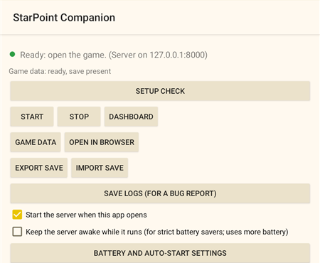
4. **点「全部设置」。**

   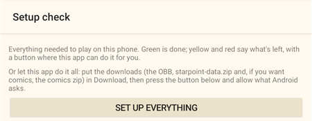

   然后按它的要求做：
   - **Android 询问** 是否允许 StarPoint Companion 使用手机存储：点 **允许**。（Android 11 及更新版本会打开 **所有文件访问权限** 页面：
     打开开关，然后按返回。）
   - **它会打开世界弹射物语的设置。** 游戏在列表里叫 **世界弹射物语**。打开 **所有文件访问权限**，并在 **权限** 里允许存储权限
     （Android 13 及更新版本：**音乐和音频** 以及 **照片和视频**）。然后按返回。应用会自己继续。
   - **它会列出要做的事。** 点 **开始**。

     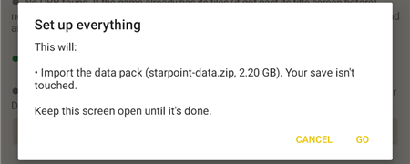
5. **等待，并保持画面打开。** 它会检查 OBB 没有损坏并移到游戏读取的位置，导入数据包和漫画包，清理之前安装留下的文件，然后启动服务器。
   可能需要几分钟。
6. **它会问是否删除** 已导入的压缩包。**删除** 可以腾出空间；**保留** 也没问题。

   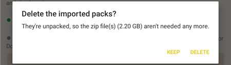
7. **它显示全部完成。** 如果还缺什么（找不到的下载，或损坏的文件），会在 **还需完成** 下说明。

   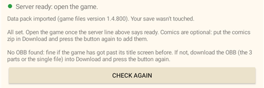
8. 服务器那一行显示 **已就绪**（主界面的指示灯为 **绿色：已就绪**）后，**打开游戏**。第一次会显示「正在解压游戏文件」，它会自己解压 OBB，
   完成后删除 OBB。

（本页的截图是英文界面；手机语言为中文时，StarPoint Companion 显示中文。）

### 逐步操作：设置检查

如果 **全部设置** 说缺了什么，或者你想自己一步步做。（下面有些截图来自旧版本，那时主按钮叫 **设置检查**，设置画面也没有 **全部设置** 按钮；清单本身一样。）

1. 把下载的文件放进 **下载**，并安装两个 APK，同上。
2. 打开 **StarPoint Companion**。第一次时指示灯是红色，并显示 **游戏数据：缺失**：这是正常的。

   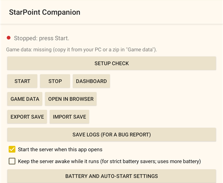

   点 **游戏数据** > **导入资源包……**，在文件选择器里打开 **下载**（左上角的 ☰ 菜单），选数据包。想要漫画的话再用同样的方法选漫画压缩包。
   也可以改为从电脑服务器复制（[见下文](#改从电脑复制数据)）。

   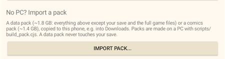
   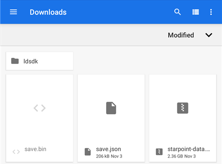

   底部的进度条显示导入进度（一两分钟）。完成后应用会问是否删除压缩包：**删除** 腾出 0.2 GB，**保留** 也没问题。

   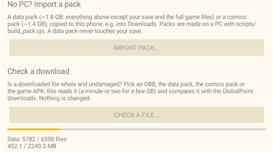
   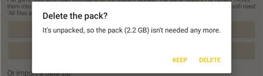
3. 返回并点 **设置**。每一行是 **绿色**（完成）、**黄色**（等待）或 **红色**（还有事要做），应用能代劳的会附带按钮：

   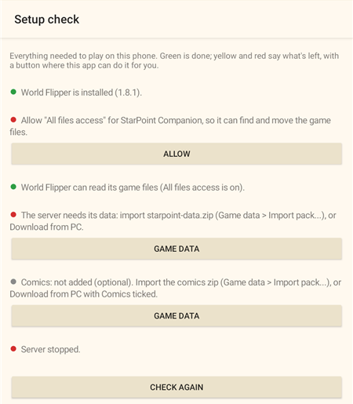

   - **允许**：让 StarPoint Companion 使用手机存储，以便找到并移动 OBB。Android 询问时点 **允许**（Android 11 及更新版本会打开
     **所有文件访问权限** 页面：打开开关后返回）。

     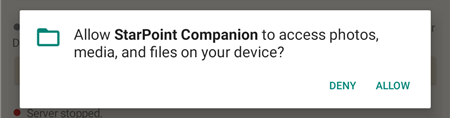
   - **打开世界弹射物语的设置**：打开 **所有文件访问权限** 并允许存储权限。只有你能拨这些开关；游戏自己从不请求，没有它们就看不到 OBB。
     在 Android 设置里游戏叫 **世界弹射物语**；这个按钮会直接带你过去。打开 **权限**，把存储权限打开。

     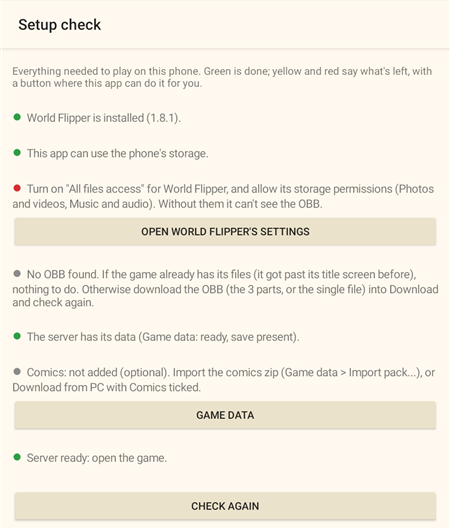
     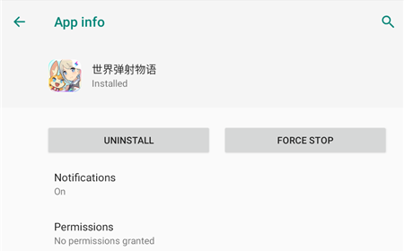
     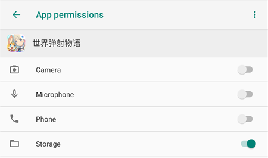

     （这些截图来自 Android 9 模拟器。Android 11 及更新版本还有 **所有文件访问权限** 开关；Android 13 及更新版本的存储分成 **音乐和音频**
     以及 **照片和视频**：两个都要允许。）
   - **检查并移动**：检查每个 OBB 文件都没有损坏（每几 GB 一两分钟），然后移到 `starpoint_game`（会自动创建；瞬间完成，不占额外空间）。
     如果有文件损坏，就什么都不移动，并说明要重新下载哪一个。
   - **移除它们**：之前安装留下的游戏文件，会让游戏启动非常慢。
   - **启动**：如果服务器没在运行，启动它（启动期间为黄色）。
4. 每一行都变绿后，主界面的指示灯就是 **绿色：已就绪**。打开游戏（如果已经开着，先完全关闭）。它会显示「正在解压游戏文件」，自己解压 OBB，
   完成后删除 OBB。

   

StarPoint Companion 主界面的指示灯：**绿色** = 打开游戏；**黄色** = 等待（服务器正在启动，或在控制台更改后正在重建游戏更新；这时打开的游戏会拿到旧的更新）；
**红色** = 已停止。**游戏数据 > 检查文件……** 可以检查任何下载（OBB 分卷、数据包、漫画包、游戏 APK），不会改动任何东西。

### 手动操作

1. 安装游戏 APK（build 25）。**先不要打开。**
2. 在内部存储的最上层，新建一个名字正好是 **`starpoint_game`** 的文件夹（`内部存储/starpoint_game/`；`内部存储/StarPoint/game/` 也一样可以）。
3. 把 OBB 放进去：三个分卷放在一起，直接放在这个文件夹里（不要放进子文件夹）。从电脑通过 USB 复制；已经在手机上的话，用文件管理器
   **移动**（是移动不是复制：复制需要两倍空间）。不要让任何东西压缩或打包它们。要检查下载，把 SHA-256 和[上面的列表](#校验值)对比。
4. Android 设置 > 应用 > 世界弹射物语：打开 **所有文件访问权限**，并在 **权限** 里允许存储权限（同[逐步操作第 3 步](#逐步操作设置检查)）。
5. 安装 StarPoint Companion，导入数据包（**游戏数据** > **导入资源包……**），并启动服务器：主界面应显示服务器正在运行。点
   **允许服务器在后台运行**，如果询问的话允许通知。
6. 打开游戏，同[简单方法第 8 步](#简单方法一个按钮)。

### 让服务器保持运行

如果手机在后台停掉了 StarPoint Companion 的服务器，在主界面勾选 **服务器运行时保持唤醒**，也试试那里的 **电池与自启动设置** 和
**允许使用情况访问权限**。存档在设备上：StarPoint Companion 的 **导出存档** / **导入存档** 可以搬移它。

### 改从电脑复制数据

如果[电脑上装了服务器](#在电脑上安装服务器)并且在同一个 Wi-Fi 下，StarPoint Companion 可以从它复制服务器的数据，代替数据包，连电脑上的存档也一起。
游戏的文件仍然来自 OBB：先把它放到手机上（[手动操作](#手动操作)第 1-4 步）。

1. 在电脑上，把 `.env` 里的 `LISTEN_HOST` 设为 `"0.0.0.0"`，让手机能连到服务器，然后启动它。如果 Windows 询问防火墙，在 **专用网络** 上允许。
2. 找到电脑的地址：控制台的 **通过 Wi-Fi 在手机上游玩** 会显示，或者运行 `ipconfig`，用 **IPv4 地址** 那一行（以 `192.168.` 或 `10.` 开头）。
3. 在手机上安装两个 APK：**游戏** 和 **StarPoint Companion**。如果 Android 拦截，点 **设置** 并打开 **允许来自此来源**。**先不要打开游戏。**
4. 打开 **StarPoint Companion**，点 **游戏数据**，输入电脑的地址和端口，例如 `192.168.1.20:8000`（用你自己的；这只是例子）。
5. 勾选 **我的存档**（带上电脑上的账号）、**活动日程编辑** 和 **控制台图片**。漫画可选。**完整游戏文件** 和 **游戏更新** 不要勾：OBB 里已经有了。
6. 点 **从电脑下载**。询问时，为 StarPoint Companion 打开 **所有文件访问权限** 并返回。复制会自己开始（几百 MB，加上漫画会更多）。
7. 在同一个画面上，点打开 **世界弹射物语的「所有文件访问权限」** 页面的按钮，把它打开。游戏自己从不请求这个权限。
8. 在 StarPoint Companion 主界面，确认服务器正在运行，然后点 **允许服务器在后台运行**。如果询问的话允许通知。如果手机仍然在后台停掉服务器，
   勾选 **服务器运行时保持唤醒**，并试试同一画面上的 **电池与自启动设置** 和 **允许使用情况访问权限**。
9. 打开游戏。第一次启动会解压 OBB（几分钟），之后就能进去，不需要下载。

如果手机显示 **「failed to connect」**（连接失败），说明地址错了，或者电脑的防火墙拦住了 Node.js（在 Windows 安全中心 > 防火墙 > 允许应用通过防火墙
里，在专用网络上允许它）。已经有游戏文件（来自 OBB）的手机只需要除 **完整游戏文件** 以外的选项；完整游戏文件只在电脑上还留着旧版 GlobalPoint
的游戏更新时才有用。

之后你的存档就在手机上了。用 StarPoint Companion 的 **导出存档** / **导入存档** 来搬移它。

### 出问题时

**游戏显示错误代码**（例如 `U_f72d75` 或 `C8601`）：在 StarPoint Companion 里按 **保存日志（用于反馈问题）**，保存文件，连同你当时在做什么一起发出来。
它包含游戏完整的崩溃报告。

除了 OBB 之外，手机只需要很少的可用空间：游戏解压时会缩小 OBB，如果中途被打断，下次会从停下的地方继续。设置检查也会显示下面大部分问题。

- **缺少某个分卷或分卷不完整：** 游戏会说明，例如「Game files part 2 of 3 is missing」或「...is incomplete: x of y GB」，并且什么都不解压。
  把缺少的分卷复制到其他分卷旁边（或重新下载），然后重新打开游戏。
- **解压后卡在「Finding game files…（一个数字）」：** 某个投放文件夹里还有之前安装留下的零散游戏文件，通常是 `StarPoint/game`、`starpoint_game`
  或 `Android/obb/com.leiting.wf` 里的 `download` 文件夹（例如来自 StarPoint Companion 的 **完整游戏文件**）。游戏会列出并移动其中每一个文件，
  非常慢，而且没必要：OBB 已经有全部文件。完全关闭游戏，然后 设置检查 > **移除它们**（或手动删除那个 `download` 文件夹，保留其中的 `.obb`，
  哪怕是剩下的一小段 `part1of3`），再重新打开游戏。
- **如果游戏要求下载约 10 GB**，或标题画面显示 **ResVer null**，而不是「正在解压游戏文件」，说明它看不到 OBB。点取消。检查 OBB 直接放在
  `starpoint_game/` 里，并且世界弹射物语有 **所有文件访问权限** 和存储权限（设置检查会显示这两项）。完全关闭游戏后重新打开。什么都不会丢失。
- **手动放置时文件名无所谓**，只要以 `.obb` 结尾并直接放在文件夹里。改名成 `.obb.zip` 的不行。（设置检查按下载时的名称查找：
  `main.1008001.com.leiting.wf.obb` 和 `main.1008001.com.leiting.wf.partNof3.obb`，也允许浏览器加上的 ` (1)`、`-1` 或 `.bin`。它在 Download、
  Downloads 和 Documents 里找，并往下多找一层（有些手机的浏览器保存到 `Download/Browser` 之类），以及存储的最上层，SD 卡上也一样。）
- **`Android/obb/com.leiting.wf/` 在有些手机上也能用**，不需要权限（那里权限反正不起作用）。关键在于是哪个应用写入的文件：有些手机的文件管理器
  （例如三星的我的文件）写入后游戏读不了。带上述权限的 `starpoint_game` 才是可靠的方式，也是设置检查使用的方式。
- **有电脑和 adb 的话**，`Android/obb` 总是可用。如果文件夹还不存在：
  ```bash
  adb shell mkdir -p /sdcard/Android/obb/com.leiting.wf
  ```
  ```bash
  adb shell chmod 777 /sdcard/Android/obb/com.leiting.wf
  ```
  ```bash
  adb push main.1008001.com.leiting.wf.obb /sdcard/Android/obb/com.leiting.wf/
  ```
  （3 个分卷的话，每个都这样推送。）adb 修不了文件管理器已经建好的文件夹：先把那个文件夹改名或删掉。
- **GrapheneOS：** 给世界弹射物语 **所有文件访问权限**，不要用 Storage Scopes。Scopes 只给应用看它自己建的文件和你挑选的文件，而游戏还需要缩小和删除 OBB。

## 2. 手机连接电脑服务器

手机连接你电脑上的服务器，所以存档留在电脑上，玩的时候电脑必须开着。先[在电脑上安装服务器](#在电脑上安装服务器)。游戏也需要它的文件：
按[方式 1 手动操作](#手动操作)第 1-4 步把 OBB 放到手机上。（自 GlobalPoint 1.0 起，电脑上不再有不用 OBB 下载所需的游戏更新。）

**通过 Wi-Fi（游戏 build 23 或更新）：**
1. 在电脑上把 `.env` 里的 `LISTEN_HOST` 设为 `"0.0.0.0"`，然后启动服务器。如果 Windows 询问防火墙，允许它。
2. 在电脑上打开控制台（**http://127.0.0.1:8000**）。在 **通过 Wi-Fi 在手机上游玩** 下，选电脑的地址（以 192.168 或 10 开头的那个），点
   **下载手机连接文件**。你会得到 `server.txt`。

   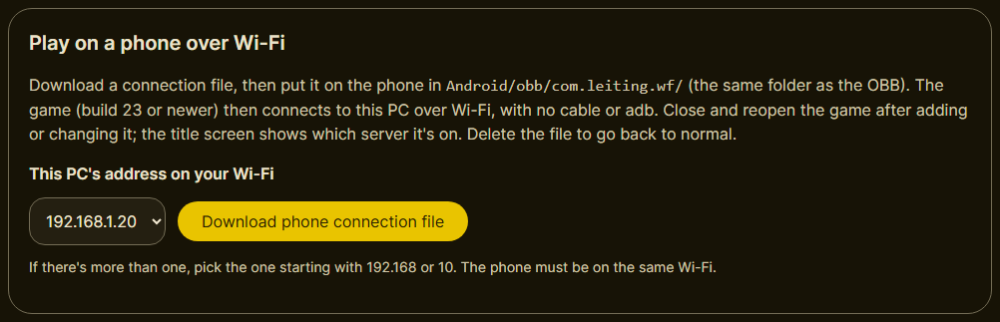
3. 把 `server.txt` 放到手机的 `内部存储/Android/obb/com.leiting.wf/`（需要的话新建这个文件夹）。可以发给自己，也可以在手机上打开
   `http://<电脑地址>:8000` 的控制台直接下载。

   游戏能不能读取那里的文件，取决于写入它的应用，和方式 1 的 OBB 一样。如果标题画面没有显示「Server: ...」，多半就是这个原因：把
   `server.txt` 改放到 `内部存储/StarPoint/`，并给世界弹射物语[方式 1 手动操作](#手动操作)第 4 步的权限；或者用 adb 推送
   （`adb push server.txt /sdcard/Android/obb/com.leiting.wf/`，先做方式 1 故障排除里建文件夹的步骤）。游戏不会从 `starpoint_game` 读取 `server.txt`。
4. 安装并打开游戏。标题画面显示 **「Server: 192.168.x.y:8000」**。如果显示「server.txt not understood」，说明文件里的地址行写错了。

   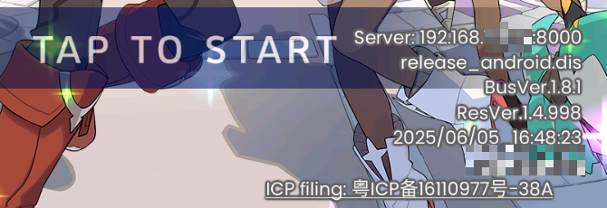

`server.txt` 只有一行：电脑的地址和端口，例如 `192.168.1.20:8000`，所以也可以手写。以 `#` 开头的行会被忽略。游戏每次启动时读取它。
删除它就回到手机自己的服务器（StarPoint Companion）。如果路由器给电脑分配了新地址，重新下载这个文件。

**通过 USB（任意游戏版本；需要 [adb](#获取-adb)）：** 在手机的开发者选项里打开 **USB 调试**，连接电脑，运行 `start-cn.bat`。它用
`adb reverse` 把手机的 `127.0.0.1:8000` 转发到电脑。Android 11+ 可以通过 **无线调试** 不用线做同样的事。adb 一断开连接就会失效；再运行
`start-cn.bat` 即可恢复。

## 3. 只用电脑：模拟器加电脑服务器

用于 **自制角色**（[CUSTOM_UNITS.md](CUSTOM_UNITS.md)，它们在电脑上添加），或 **开发 GlobalPoint**。只是想在电脑上玩的话，改在模拟器里用[方式 1](#1-手机或模拟器)。

1. 安装 Android 模拟器（已测试：雷电模拟器 9；它必须能运行 ARM64 应用，同方式 1），并在下一步之前把游戏 APK 放进 GlobalPoint 文件夹里的
   `apk` 文件夹（例如 `D:\GlobalPoint\apk\`）。
2. [在电脑上安装服务器](#在电脑上安装服务器)，并[获取 adb](#获取-adb)：模拟器通过它连到服务器。`setup.bat` 找到 `adb` 时会提出把 APK 装到模拟器上；
   也可以自己装。
3. 之后用 **`start-cn.bat`** 启动服务器。它也会把模拟器连上服务器（`adb reverse`）。
4. 打开游戏。
   - 第一个画面是国服发行商的协议。**右边** 的按钮（同意）同意并继续；左边的（拒绝）关闭游戏。
   - 第一次启动前，按[方式 1 手动操作](#手动操作)第 1-4 步把 OBB 放到模拟器上（用模拟器的共享文件夹或 `adb push` 把三个分卷复制进去）。
     第一次启动会解压它（几分钟），只有这一次。

## 在电脑上安装服务器

用于方式 2 和 3，以及方式 1 里的从电脑复制数据。

**这部分比较技术：** 要用几次命令提示符，并搬动约 12 GB 的文件。只是想玩的话完全不需要：[方式 1](#1-手机或模拟器) 在手机或模拟器上就能用。
下面的步骤用 `D:\GlobalPoint` 作为文件夹；请用你自己的（任意至少有 16 GB 可用空间的磁盘），命令里写 `D:\GlobalPoint` 的地方都换成你自己的文件夹。

**在文件夹里打开命令提示符：** 在文件资源管理器里打开这个文件夹，点顶部的地址栏，输入 `cmd` 并按回车。会打开一个黑色窗口，已经位于这个文件夹。

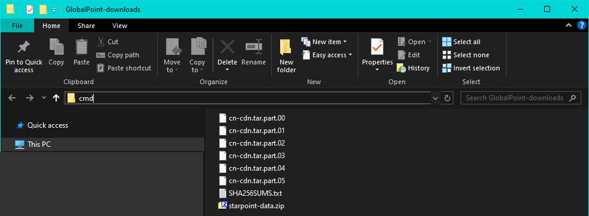

1. **安装 Node.js 22。** 从 [nodejs.org/dist/latest-v22.x](https://nodejs.org/dist/latest-v22.x/) 下载 Windows 安装程序：文件名以 **`-x64.msi`**
   结尾的那个（例如 `node-v22.23.4-x64.msi`）。运行它，保持默认选项。
   - 为什么是 22：服务器用的一个软件包（`better-sqlite3`）只为 Node.js 20 和 22 提供现成的版本。更新的 Node.js（23、24 及以上，包括 nodejs.org
     首推的那个）安装时需要编译它，这需要微软的 C++ 生成工具。
   - **已经装了更新的 Node.js？** 如果 `setup.bat`（第 5 步）报错并提到 `better-sqlite3`、`node-gyp` 或 Visual Studio，要么改装 Node.js 22，
     要么安装 [Visual Studio Build Tools](https://visualstudio.microsoft.com/visual-cpp-build-tools/) 并勾选 **使用 C++ 的桌面开发**，然后再运行 `setup.bat`。
2. **获取 GlobalPoint。** 在 GitHub 页面上按 **Code** > **Download ZIP**，解压到 `D:\GlobalPoint`（右键压缩包 > **全部解压缩**）。确认 `setup.bat`
   直接在 `D:\GlobalPoint` 里，而不是深一层（如果是，把文件移上来）。用 git 的话：
   `git clone https://github.com/NekoWeeb19/globalpoint.git D:\GlobalPoint`。

   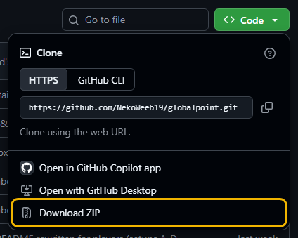
3. **放入国服游戏文件。** 从 [CN CDN 1.4.54 release](https://github.com/dennis96292/.cdn/releases/tag/cdn-1.4.54) 下载六个 `cn-cdn.tar.part.00` 到
   `.05` 文件和 `SHA256SUMS.txt`，全部放在同一个文件夹（例如下载）。然后 **在那个文件夹里** 打开命令提示符，逐条运行：
   ```bat
   mkdir D:\GlobalPoint\.cdn
   ```
   ```bat
   copy /b cn-cdn.tar.part.00 + cn-cdn.tar.part.01 + cn-cdn.tar.part.02 + cn-cdn.tar.part.03 + cn-cdn.tar.part.04 + cn-cdn.tar.part.05 cn-cdn.tar
   ```
   ```bat
   tar -xf cn-cdn.tar -C D:\GlobalPoint\.cdn
   ```
   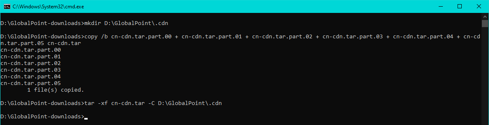

   - 第一条创建 `.cdn` 文件夹（如果说已存在，没关系）。第二条把六个分卷合成一个文件 `cn-cdn.tar`：暂时需要多约 10 GB 可用空间。第三条解压它；
     需要几分钟，完成前不会显示任何东西。
   - **确认成功：** `D:\GlobalPoint\.cdn\cn` 里现在有名为 `archive-...` 的文件夹和一个 `entities` 文件夹。然后可以删除 `cn-cdn.tar` 和六个分卷。

     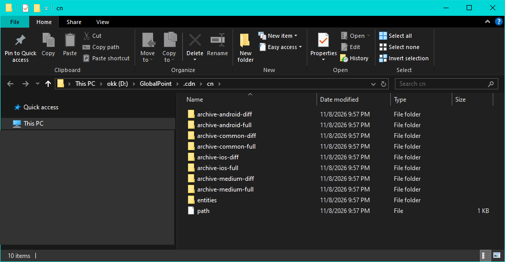
   - 用命令提示符，不要用 PowerShell：`copy /b` 只能在命令提示符里用。（`tar` 是 Windows 10 及更新版本自带的。）
   - **检查下载**（可选）：在同一窗口里对每个分卷运行 `certutil -hashfile cn-cdn.tar.part.00 SHA256`，并与 `SHA256SUMS.txt` 对比。用 Git Bash、Linux
     或 macOS 时，`sha256sum -c SHA256SUMS.txt` 一次检查全部，`cat cn-cdn.tar.part.* | tar -x -C /path/to/GlobalPoint/.cdn` 解压时不需要额外的 10 GB。
4. **把数据包解压到 `D:\GlobalPoint`** 本身：右键 > **全部解压缩**，目标设为正好 `D:\GlobalPoint`（Windows 会建议 `D:\GlobalPoint\starpoint-data`；
   删掉最后一段）。如果 Windows 询问已存在的文件，选择替换。确认成功：`D:\GlobalPoint\.cdn` 里现在也有 `cn_text` 和 `cn_patches`。想要漫画的话，
   漫画压缩包也这样做。

   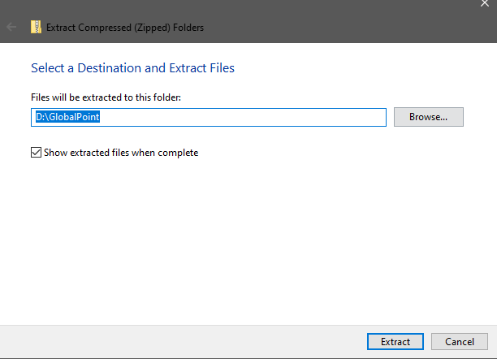
5. **运行 `setup.bat`**（在 `D:\GlobalPoint` 里双击）。它会安装服务器的软件包（需要联网一次）、构建服务器、从 `.env.example` 生成你的 `.env` 设置文件，
   并检查游戏文件和更新。缺什么会停下并说明。如果找到 `adb`，它会提出把 `apk` 文件夹里的 APK 装到模拟器上（方式 3，或通过 USB 的方式 2，
   请在这一步之前[获取 adb](#获取-adb)）。然后启动服务器。

### 获取 adb

`adb` 是 Android 自己的工具，用于从电脑和手机或模拟器通信。`setup.bat` 用它安装游戏，`start-cn.bat` 用它把模拟器（方式 3）或 USB 连接的手机（方式 2）
连到服务器。没有它，方式 3 的模拟器连不上服务器。方式 1 和通过 Wi-Fi 的方式 2 不需要它。

1. 从 [Android 的网站](https://developer.android.com/tools/releases/platform-tools) 下载 **SDK Platform-Tools for Windows** 并解压。
2. 把它的 `platform-tools` 文件夹里的三个文件复制到你的 GlobalPoint 文件夹（`setup.bat` 旁边）：**`adb.exe`**、**`AdbWinApi.dll`** 和
   **`AdbWinUsbApi.dll`**。脚本会先在这里找。（或者把 `platform-tools` 文件夹加入 PATH，如果你会的话。）

   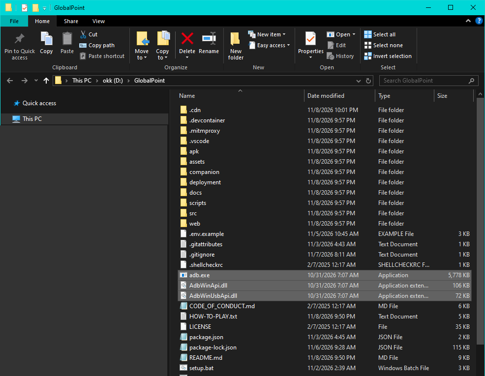
3. 检查：在 GlobalPoint 文件夹里打开命令提示符，运行 `adb devices`。模拟器在运行时（或手机已插上并打开 USB 调试），会列出一个设备。

很多模拟器的安装文件夹里也自带 `adb.exe`（雷电模拟器 9 就有，在 `D:\LDPlayer\LDPlayer9` 或你安装的位置）；复制那个进来也可以。如果 `adb devices`
没有列出你的模拟器，它的设置或帮助页面会说明怎样打开 ADB，或需要哪条 `adb connect 127.0.0.1:<端口>`。

之后运行 **`start-cn.bat`** 启动服务器，然后打开游戏。关闭服务器窗口即可停止。

这些步骤的简短版本在 [`HOW-TO-PLAY.zh-CN.txt`](../../HOW-TO-PLAY.zh-CN.txt)。Linux 和 macOS 有 `setup.sh` 和 `start-cn.sh`，未经测试。

## 更新电脑上的服务器

不用重新安装：在同一个文件夹里更新代码。你的存档（`.database`）、游戏文件（`.cdn`）、设置（`.env`）和 `apk` 文件夹不属于代码，更新不会动它们。

1. **关闭服务器窗口**，并 **备份存档**：把 `.database` 文件夹复制到安全的地方（或在控制台下载：**玩家** > 某个玩家 > **下载存档**）。
2. **获取新代码：**
   - **下载 ZIP 的：** 从 GitHub 下载新的 ZIP（**Code** > **Download ZIP**），解压到任意位置，然后把里面的所有内容复制到你的 GlobalPoint 文件夹，
     Windows 询问时选 **替换目标中的文件**。不要先删除旧文件夹。
   - **用 git 的：** 在 GlobalPoint 文件夹里打开命令提示符，运行 `git pull`。
3. **删除 GlobalPoint 文件夹里的 `node_modules` 文件夹**，然后 **再次运行 `setup.bat`**。它会重新安装服务器的软件包（需要联网）、重新构建服务器并检查游戏文件。
   （`node_modules` 已存在时 `setup.bat` 会跳过软件包，所以删掉它可以确保装上更新带来的新软件包。）
4. **如果更新附带了新的数据包**（下载站上有更新的），再次解压到 GlobalPoint 文件夹，同上面[第 4 步](#在电脑上安装服务器)。
5. **启动服务器**（`start-cn.bat`）并打开游戏。如果服务器的游戏更新变了，游戏会在标题画面下载一个小更新。

**新的游戏 APK** 可以在手机或模拟器上覆盖安装旧版，进度保留。打开前先清除一次游戏缓存：Android 设置 > 应用 > 世界弹射物语 > 存储 > **清除缓存**
（不是清除数据，那会删除游戏文件）。**新的 StarPoint Companion APK** 也可以覆盖安装，并保留手机上的存档。
